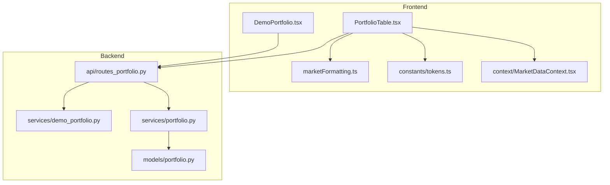
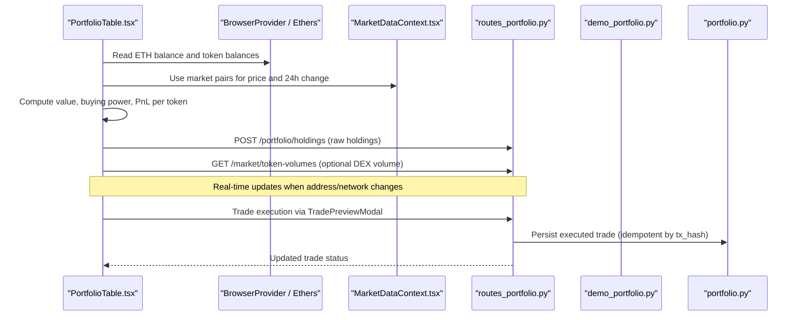
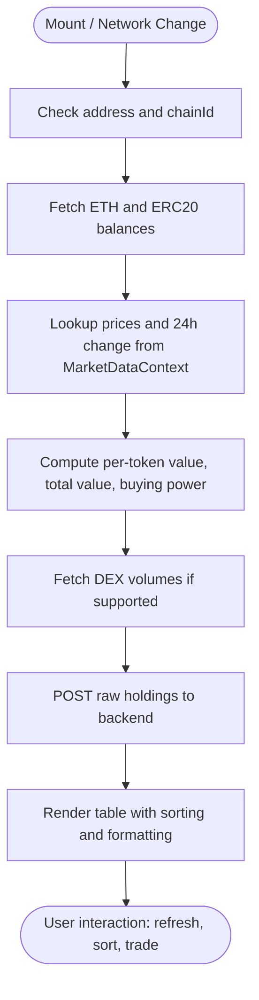
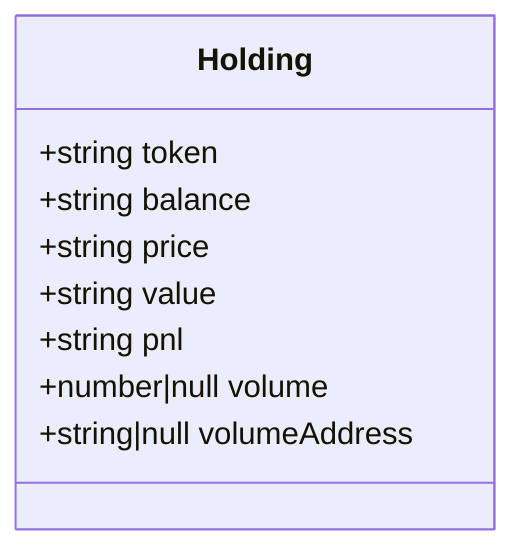
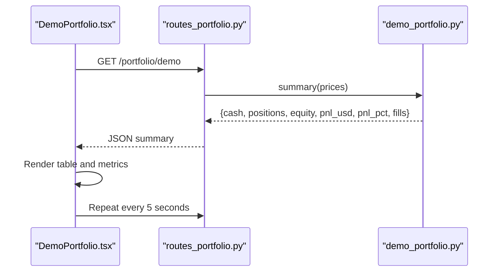
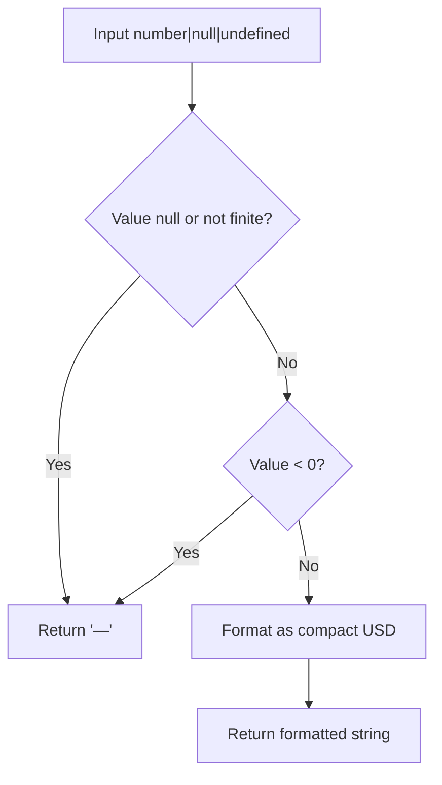
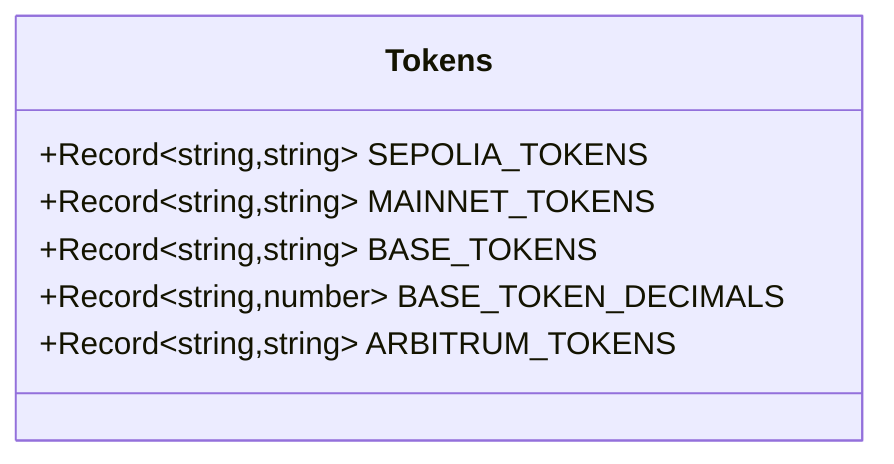
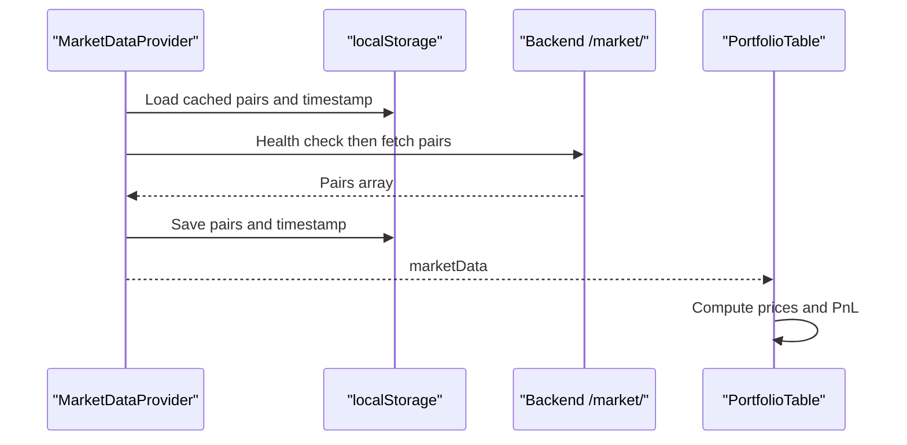
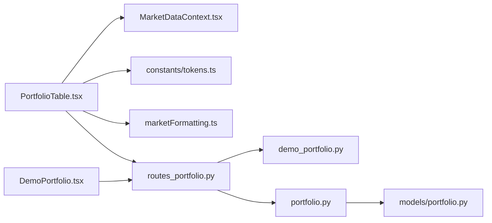

# Portfolio Management Components

<cite>
**Referenced Files in This Document**
- [PortfolioTable.tsx](file://frontend/components/PortfolioTable.tsx)
- [DemoPortfolio.tsx](file://frontend/components/DemoPortfolio.tsx)
- [marketFormatting.ts](file://frontend/lib/marketFormatting.ts)
- [tokens.ts](file://frontend/constants/tokens.ts)
- [MarketDataContext.tsx](file://frontend/context/MarketDataContext.tsx)
- [routes_portfolio.py](file://backend/app/api/routes_portfolio.py)
- [demo_portfolio.py](file://backend/app/services/demo_portfolio.py)
- [portfolio.py](file://backend/app/services/portfolio.py)
- [portfolio.py (models)](file://backend/app/models/portfolio.py)
</cite>

## Table of Contents
1. [Introduction](#introduction)
2. [Project Structure](#project-structure)
3. [Core Components](#core-components)
4. [Architecture Overview](#architecture-overview)
5. [Detailed Component Analysis](#detailed-component-analysis)
6. [Dependency Analysis](#dependency-analysis)
7. [Performance Considerations](#performance-considerations)
8. [Troubleshooting Guide](#troubleshooting-guide)
9. [Conclusion](#conclusion)

## Introduction
This document explains the portfolio tracking and management components that display holdings, balances, P&L, volume, and analytics for both real wallet-backed trading and a simulated demo portfolio. It covers:

- The `PortfolioTable` component for live on-chain holdings, balance formatting, 24-hour PnL, DEX volume, sorting, and trade preview integration.
- The `DemoPortfolio` component for demonstration purposes, including virtual cash, positions, equity, and unrealized PnL.
- Backend services for demo portfolio state, persistent trade ledger, and API endpoints.
- Data synchronization between frontend, backend, blockchain wallets, and local storage.
- Formatting utilities and performance considerations for large portfolios and frequent updates.

## Project Structure
The portfolio feature spans frontend React components, shared formatting utilities, context providers, and backend FastAPI routes plus services.

**Diagram sources**
- [PortfolioTable.tsx:1-10](file://frontend/components/PortfolioTable.tsx#L1-L10)
- [DemoPortfolio.tsx:1-10](file://frontend/components/DemoPortfolio.tsx#L1-L10)
- [marketFormatting.ts:1-12](file://frontend/lib/marketFormatting.ts#L1-L12)
- [tokens.ts:1-128](file://frontend/constants/tokens.ts#L1-L128)
- [MarketDataContext.tsx:1-20](file://frontend/context/MarketDataContext.tsx#L1-L20)
- [routes_portfolio.py:1-15](file://backend/app/api/routes_portfolio.py#L1-L15)
- [demo_portfolio.py:1-30](file://backend/app/services/demo_portfolio.py#L1-L30)
- [portfolio.py:1-12](file://backend/app/services/portfolio.py#L1-L12)
- [portfolio.py (models):1-10](file://backend/app/models/portfolio.py#L1-L10)

**Section sources**
- [PortfolioTable.tsx:1-10](file://frontend/components/PortfolioTable.tsx#L1-L10)
- [DemoPortfolio.tsx:1-10](file://frontend/components/DemoPortfolio.tsx#L1-L10)
- [routes_portfolio.py:1-15](file://backend/app/api/routes_portfolio.py#L1-L15)

## Core Components
- `PortfolioTable`: Displays real wallet holdings, computed totals, 24-hour PnL, optional DEX volume, sortable columns, network mismatch warnings, and trade preview integration.
- `DemoPortfolio`: Displays a simulated portfolio with cash, positions, equity, total PnL, and fill count.
- `marketFormatting.ts`: Provides compact USD formatting for volume and other metrics.
- Backend routes and services: Provide demo portfolio data, persist trades, update controller holdings, and expose trade history.

**Section sources**
- [PortfolioTable.tsx:28-50](file://frontend/components/PortfolioTable.tsx#L28-L50)
- [DemoPortfolio.tsx:25-27](file://frontend/components/DemoPortfolio.tsx#L25-L27)
- [marketFormatting.ts:8-11](file://frontend/lib/marketFormatting.ts#L8-L11)
- [routes_portfolio.py:41-68](file://backend/app/api/routes_portfolio.py#L41-L68)

## Architecture Overview
The system integrates wallet-based on-chain reads, market data context, backend portfolio APIs, and local storage persistence.

**Diagram sources**
- [PortfolioTable.tsx:82-289](file://frontend/components/PortfolioTable.tsx#L82-L289)
- [MarketDataContext.tsx:66-121](file://frontend/context/MarketDataContext.tsx#L66-L121)
- [routes_portfolio.py:63-96](file://backend/app/api/routes_portfolio.py#L63-L96)
- [portfolio.py:37-52](file://backend/app/services/portfolio.py#L37-L52)

## Detailed Component Analysis

### PortfolioTable Component
`PortfolioTable` is the primary interface for displaying holdings across supported networks. It:

- Reads the connected wallet address and chain ID.
- Uses `MarketDataContext` to obtain current prices and 24-hour price changes.
- Computes per-token values, total portfolio value, and buying power (ETH/WETH/USDC).
- Calculates 24-hour PnL based on market data change percentages.
- Optionally fetches DEX 24-hour volumes for supported chains.
- Sorts holdings by token, balance, price, value, PnL, or volume.
- Warns about network mismatch between wallet and app settings.
- Integrates with `TradePreviewModal` to initiate trades.

#### Key Responsibilities
- On-chain balance fetching using ethers.
- Price lookup and symbol mapping for known tokens.
- Stablecoin price normalization to $1.00.
- Volume fetching from backend market endpoint.
- Local storage for user-added tokens.
- Sorting and formatted display.

**Diagram sources**
- [PortfolioTable.tsx:82-289](file://frontend/components/PortfolioTable.tsx#L82-L289)
- [PortfolioTable.tsx:325-359](file://frontend/components/PortfolioTable.tsx#L325-L359)
- [PortfolioTable.tsx:397-455](file://frontend/components/PortfolioTable.tsx#L397-L455)

#### Data Model
Holding row type includes token, balance, price, value, PnL, volume, and volume address.

**Diagram sources**
- [PortfolioTable.tsx:12-20](file://frontend/components/PortfolioTable.tsx#L12-L20)

#### Performance Notes
- Uses AbortController to cancel stale volume requests.
- Avoids redundant calls by checking requestId and chainId.
- Skips placeholder tokens on testnets to reduce RPC calls.
- Formats small balances defensively to avoid floating-point noise.

**Section sources**
- [PortfolioTable.tsx:64-80](file://frontend/components/PortfolioTable.tsx#L64-L80)
- [PortfolioTable.tsx:177-263](file://frontend/components/PortfolioTable.tsx#L177-L263)
- [PortfolioTable.tsx:291-297](file://frontend/components/PortfolioTable.tsx#L291-L297)

### DemoPortfolio Component
`DemoPortfolio` displays a simulated portfolio without requiring a wallet connection. It:

- Polls `/portfolio/demo` every five seconds.
- Shows summary fields: cash, equity, starting capital, PnL in USD and percentage, fills count, and whether prices are available.
- Renders open positions with quantity, average entry, current price, value, and unrealized PnL.
- Handles errors and loading states gracefully.

**Diagram sources**
- [DemoPortfolio.tsx:29-50](file://frontend/components/DemoPortfolio.tsx#L29-L50)
- [routes_portfolio.py:41-49](file://backend/app/api/routes_portfolio.py#L41-L49)
- [demo_portfolio.py:72-99](file://backend/app/services/demo_portfolio.py#L72-L99)

**Section sources**
- [DemoPortfolio.tsx:25-137](file://frontend/components/DemoPortfolio.tsx#L25-L137)
- [routes_portfolio.py:41-60](file://backend/app/api/routes_portfolio.py#L41-L60)
- [demo_portfolio.py:26-99](file://backend/app/services/demo_portfolio.py#L26-L99)

### Formatting Utilities
`formatCompactUsd` formats numeric values into compact USD strings suitable for volume display. It returns a neutral placeholder for null, non-finite, or negative values.

**Diagram sources**
- [marketFormatting.ts:1-12](file://frontend/lib/marketFormatting.ts#L1-L12)

**Section sources**
- [marketFormatting.ts:1-12](file://frontend/lib/marketFormatting.ts#L1-L12)

### Token Configuration
Token addresses and decimals are defined per network. `PortfolioTable` uses these mappings to read balances and optionally add tokens to MetaMask.

**Diagram sources**
- [tokens.ts:1-128](file://frontend/constants/tokens.ts#L1-L128)

**Section sources**
- [tokens.ts:1-128](file://frontend/constants/tokens.ts#L1-L128)

### Market Data Context
`MarketDataProvider` loads market pairs from the backend, persists them to localStorage, and exposes them via context. `PortfolioTable` consumes this context to compute prices and PnL.

**Diagram sources**
- [MarketDataContext.tsx:28-64](file://frontend/context/MarketDataContext.tsx#L28-L64)
- [MarketDataContext.tsx:66-121](file://frontend/context/MarketDataContext.tsx#L66-L121)
- [PortfolioTable.tsx:102-143](file://frontend/components/PortfolioTable.tsx#L102-L143)

**Section sources**
- [MarketDataContext.tsx:1-150](file://frontend/context/MarketDataContext.tsx#L1-L150)
- [PortfolioTable.tsx:102-143](file://frontend/components/PortfolioTable.tsx#L102-L143)

## Dependency Analysis
The following diagram shows how components and services depend on each other.

**Diagram sources**
- [PortfolioTable.tsx:1-10](file://frontend/components/PortfolioTable.tsx#L1-L10)
- [DemoPortfolio.tsx:1-10](file://frontend/components/DemoPortfolio.tsx#L1-L10)
- [routes_portfolio.py:1-15](file://backend/app/api/routes_portfolio.py#L1-L15)
- [demo_portfolio.py:1-30](file://backend/app/services/demo_portfolio.py#L1-L30)
- [portfolio.py:1-12](file://backend/app/services/portfolio.py#L1-L12)
- [portfolio.py (models):1-10](file://backend/app/models/portfolio.py#L1-L10)

**Section sources**
- [PortfolioTable.tsx:1-10](file://frontend/components/PortfolioTable.tsx#L1-L10)
- [DemoPortfolio.tsx:1-10](file://frontend/components/DemoPortfolio.tsx#L1-L10)
- [routes_portfolio.py:1-15](file://backend/app/api/routes_portfolio.py#L1-L15)

## Performance Considerations
- **Batching and Cancellation**: Volume requests use an AbortController and request IDs to prevent race conditions and stale updates.
- **RPC Optimization**: Known token decimals are preloaded; unknown decimals are fetched only when necessary. Small balances are handled to avoid excessive precision issues.
- **Contextual Pricing**: Market data is centralized in context to avoid repeated API calls and to reuse price/change data across components.
- **Sorting Efficiency**: Sorting is performed client-side with memoization; numeric parsing handles formatted strings safely.
- **Network Mismatch Handling**: Warnings and disabled controls prevent unnecessary trade attempts on mismatched networks.

[No sources needed since this section provides general guidance]

## Troubleshooting Guide
Common issues and resolutions:

- **Missing Market Data for a Token**: Ensure the token symbol exists in `MarketDataContext` pairs. If missing, debug logs indicate which symbols were searched and what is available.
- **Volume Unavailable**: DEX volume is only supported on specific chains. If unsupported, the column shows a neutral placeholder.
- **Network Mismatch**: When the wallet network differs from the app network, trading buttons are disabled and a warning is shown. Switch the wallet or app network accordingly.
- **Failed Holdings Sync**: If syncing holdings to the backend fails, check the network and CORS configuration. The component logs errors but continues rendering local holdings.
- **Demo Portfolio Errors**: If the demo endpoint returns an error, verify that demo mode is enabled in the backend controller.

**Section sources**
- [PortfolioTable.tsx:136-143](file://frontend/components/PortfolioTable.tsx#L136-L143)
- [PortfolioTable.tsx:457-479](file://frontend/components/PortfolioTable.tsx#L457-L479)
- [PortfolioTable.tsx:274-282](file://frontend/components/PortfolioTable.tsx#L274-L282)
- [DemoPortfolio.tsx:29-50](file://frontend/components/DemoPortfolio.tsx#L29-L50)

## Conclusion
The portfolio management components provide a robust, user-friendly interface for tracking holdings, calculating PnL, and visualizing performance across multiple networks. `PortfolioTable` integrates on-chain data, market context, and backend synchronization, while `DemoPortfolio` offers a safe simulation environment. Together with formatting utilities and backend services, they deliver real-time insights, historical trade tracking, and analytics-ready data structures.

[No sources needed since this section summarizes without analyzing specific files]