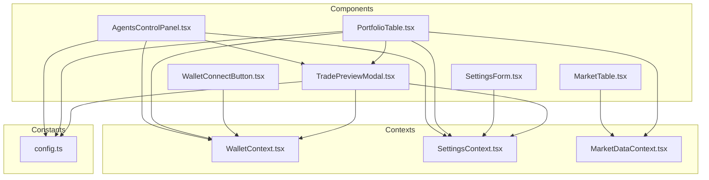
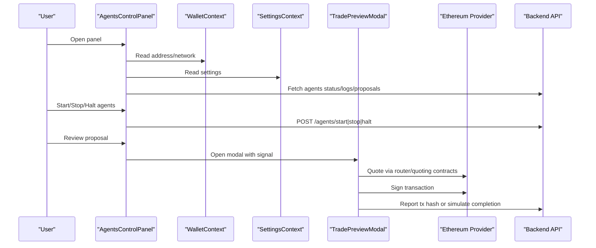
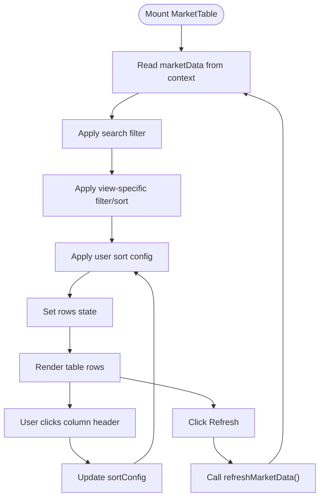
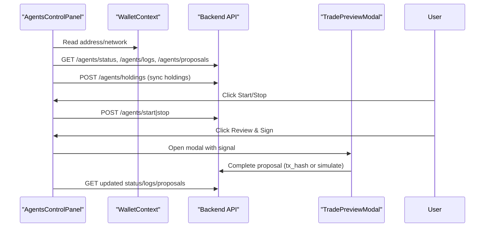
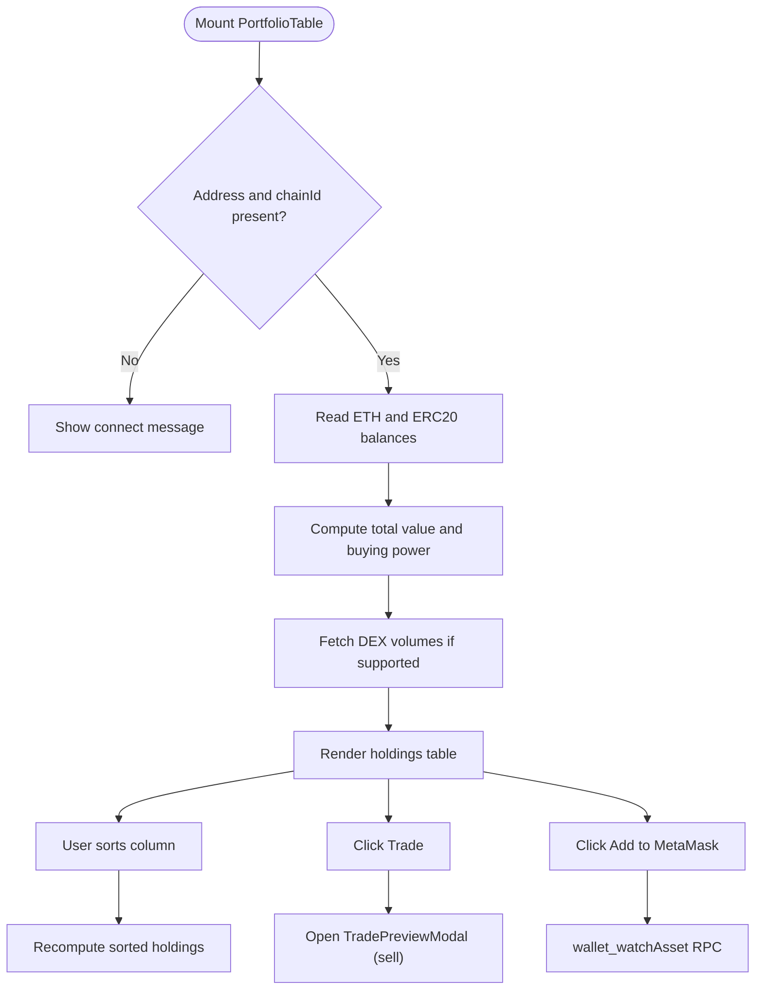
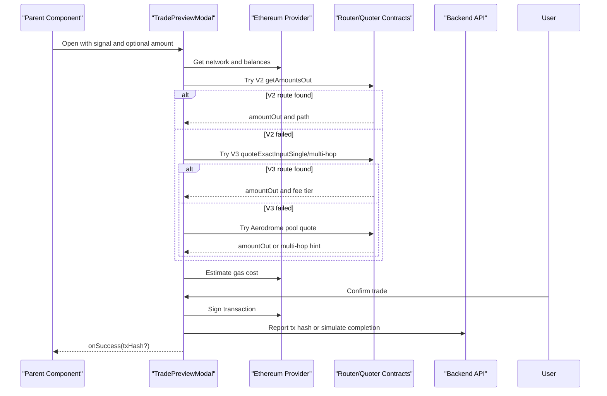
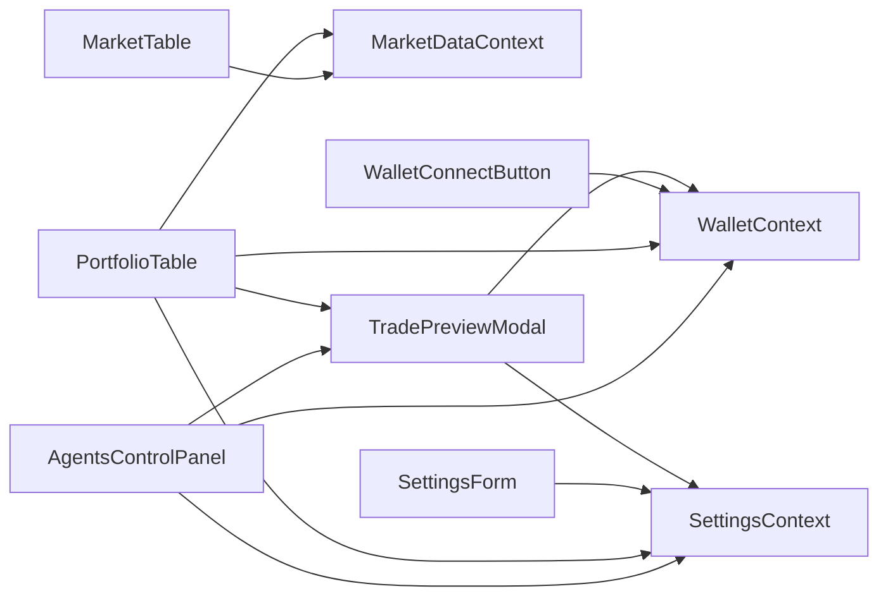

# UI Components Library

<cite>
**Referenced Files in This Document**
- [MarketTable.tsx](file://frontend/components/MarketTable.tsx)
- [AgentsControlPanel.tsx](file://frontend/components/AgentsControlPanel.tsx)
- [PortfolioTable.tsx](file://frontend/components/PortfolioTable.tsx)
- [SettingsForm.tsx](file://frontend/components/SettingsForm.tsx)
- [WalletConnectButton.tsx](file://frontend/components/WalletConnectButton.tsx)
- [TradePreviewModal.tsx](file://frontend/components/TradePreviewModal.tsx)
- [WalletContext.tsx](file://frontend/context/WalletContext.tsx)
- [SettingsContext.tsx](file://frontend/context/SettingsContext.tsx)
- [MarketDataContext.tsx](file://frontend/context/MarketDataContext.tsx)
- [config.ts](file://frontend/constants/config.ts)
</cite>

## Table of Contents
1. [Introduction](#introduction)
2. [Project Structure](#project-structure)
3. [Core Components](#core-components)
4. [Architecture Overview](#architecture-overview)
5. [Detailed Component Analysis](#detailed-component-analysis)
6. [Dependency Analysis](#dependency-analysis)
7. [Performance Considerations](#performance-considerations)
8. [Troubleshooting Guide](#troubleshooting-guide)
9. [Conclusion](#conclusion)
10. [Appendices](#appendices)

## Introduction
This document provides comprehensive documentation for the React component library used in the DexTrader frontend. It focuses on six major components: MarketTable, AgentsControlPanel, PortfolioTable, SettingsForm, WalletConnectButton, and TradePreviewModal. For each component, we explain props interfaces, state management, event handling, styling approaches, usage examples, customization options, integration patterns, composition strategies, accessibility features, responsive design, and cross-browser considerations.

The library is built with Next.js client components, Tailwind CSS for styling, and Ethers.js for blockchain interactions. Shared application state is provided through React contexts for wallet connection, settings, and market data.

## Project Structure
The relevant frontend code is organized into:
- components: reusable UI components
- context: shared React contexts (wallet, settings, market data)
- constants: configuration values such as backend URL and demo mode flags
- app pages: page-level layouts that compose these components

**Diagram sources**
- [MarketTable.tsx:1-259](file://frontend/components/MarketTable.tsx#L1-L259)
- [AgentsControlPanel.tsx:1-554](file://frontend/components/AgentsControlPanel.tsx#L1-L554)
- [PortfolioTable.tsx:1-654](file://frontend/components/PortfolioTable.tsx#L1-L654)
- [SettingsForm.tsx:1-680](file://frontend/components/SettingsForm.tsx#L1-L680)
- [WalletConnectButton.tsx:1-31](file://frontend/components/WalletConnectButton.tsx#L1-L31)
- [TradePreviewModal.tsx:1-800](file://frontend/components/TradePreviewModal.tsx#L1-L800)
- [WalletContext.tsx:1-118](file://frontend/context/WalletContext.tsx#L1-L118)
- [SettingsContext.tsx:1-201](file://frontend/context/SettingsContext.tsx#L1-L201)
- [MarketDataContext.tsx:1-150](file://frontend/context/MarketDataContext.tsx#L1-L150)
- [config.ts:1-8](file://frontend/constants/config.ts#L1-L8)

**Section sources**
- [MarketTable.tsx:1-259](file://frontend/components/MarketTable.tsx#L1-L259)
- [AgentsControlPanel.tsx:1-554](file://frontend/components/AgentsControlPanel.tsx#L1-L554)
- [PortfolioTable.tsx:1-654](file://frontend/components/PortfolioTable.tsx#L1-L654)
- [SettingsForm.tsx:1-680](file://frontend/components/SettingsForm.tsx#L1-L680)
- [WalletConnectButton.tsx:1-31](file://frontend/components/WalletConnectButton.tsx#L1-L31)
- [TradePreviewModal.tsx:1-800](file://frontend/components/TradePreviewModal.tsx#L1-L800)
- [WalletContext.tsx:1-118](file://frontend/context/WalletContext.tsx#L1-L118)
- [SettingsContext.tsx:1-201](file://frontend/context/SettingsContext.tsx#L1-L201)
- [MarketDataContext.tsx:1-150](file://frontend/context/MarketDataContext.tsx#L1-L150)
- [config.ts:1-8](file://frontend/constants/config.ts#L1-L8)

## Core Components
This section summarizes the responsibilities and key behaviors of each component.

- MarketTable: Displays trading pairs with search, filtering by view, sorting, and optional selection toggles. Integrates with MarketDataContext to fetch and display market data.
- AgentsControlPanel: Manages agent lifecycle (start/stop/halt), monitors logs, displays trade proposals, and integrates with TradePreviewModal for transaction approval. Syncs holdings to the backend.
- PortfolioTable: Reads on-chain balances via Ethers.js, computes total value and buying power, shows PnL and volume, supports adding tokens to MetaMask, and opens TradePreviewModal for selling.
- SettingsForm: Configures network, currency, polling intervals, agent cache duration, auto-trading toggle and interval, and generates reports from the backend.
- WalletConnectButton: Connects/disconnects a browser wallet using injected Ethereum provider and displays connection status and errors.
- TradePreviewModal: Provides a full trade preview flow including quoting across Uniswap V2/V3 and Aerodrome, slippage control, gas estimation, and execution with wallet signing.

**Section sources**
- [MarketTable.tsx:1-259](file://frontend/components/MarketTable.tsx#L1-L259)
- [AgentsControlPanel.tsx:1-554](file://frontend/components/AgentsControlPanel.tsx#L1-L554)
- [PortfolioTable.tsx:1-654](file://frontend/components/PortfolioTable.tsx#L1-L654)
- [SettingsForm.tsx:1-680](file://frontend/components/SettingsForm.tsx#L1-L680)
- [WalletConnectButton.tsx:1-31](file://frontend/components/WalletConnectButton.tsx#L1-L31)
- [TradePreviewModal.tsx:1-800](file://frontend/components/TradePreviewModal.tsx#L1-L800)

## Architecture Overview
The UI architecture uses React Contexts to share global state:
- WalletContext exposes address, chainId, connecting, error, connect, disconnect.
- SettingsContext exposes currency, network, polling intervals, agent cache duration, auto-trading settings, exchange rate, and a format function.
- MarketDataContext exposes marketData, loading, error, lastUpdated, and refreshMarketData.

Components consume these contexts to avoid prop drilling and to keep business logic centralized.

**Diagram sources**
- [AgentsControlPanel.tsx:140-267](file://frontend/components/AgentsControlPanel.tsx#L140-L267)
- [TradePreviewModal.tsx:174-779](file://frontend/components/TradePreviewModal.tsx#L174-L779)
- [WalletContext.tsx:21-118](file://frontend/context/WalletContext.tsx#L21-L118)
- [SettingsContext.tsx:28-201](file://frontend/context/SettingsContext.tsx#L28-L201)

## Detailed Component Analysis

### MarketTable
Purpose: Display trading pairs with search, view-based filtering, sorting, and optional selection toggles.

Props interface:
- view: string indicating view type ("tracked", "volume", "gainers", "losers")
- selectedPairs?: string[]: list of selected pairs when view is "tracked"
- onTogglePair?: (pair: string) => void: callback to toggle pair selection

State management:
- rows: filtered and sorted TradingPair[]
- searchQuery: local search input
- sortConfig: { key, direction } for column sorting

Event handling:
- handleSort(key): toggles ascending/descending sort per column
- handleManualRefresh(): triggers refreshMarketData from MarketDataContext

Styling approach:
- Tailwind utility classes for layout, colors, spacing, and typography
- Responsive table with horizontal overflow
- Conditional color coding for positive/negative change_24h

Accessibility:
- Sortable headers are clickable elements; consider adding aria-sort attributes for better screen reader support
- Search input has placeholder text

Usage example:
- Render within a dashboard page, passing view="tracked" and selectedPairs from parent state, and onTogglePair to update parent state.

Customization options:
- Extend view types by modifying the filtering logic
- Add more columns by extending TradingPair type and rendering new th/td cells

Integration pattern:
- Consumes useMarketData() for data and refresh actions
- Can be composed alongside GainersLosersToggle or other filters

Responsive design:
- Uses overflow-x-auto for small screens
- Flexbox header with search and refresh controls

Cross-browser compatibility:
- Relies on standard DOM APIs and Tailwind utilities; no special polyfills required

**Diagram sources**
- [MarketTable.tsx:31-107](file://frontend/components/MarketTable.tsx#L31-L107)
- [MarketDataContext.tsx:66-125](file://frontend/context/MarketDataContext.tsx#L66-L125)

**Section sources**
- [MarketTable.tsx:1-259](file://frontend/components/MarketTable.tsx#L1-L259)
- [MarketDataContext.tsx:1-150](file://frontend/context/MarketDataContext.tsx#L1-L150)

### AgentsControlPanel
Purpose: Provide an agent controller UI with start/stop/halt controls, live logs, active proposals, and integration with TradePreviewModal for transaction approvals. Also syncs current wallet holdings to the backend.

Props interface:
- No explicit props; reads from WalletContext and SettingsContext

State management:
- holdingsMap: Record<string, number> mapping token symbols to balances
- status: AgentStatus object from backend
- logs: AuditLog[]
- proposals: TradeProposal[]
- tokensInput: comma-separated monitored tokens
- previewOpen, selectedProposal: modal state
- simulatingId: tracks simulated proposal completion in demo mode

Event handling:
- toggleAgents(): POST /agents/start or /agents/stop
- executeProposal(proposal): open TradePreviewModal or simulate in demo mode
- toggleHalt(): POST /agents/halt or /agents/resume
- rejectProposal(id): POST /agents/proposals/{id}/reject
- handleTradeSuccess(txHash?): POST /agents/proposals/{id}/complete

Styling approach:
- Three-column grid layout on large screens
- Dark theme with Tailwind utility classes
- Status indicators with animated dots

Accessibility:
- Buttons have descriptive labels
- Logs include expandable details for structured data

Usage example:
- Place on the agents page; it polls backend every 2 seconds for status/logs/proposals.

Customization options:
- Adjust polling interval
- Customize monitored tokens default list
- Extend proposal fields and UI

Integration pattern:
- Uses WalletContext for address and SettingsContext for network
- Composes TradePreviewModal for transaction approval
- Sends holdings to backend via POST /agents/holdings

Responsive design:
- Grid switches from single column to multi-column based on breakpoints
- Scrollable panels for logs and proposals

Cross-browser compatibility:
- Uses BrowserProvider and Contract from Ethers.js
- Handles missing ethereum injection gracefully

**Diagram sources**
- [AgentsControlPanel.tsx:70-267](file://frontend/components/AgentsControlPanel.tsx#L70-L267)
- [TradePreviewModal.tsx:174-779](file://frontend/components/TradePreviewModal.tsx#L174-L779)

**Section sources**
- [AgentsControlPanel.tsx:1-554](file://frontend/components/AgentsControlPanel.tsx#L1-L554)
- [WalletContext.tsx:1-118](file://frontend/context/WalletContext.tsx#L1-L118)
- [SettingsContext.tsx:1-201](file://frontend/context/SettingsContext.tsx#L1-L201)
- [TradePreviewModal.tsx:1-800](file://frontend/components/TradePreviewModal.tsx#L1-L800)

### PortfolioTable
Purpose: Display user holdings fetched from the connected wallet, compute totals, show PnL and DEX volume, allow adding tokens to MetaMask, and open TradePreviewModal for selling.

Props interface:
- No explicit props; reads from WalletContext, SettingsContext, and MarketDataContext

State management:
- holdings: Holding[]
- totalValue, buyingPower: formatted strings
- sortConfig: sortable columns
- addedTokens: persisted token watchlist
- tradeOpen, tradeToken: modal state

Event handling:
- fetchHoldings(): reads balances via Ethers.js, updates holdings and totals, syncs to backend
- requestSort(key): toggles sort direction
- addToMetaMask(symbol): calls wallet_watchAsset RPC
- handleTradeClick(token): opens TradePreviewModal with sell signal

Styling approach:
- Tailwind utility classes for table layout and status colors
- Network mismatch warning banner
- Bridge links for Base and Arbitrum

Accessibility:
- Sort buttons include aria-sort and focus-visible outlines
- Tooltip titles for unavailable volume

Usage example:
- Render on the portfolio page; it automatically loads holdings when wallet is connected.

Customization options:
- Extend knownDecimals mapping for additional tokens
- Modify bridge links or add more supported networks

Integration pattern:
- Uses MarketDataContext for price/change data
- Uses SettingsContext.format for currency formatting
- Uses WalletContext for address and chainId
- Composes TradePreviewModal for selling

Responsive design:
- Horizontal scrolling for table on small screens
- Flexible header with wrap

Cross-browser compatibility:
- Uses window.ethereum and Ethers.js BrowserProvider
- Gracefully handles missing provider or unsupported chains

**Diagram sources**
- [PortfolioTable.tsx:82-289](file://frontend/components/PortfolioTable.tsx#L82-L289)
- [PortfolioTable.tsx:366-395](file://frontend/components/PortfolioTable.tsx#L366-L395)

**Section sources**
- [PortfolioTable.tsx:1-654](file://frontend/components/PortfolioTable.tsx#L1-L654)
- [MarketDataContext.tsx:1-150](file://frontend/context/MarketDataContext.tsx#L1-L150)
- [SettingsContext.tsx:1-201](file://frontend/context/SettingsContext.tsx#L1-L201)
- [WalletContext.tsx:1-118](file://frontend/context/WalletContext.tsx#L1-L118)

### SettingsForm
Purpose: Configure application-wide settings including network, currency, polling intervals, agent cache duration, auto-trading toggle and interval, and generate trading reports.

Props interface:
- No explicit props; reads/writes via SettingsContext

State management:
- agentStatus: running flag from backend
- showReportModal, isGenerating, reportData: report generation state
- filters: network/action/date range for report queries

Event handling:
- setNetwork/setCurrency: update SettingsContext and persist to localStorage
- setPollingInterval/setMarketRefreshInterval/setAgentCacheDuration: update intervals and persist
- setAutoTrading/setAutoTradingInterval: toggle auto-trading and set check interval
- Generate Report: fetch trades from backend and render results with export/print options

Styling approach:
- Card-based layout with Tailwind utility classes
- Toggle switch for auto-trading
- Modal for report generation with filters and tables

Accessibility:
- Labels for inputs and selects
- Date inputs use color-scheme dark for consistent appearance

Usage example:
- Render on the settings page; changes persist across sessions.

Customization options:
- Add more networks or currencies
- Extend report filters and export formats

Integration pattern:
- Uses SettingsContext for all settings
- Calls backend endpoints for agent status and trade reports

Responsive design:
- Grid layout adapts from single to double columns
- Modal content scrolls vertically

Cross-browser compatibility:
- Uses standard HTML inputs and fetch API
- Prints via window.open and document.write for PDF-like output

**Section sources**
- [SettingsForm.tsx:1-680](file://frontend/components/SettingsForm.tsx#L1-L680)
- [SettingsContext.tsx:1-201](file://frontend/context/SettingsContext.tsx#L1-L201)

### WalletConnectButton
Purpose: Provide a simple button to connect/disconnect a browser wallet and display connection status and errors.

Props interface:
- No props; uses WalletContext

State management:
- Reads address, connecting, error from context
- Renders truncated address when connected

Event handling:
- onClick triggers connect() from WalletContext

Styling approach:
- Tailwind utility classes for button and error text

Accessibility:
- Button has type="button" and dynamic label

Usage example:
- Place in the navbar or header area.

Customization options:
- Customize label formatting or error display

Integration pattern:
- Depends solely on WalletContext

Responsive design:
- Small text on mobile, larger on desktop via md:text-sm

Cross-browser compatibility:
- Requires injected Ethereum provider; shows error if not detected

**Section sources**
- [WalletConnectButton.tsx:1-31](file://frontend/components/WalletConnectButton.tsx#L1-L31)
- [WalletContext.tsx:1-118](file://frontend/context/WalletContext.tsx#L1-L118)

### TradePreviewModal
Purpose: Provide a comprehensive trade preview and execution flow, supporting Uniswap V2, V3, and Aerodrome routing, slippage control, gas estimation, and transaction signing.

Props interface:
- open: boolean
- onClose: () => void
- onSuccess?: (txHash?: string) => void
- signal: TradeSignal | null
- initialAmount?: string
- initialSlippage?: number

State management:
- Balances and decimals for input/output assets
- amount, slippage, gasPriceGwei, gasLimit
- quoteAmount, quoteError, tradePath, protocolVersion, v3FeeTier
- priceImpact, estimating, estimateError, gasCostEth
- submitting, submitError, submitResult, txHash, executionData
- ethPrice, pricesBySymbol

Event handling:
- fetchQuote(): attempts V2, then V3, then Aerodrome fallbacks
- convertInputAmount(): swaps asset while preserving approximate value
- executeTrade(): signs and submits transaction via wallet

Styling approach:
- Modal overlay with Tailwind utility classes
- Dynamic sections for quoting, gas estimation, and execution results

Accessibility:
- Inputs have labels and placeholders
- Error messages displayed inline

Usage example:
- Opened by AgentsControlPanel or PortfolioTable with a trade signal and optional initial amount/slippage.

Customization options:
- Add more routers or intermediates for routing
- Adjust recommended slippage for specific tokens
- Extend fee tiers and path exploration

Integration pattern:
- Uses WalletContext for address
- Uses SettingsContext for network
- Uses Ethers.js BrowserProvider and Contract for on-chain calls
- Calls backend for market prices and reporting

Responsive design:
- Modal scales to viewport size with scrollable content

Cross-browser compatibility:
- Requires Ethereum provider injection
- Handles missing providers and unsupported chains gracefully

**Diagram sources**
- [TradePreviewModal.tsx:174-779](file://frontend/components/TradePreviewModal.tsx#L174-L779)

**Section sources**
- [TradePreviewModal.tsx:1-800](file://frontend/components/TradePreviewModal.tsx#L1-L800)
- [WalletContext.tsx:1-118](file://frontend/context/WalletContext.tsx#L1-L118)
- [SettingsContext.tsx:1-201](file://frontend/context/SettingsContext.tsx#L1-L201)
- [config.ts:1-8](file://frontend/constants/config.ts#L1-L8)

## Dependency Analysis
Component dependencies and relationships:
- MarketTable depends on MarketDataContext for data and refresh
- AgentsControlPanel depends on WalletContext, SettingsContext, and TradePreviewModal; communicates with backend endpoints
- PortfolioTable depends on WalletContext, SettingsContext, MarketDataContext, and TradePreviewModal; reads balances via Ethers.js
- SettingsForm depends on SettingsContext and backend endpoints
- WalletConnectButton depends on WalletContext
- TradePreviewModal depends on WalletContext, SettingsContext, Ethers.js, and backend endpoints

**Diagram sources**
- [MarketTable.tsx:1-259](file://frontend/components/MarketTable.tsx#L1-L259)
- [AgentsControlPanel.tsx:1-554](file://frontend/components/AgentsControlPanel.tsx#L1-L554)
- [PortfolioTable.tsx:1-654](file://frontend/components/PortfolioTable.tsx#L1-L654)
- [SettingsForm.tsx:1-680](file://frontend/components/SettingsForm.tsx#L1-L680)
- [WalletConnectButton.tsx:1-31](file://frontend/components/WalletConnectButton.tsx#L1-L31)
- [TradePreviewModal.tsx:1-800](file://frontend/components/TradePreviewModal.tsx#L1-L800)
- [WalletContext.tsx:1-118](file://frontend/context/WalletContext.tsx#L1-L118)
- [SettingsContext.tsx:1-201](file://frontend/context/SettingsContext.tsx#L1-L201)
- [MarketDataContext.tsx:1-150](file://frontend/context/MarketDataContext.tsx#L1-L150)

**Section sources**
- [MarketTable.tsx:1-259](file://frontend/components/MarketTable.tsx#L1-L259)
- [AgentsControlPanel.tsx:1-554](file://frontend/components/AgentsControlPanel.tsx#L1-L554)
- [PortfolioTable.tsx:1-654](file://frontend/components/PortfolioTable.tsx#L1-L654)
- [SettingsForm.tsx:1-680](file://frontend/components/SettingsForm.tsx#L1-L680)
- [WalletConnectButton.tsx:1-31](file://frontend/components/WalletConnectButton.tsx#L1-L31)
- [TradePreviewModal.tsx:1-800](file://frontend/components/TradePreviewModal.tsx#L1-L800)
- [WalletContext.tsx:1-118](file://frontend/context/WalletContext.tsx#L1-L118)
- [SettingsContext.tsx:1-201](file://frontend/context/SettingsContext.tsx#L1-L201)
- [MarketDataContext.tsx:1-150](file://frontend/context/MarketDataContext.tsx#L1-L150)

## Performance Considerations
- MarketTable: Sorting and filtering run on each effect dependency change; consider memoizing filtered rows for large datasets.
- AgentsControlPanel: Polls backend every 2 seconds; ensure debouncing or throttling if needed. Holdings sync occurs on change; batch updates if necessary.
- PortfolioTable: Reads multiple ERC20 balances; consider batching contract calls or limiting token sets. Volume fetching uses AbortController to cancel stale requests.
- SettingsForm: Report generation can be heavy; disable interactive elements during processing.
- TradePreviewModal: Quoting involves multiple contract calls; debounce input changes and limit path exploration to reduce RPC load.

[No sources needed since this section provides general guidance]

## Troubleshooting Guide
Common issues and resolutions:
- Backend not ready: MarketDataContext shows a friendly error and falls back to stored data. Ensure backend health endpoint responds.
- Missing Ethereum provider: WalletConnectButton displays an error; instruct users to install a wallet extension.
- Network mismatch: PortfolioTable warns when wallet chain differs from app network; provide quick links to switch or bridge.
- No route found: TradePreviewModal throws an error after exhausting V2/V3/Aerodrome routes; verify token addresses and liquidity.
- Proposal simulation failures: In demo mode, backend may reject simulations; check console logs and backend responses.

**Section sources**
- [MarketDataContext.tsx:66-125](file://frontend/context/MarketDataContext.tsx#L66-L125)
- [WalletConnectButton.tsx:1-31](file://frontend/components/WalletConnectButton.tsx#L1-L31)
- [PortfolioTable.tsx:457-479](file://frontend/components/PortfolioTable.tsx#L457-L479)
- [TradePreviewModal.tsx:769-779](file://frontend/components/TradePreviewModal.tsx#L769-L779)
- [AgentsControlPanel.tsx:207-234](file://frontend/components/AgentsControlPanel.tsx#L207-L234)

## Conclusion
The DexTrader UI component library provides a cohesive set of React components for trading pair display, agent management, portfolio tracking, settings configuration, wallet connection, and trade execution. The architecture leverages React Contexts for shared state, Tailwind CSS for styling, and Ethers.js for blockchain interactions. Components are designed to be composable, accessible, and responsive, with clear integration points to the backend and on-chain protocols.

[No sources needed since this section summarizes without analyzing specific files]

## Appendices

### Component Props Summary
- MarketTable: view, selectedPairs?, onTogglePair?
- AgentsControlPanel: none (context-driven)
- PortfolioTable: none (context-driven)
- SettingsForm: none (context-driven)
- WalletConnectButton: none (context-driven)
- TradePreviewModal: open, onClose, onSuccess?, signal, initialAmount?, initialSlippage?

**Section sources**
- [MarketTable.tsx:15-19](file://frontend/components/MarketTable.tsx#L15-L19)
- [TradePreviewModal.tsx:25-32](file://frontend/components/TradePreviewModal.tsx#L25-L32)

### Styling Patterns
- Dark theme with slate color palette
- Utility-first styling via Tailwind
- Consistent border radius, spacing, and typography
- Conditional color coding for financial metrics (positive/negative)

**Section sources**
- [MarketTable.tsx:109-259](file://frontend/components/MarketTable.tsx#L109-L259)
- [AgentsControlPanel.tsx:299-554](file://frontend/components/AgentsControlPanel.tsx#L299-L554)
- [PortfolioTable.tsx:397-654](file://frontend/components/PortfolioTable.tsx#L397-L654)
- [SettingsForm.tsx:60-680](file://frontend/components/SettingsForm.tsx#L60-L680)
- [WalletConnectButton.tsx:14-31](file://frontend/components/WalletConnectButton.tsx#L14-L31)
- [TradePreviewModal.tsx:1-800](file://frontend/components/TradePreviewModal.tsx#L1-L800)