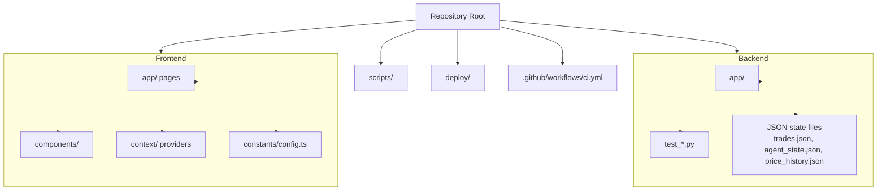

# Getting Started

<cite>
**Referenced Files in This Document**
- [README.md](file://README.md)
- [backend/app/core/config.py](file://backend/app/core/config.py)
- [backend/app/main.py](file://backend/app/main.py)
- [frontend/constants/config.ts](file://frontend/constants/config.ts)
- [frontend/package.json](file://frontend/package.json)
- [docker-compose.yml](file://docker-compose.yml)
- [start_dev.bat](file://start_dev.bat)
- [start-all.ps1](file://start-all.ps1)
</cite>

## Table of Contents
1. [Introduction](#introduction)
2. [Prerequisites](#prerequisites)
3. [Project Structure](#project-structure)
4. [Environment Setup](#environment-setup)
5. [Configuration](#configuration)
6. [Installation and Startup](#installation-and-startup)
7. [First Launch and Wallet Connection](#first-launch-and-wallet-connection)
8. [Basic Usage Patterns](#basic-usage-patterns)
9. [Demo Mode](#demo-mode)
10. [Verification Steps](#verification-steps)
11. [Troubleshooting](#troubleshooting)
12. [Security Considerations](#security-considerations)
13. [Conclusion](#conclusion)

## Introduction
DexTrader is a two-part semi-autonomous crypto trading application:
- A Next.js dashboard that reads your wallet in the browser.
- A FastAPI backend that turns market data into trade proposals, which you approve and sign yourself.

The backend never holds or signs private keys. It proposes trades; the browser executes swaps through an injected wallet such as MetaMask. The default network is Base mainnet, so real funds can be moved when you approve a swap. Treat this as experimental software and use testnets or small amounts until you trust the workflow.

**Section sources**
- [README.md:1-11](file://README.md#L1-L11)

## Prerequisites
Before installing DexTrader, ensure your machine has the following tools installed.

| Requirement | Minimum version | Notes |
|---|---:|---|
| Python | 3.12+ | Used by the backend. CI uses 3.12; development may use newer versions. |
| Node.js | 20+ | Used by the frontend. CI uses 20; development may use newer versions. |
| npm | Included with Node.js | Used to install frontend dependencies. |
| MetaMask or similar wallet extension | Latest stable | Provides `window.ethereum` for signing transactions. |
| Windows Terminal (optional) | Any recent version | Required only if you use `start-all.ps1`. |
| Docker Compose (optional) | Any supported version | Required only if you run the demo stack via `docker-compose.yml`. |

Recommended setup checklist:
- Verify Python: `python --version` should report 3.12 or higher.
- Verify Node.js: `node --version` should report 20.x or higher.
- Install MetaMask or another Ethereum-compatible wallet extension in your browser.
- If using Windows Terminal scripts, ensure `wt` is available on your PATH.

**Section sources**
- [README.md:189-190](file://README.md#L189-L190)
- [start-all.ps1:11-12](file://start-all.ps1#L11-L12)

## Project Structure
DexTrader is organized into two main services plus shared configuration and scripts.

Key responsibilities:
- **Backend**: FastAPI server, agents, market data integration, portfolio state, signals, news, and JSON-based persistence.
- **Frontend**: Next.js dashboard, wallet connection, proposal review, auto-trading controls, settings, and reports.
- **Scripts**: Cross-cutting tests for frontend policy logic.
- **Deploy**: Optional production-like Docker Compose stack for the public demo.

**Diagram sources**
- [README.md:116-144](file://README.md#L116-L144)

**Section sources**
- [README.md:116-144](file://README.md#L116-L144)

## Environment Setup
This section covers preparing both the backend and frontend environments.

### Backend environment
The backend is a Python FastAPI application. It does not require a build step.

Steps:
1. Open a terminal in the repository root.
2. Change into the backend directory: `cd backend`.
3. Create a virtual environment: `python -m venv venv`.
4. Activate the virtual environment:
   - On Windows: `venv\Scripts\activate`
   - On macOS/Linux: `source venv/bin/activate`
5. Install backend dependencies: `pip install -r requirements.txt`.
6. Start the backend server: `uvicorn app.main:app --reload`.
7. The backend listens at `http://127.0.0.1:8000`. API documentation is available at `/docs` when running locally.

On startup, the backend pre-populates market data and news caches asynchronously. The first page load is fast, but transient upstream fetch errors may appear during the first seconds after boot.

**Section sources**
- [README.md:35-47](file://README.md#L35-L47)
- [README.md:64](file://README.md#L64)
- [backend/app/main.py:41-54](file://backend/app/main.py#L41-L54)

### Frontend environment
The frontend is a Next.js application.

Steps:
1. Open a new terminal in the repository root.
2. Change into the frontend directory: `cd frontend`.
3. Install dependencies: `npm install`.
4. Start the development server: `npm run dev`.
5. Open the dashboard in your browser at `http://localhost:3000/dashboard`.

The frontend expects the backend to be reachable at the configured backend URL. By default, it points to `http://127.0.0.1:8000`.

**Section sources**
- [README.md:49-57](file://README.md#L49-L57)
- [frontend/constants/config.ts:1](file://frontend/constants/config.ts#L1)
- [frontend/package.json:5-10](file://frontend/package.json#L5-L10)

## Configuration
DexTrader uses environment variables for secrets, service URLs, and feature flags.

### .env file location and purpose
- The backend loads `.env` from its working directory.
- The README states that a root-level `.env` exists in the working copy and is gitignored.
- You can copy `.env.example` to `.env` if you want to supply optional API keys.
- The project runs without API keys, but some features have reduced functionality or stricter rate limits without them.

Important note: this document intentionally does not reproduce secret values. Do not commit `.env` to version control.

### Backend configuration
The backend reads these variables:

| Variable | Purpose | Default behavior |
|---|---|---|
| `COINMARKETCAP_API_KEY` | Sent to CoinMarketCap when not using the keyless trial endpoint. | Optional. With the current hardcoded trial base URL, the key is not sent. |
| `COINGECKO_API_KEY` | Sent as a demo API key header for CoinGecko calls. | Optional; anonymous requests still work with stricter limits. |
| `OPENAI_API_KEY` | Second-tier signal source via LangChain. | Optional. |
| `DEEPSEEK_API_KEY` | First-tier signal source via raw HTTP. | Optional. |
| `CORS_ORIGINS` | Comma-separated allowed frontend origins. | Defaults to local development origins. Credentials are disabled if you set `*`. |
| `BASE_RPC_URL` | JSON-RPC endpoint used for gas price checks. | Defaults to Base mainnet RPC. |
| `DEXTRADER_STATE_DIR` | Directory for persistent agent state and indicator history. | Defaults to `backend/`. |
| `DEMO_MODE` | Enables backend demo mode. | Disabled by default. |

These values are loaded by the backend configuration module and consumed across routes, agents, and services.

**Section sources**
- [README.md:66-84](file://README.md#L66-L84)
- [backend/app/core/config.py:1-16](file://backend/app/core/config.py#L1-L16)
- [backend/app/main.py:16-32](file://backend/app/main.py#L16-L32)

### Frontend configuration
The frontend uses build-time and runtime environment variables:

| Variable | Purpose | Default value |
|---|---|---|
| `NEXT_PUBLIC_BACKEND_URL` | Backend origin used by every page. | `http://127.0.0.1:8000` |
| `NEXT_PUBLIC_DEMO_MODE` | Build-time flag enabling demo UI behavior. | Disabled unless explicitly set to `"1"` during build. |

The frontend constant exports the backend URL and demo mode flag. Changing `NEXT_PUBLIC_DEMO_MODE` requires rebuilding the frontend because it is baked in at build time.

**Section sources**
- [README.md:79-81](file://README.md#L79-L81)
- [frontend/constants/config.ts:1-7](file://frontend/constants/config.ts#L1-L7)

### In-app settings
In-app settings are stored in the browser's `localStorage` under keys prefixed with `dexTrader_`. They include:
- Display currency (USD/EUR).
- Network selection (`sepolia`, `mainnet`, `base`, `arbitrum`).
- Signals polling interval.
- Market refresh interval.
- Agent cache duration.
- Auto-trading toggle and interval.

Some settings are cosmetic or partially implemented; always verify behavior in Settings rather than assuming all stored values drive scheduling.

**Section sources**
- [README.md:86-87](file://README.md#L86-L87)

## Installation and Startup
You can start DexTrader manually or use Windows convenience scripts.

### Manual installation
1. Prepare prerequisites as described in the Prerequisites section.
2. Set up the backend environment and start the server.
3. Set up the frontend environment and start the development server.
4. Open the dashboard in your browser.

### Windows manual script
Use `start_dev.bat` to open two PowerShell windows, one per service.

Usage:
- Run `.\start_dev.bat` from the repository root.
- The script starts the backend with Uvicorn reload and the frontend with `npm run dev`.

Limitations:
- It assumes dependencies are already installed.
- It opens separate console windows rather than splitting a single terminal tab.

**Section sources**
- [README.md:59-63](file://README.md#L59-L63)
- [start_dev.bat:1-8](file://start_dev.bat#L1-L8)

### Windows Windows Terminal script
Use `start-all.ps1` to open one Windows Terminal tab split into two panes.

Usage options:
- `.\start-all.ps1`: Opens one tab split in two panes and starts both services.
- `.\start-all.ps1 -Manual`: Opens one tab split in two panes and navigates to the correct directories without starting services.
- `.\start-all.ps1 -Install`: Installs dependencies and then starts both services.

Requirements:
- Requires Windows Terminal (`wt`) to be installed and available on PATH.
- Uses `npm.cmd` instead of `npm` to avoid execution policy issues with PowerShell scripts.

**Section sources**
- [README.md:59-63](file://README.md#L59-L63)
- [start-all.ps1:1-46](file://start-all.ps1#L1-L46)

### Docker Compose demo stack
The repository includes a production-ish Docker Compose configuration intended for the public demo.

Usage:
1. Copy `.env.example` to `.env` and set `DEMO_MODE=1` and `NEXT_PUBLIC_DEMO_MODE=1`.
2. Run: `docker compose up -d --build`.
3. The backend binds to `127.0.0.1:8000`.
4. The frontend binds to `127.0.0.1:3000`.
5. Both services are loopback-only; external TLS termination is expected to be handled by a reverse proxy such as Caddy.

Notes:
- The compose file sets `DEMO_MODE=1` and persists state under `/data`.
- The frontend build arguments include `NEXT_PUBLIC_BACKEND_URL` and `NEXT_PUBLIC_DEMO_MODE`.

**Section sources**
- [docker-compose.yml:1-35](file://docker-compose.yml#L1-L35)
- [README.md:88-99](file://README.md#L88-L99)

## First Launch and Wallet Connection
After both services are running:

1. Open `http://localhost:3000/dashboard` in your browser.
2. Ensure MetaMask or another compatible wallet extension is installed and unlocked.
3. Connect your wallet in the dashboard.
4. Select the desired network in Settings. The default is Base.
5. Review market data, signals, and agent proposals.

If the wallet button does not appear:
- Confirm the frontend is built with demo mode disabled.
- Confirm MetaMask is installed and enabled.
- Confirm the backend URL is correct.
- Check browser console for CORS or network errors.

**Section sources**
- [README.md:57-58](file://README.md#L57-L58)
- [frontend/constants/config.ts:1](file://frontend/constants/config.ts#L1)

## Basic Usage Patterns
DexTrader supports two primary workflows: manual approval and optional auto-trading.

### Manual workflow
1. The backend generates trade proposals based on market data and strategy rules.
2. The Agents page polls `/agents/proposals` periodically.
3. You review a proposal in the browser.
4. You approve and sign the swap through your wallet extension.
5. The signed transaction result is posted back to the backend portfolio endpoint.

### Auto-trading workflow
Auto-trading is optional and controlled in the frontend:
- When enabled, the frontend polls eligible proposals on its own interval.
- Eligible proposals are executed automatically through the injected wallet.
- Auto-trading respects frontend settings and wallet availability.
- Demo mode hard-disables auto-trading even if a wallet is present.

### Portfolio and reports
- The Portfolio page shows live wallet balances read from the browser wallet.
- Reports show trade history and support CSV export.
- Trades are recorded in backend JSON files during normal operation.
- In demo mode, simulated fills update a virtual portfolio instead of the real ledger.

**Section sources**
- [README.md:15-20](file://README.md#L15-L20)
- [README.md:101-114](file://README.md#L101-L114)
- [README.md:88-99](file://README.md#L88-L99)

## Demo Mode
Demo mode lets you explore DexTrader without connecting a real wallet or moving real funds.

### How demo mode works
- The backend runs with a virtual $1,000 portfolio.
- Market data remains real.
- Proposals and guardrails run against live indicators.
- Executing a proposal simulates an immediate fill at the proposal price.
- `POST /portfolio/trade` returns 403, preventing real trades from being injected into the demo ledger.
- The frontend banner replaces wallet actions with simulation controls.

### Enabling demo mode
Backend:
- Set `DEMO_MODE=1` in `.env`.

Frontend:
- Set `NEXT_PUBLIC_DEMO_MODE=1` before building the frontend.
- Rebuild the frontend after changing this variable because it is a build-time constant.

Docker Compose:
- The provided compose file sets `DEMO_MODE=1` and configures frontend build arguments for demo mode.

### Demo limitations
- Simulated fills ignore slippage, fees, and price impact.
- Demo P&L is optimistic by construction.
- Auto-trading is hard-disabled in the browser in demo mode.
- The demo portfolio is bookkeeping, not a full-chain simulator.

**Section sources**
- [README.md:88-99](file://README.md#L88-L99)
- [backend/app/core/config.py:14-15](file://backend/app/core/config.py#L14-L15)
- [frontend/constants/config.ts:3-7](file://frontend/constants/config.ts#L3-L7)
- [docker-compose.yml:11-17](file://docker-compose.yml#L11-L17)

## Verification Steps
Use these steps to confirm that DexTrader is installed and running correctly.

### Backend verification
1. Start the backend.
2. Visit `http://127.0.0.1:8000/health`.
3. Expect a JSON response indicating status and demo mode.
4. Optionally visit `http://127.0.0.1:8000/docs` to inspect the generated API documentation.

Expected health response shape:
- `status`: string, typically `"ok"`.
- `demo`: boolean reflecting `DEMO_MODE`.

### Frontend verification
1. Start the frontend.
2. Open `http://localhost:3000/dashboard`.
3. Confirm the page loads without CORS errors.
4. Confirm the backend URL resolves to your running backend.
5. If using demo mode, confirm the demo banner appears and the wallet button is replaced.

### Wallet verification
1. Open MetaMask or your wallet extension.
2. Ensure the extension is unlocked.
3. Navigate to the Dashboard or Agents page.
4. Connect the wallet.
5. Switch to the expected network in Settings (default Base).
6. Attempt a non-critical action such as viewing holdings or reviewing a proposal.

### Docker Compose verification
1. Run `docker compose ps` to confirm both services are running.
2. Check logs with `docker compose logs -f backend` and `docker compose logs -f frontend`.
3. Confirm the frontend can reach the backend through the configured URL.

**Section sources**
- [backend/app/main.py:57-59](file://backend/app/main.py#L57-L59)
- [README.md:57-64](file://README.md#L57-L64)
- [docker-compose.yml:8-32](file://docker-compose.yml#L8-L32)

## Troubleshooting
Common setup issues and their likely causes.

### Backend will not start
Possible causes:
- Python version is below 3.12.
- Virtual environment is not activated.
- Dependencies were not installed.
- Port 8000 is already in use.

Fixes:
- Verify Python version.
- Activate the virtual environment again.
- Reinstall dependencies: `pip install -r requirements.txt`.
- Change ports or stop the conflicting process.

### Frontend cannot reach the backend
Possible causes:
- Backend is not running.
- `NEXT_PUBLIC_BACKEND_URL` points to the wrong address.
- CORS is blocking the request.
- Browser is loading a cached build with a different backend URL.

Fixes:
- Confirm the backend is listening at the expected URL.
- Update `NEXT_PUBLIC_BACKEND_URL` in `.env` or environment configuration.
- For development, keep CORS defaults or add the exact frontend origin.
- Rebuild the frontend if you changed `NEXT_PUBLIC_DEMO_MODE`.

### CORS errors
The backend allows specific origins by default. If you change the frontend port or host:
- Set `CORS_ORIGINS` to include the new origin.
- Avoid setting `CORS_ORIGINS="*"` in production unless you fully understand the security implications.

**Section sources**
- [backend/app/main.py:16-32](file://backend/app/main.py#L16-L32)
- [frontend/constants/config.ts:1](file://frontend/constants/config.ts#L1)
- [README.md:76-77](file://README.md#L76-L77)

### Wallet does not connect
Possible causes:
- MetaMask or another wallet extension is not installed.
- The extension is locked or disabled.
- The frontend is built in demo mode.
- The selected network is incorrect.

Fixes:
- Install and unlock MetaMask.
- Disable demo mode in the frontend build.
- Select the correct network in Settings.
- Check the browser console for injection or provider errors.

### Windows scripts fail
Possible causes:
- `wt` is not installed when using `start-all.ps1`.
- Execution policy blocks PowerShell scripts.
- Dependencies are missing.

Fixes:
- Install Windows Terminal.
- Use `.\start-all.ps1 -Manual` to navigate folders manually.
- Use `.\start-all.ps1 -Install` to install dependencies automatically.
- Fall back to `.\start_dev.bat` if Windows Terminal is unavailable.

**Section sources**
- [start-all.ps1:23-26](file://start-all.ps1#L23-L26)
- [start-all.ps1:37-45](file://start-all.ps1#L37-L45)
- [start_dev.bat:1-8](file://start_dev.bat#L1-L8)

### Demo mode behaves unexpectedly
Possible causes:
- Backend and frontend demo flags do not agree.
- Frontend was rebuilt without updating `NEXT_PUBLIC_DEMO_MODE`.
- Real trades attempted while demo mode is active.

Fixes:
- Set `DEMO_MODE=1` in the backend environment.
- Set `NEXT_PUBLIC_DEMO_MODE=1` and rebuild the frontend.
- Remember that `POST /portfolio/trade` is refused in demo mode.

**Section sources**
- [README.md:88-99](file://README.md#L88-L99)
- [backend/app/core/config.py:14-15](file://backend/app/core/config.py#L14-L15)
- [frontend/constants/config.ts:3-7](file://frontend/constants/config.ts#L3-L7)

## Security Considerations
DexTrader’s security posture is intentionally localhost-focused for development.

### Development environment
- The backend has no authentication layer.
- CORS defaults to local development origins.
- Private keys never leave the browser; the backend does not sign or send transactions.
- State files such as `trades.json`, `agent_state.json`, and `price_history.json` are gitignored and contain sensitive trading data.
- API keys should remain in `.env` and must not be committed.

### Production environment
- Do not expose the backend directly without adding authentication and a proper reverse proxy.
- Restrict `CORS_ORIGINS` to trusted domains.
- Never rely on `CORS_ORIGINS="*"` as a security boundary.
- Use HTTPS and secure deployment practices.
- Separate development and production `.env` files.
- Back up or migrate JSON state files carefully; they are not database-backed.
- Monitor logs and limit exposure of audit logs and state directories.

### Wallet safety
- Always review proposals before signing.
- Use testnets for experimentation.
- Start with small amounts until you trust the strategy and UI behavior.
- Understand that demo mode is not a substitute for a real backtest.

**Section sources**
- [README.md:103](file://README.md#L103)
- [README.md:178-180](file://README.md#L178-L180)
- [backend/app/main.py:16-32](file://backend/app/main.py#L16-L32)

## Conclusion
You now have the prerequisites, environment setup, configuration, installation, startup, wallet connection, basic usage, demo mode, verification, troubleshooting, and security guidance needed to get DexTrader running locally.

Next steps:
- Explore the Dashboard, Agents, Portfolio, Reports, News, and Settings pages.
- Experiment with demo mode before connecting a real wallet.
- Review the API surface at `/docs` when running the backend locally.
- Keep `.env`, state files, and logs out of version control.
- Treat this software as experimental and manage risk accordingly.

[No sources needed since this section summarizes without analyzing specific files]