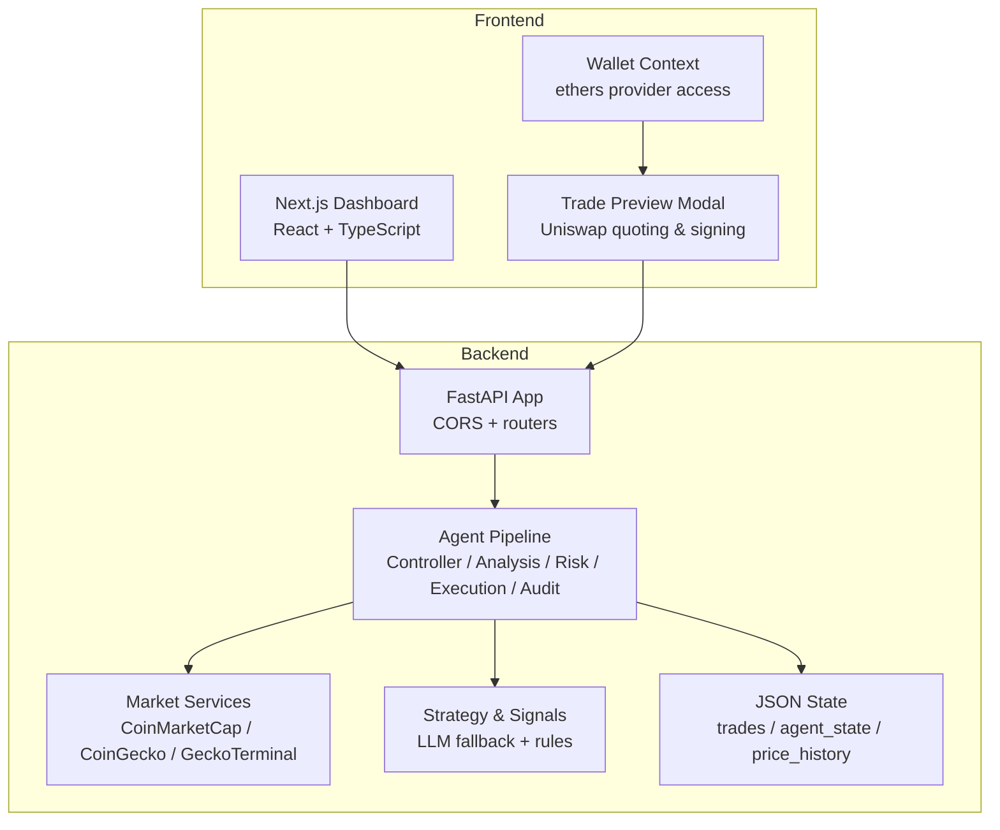
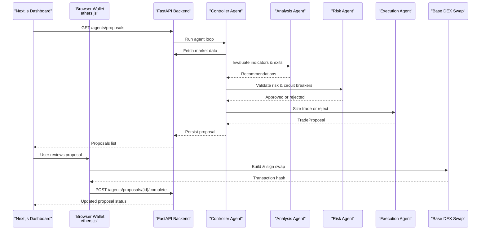
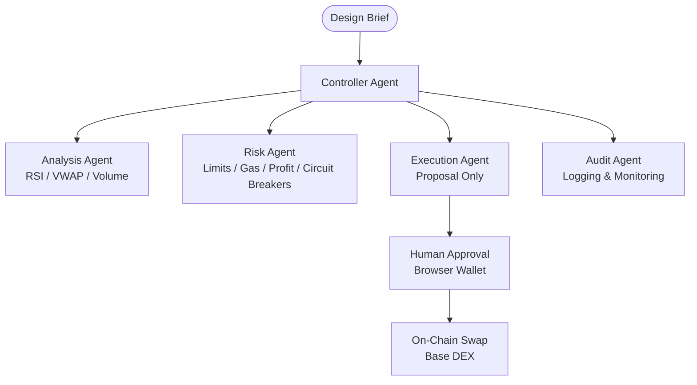
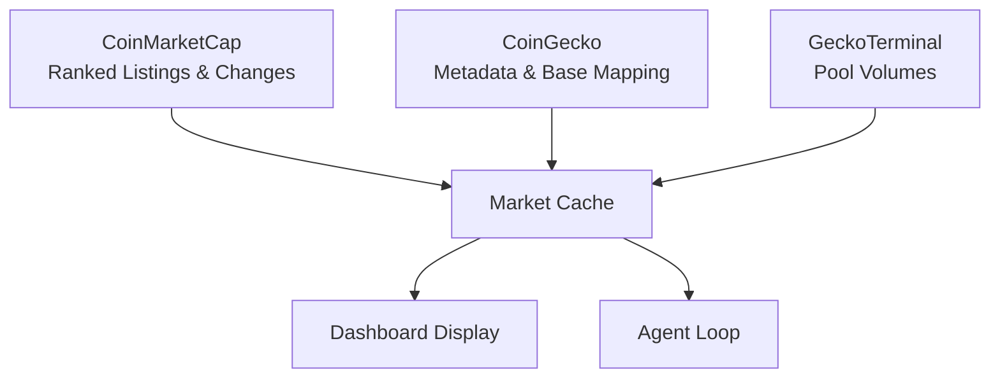
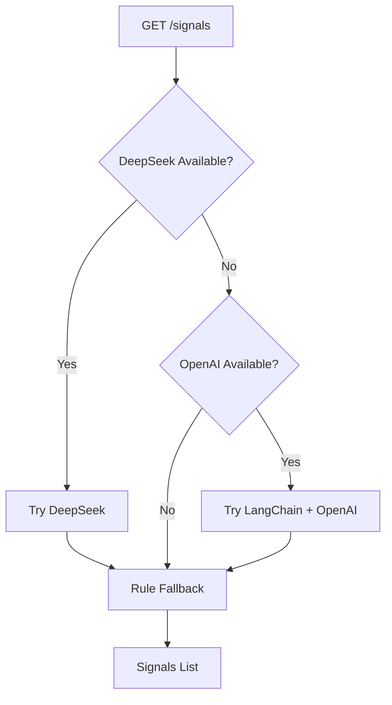
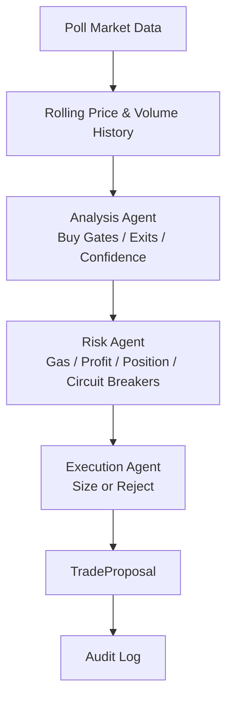
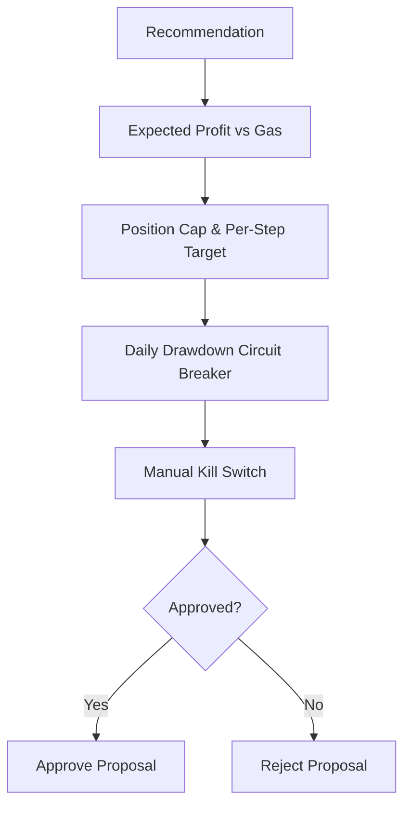
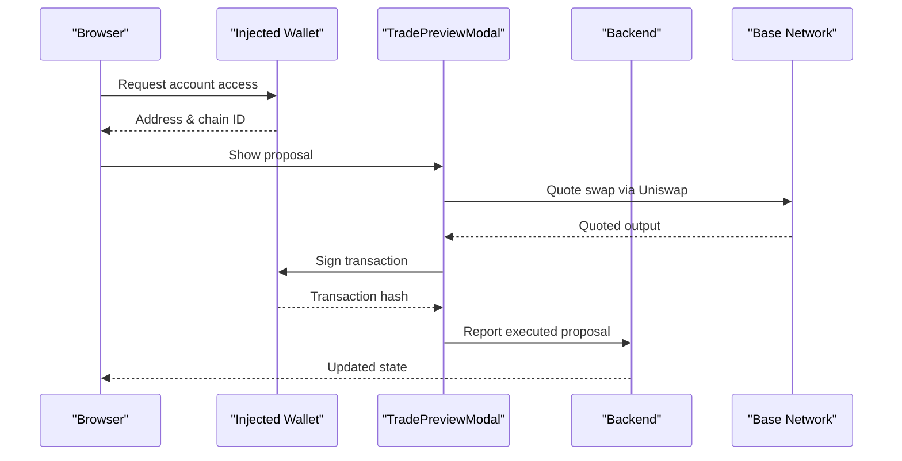
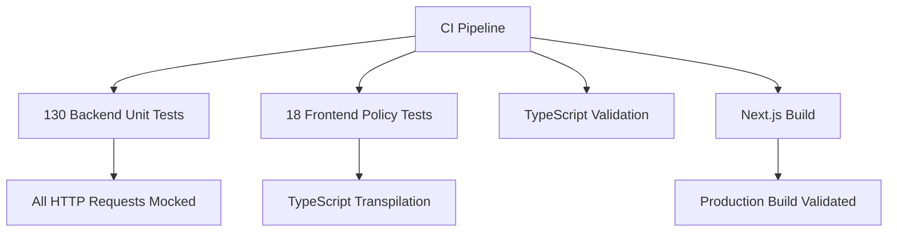
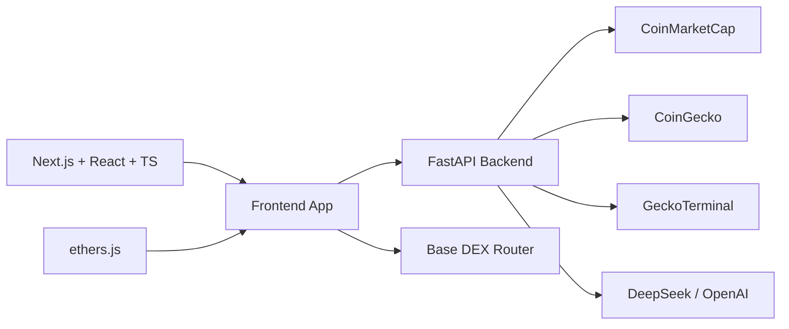

# Project Overview

<cite>
**Referenced Files in This Document**
- [README.md](file://README.md)
- [agent_guidelines.txt](file://agent_guidelines.txt)
- [docker-compose.yml](file://docker-compose.yml)
- [deploy/README.md](file://deploy/README.md)
- [backend/app/main.py](file://backend/app/main.py)
- [frontend/package.json](file://frontend/package.json)
- [frontend/app/page.tsx](file://frontend/app/page.tsx)
- [frontend/components/TradePreviewModal.tsx](file://frontend/components/TradePreviewModal.tsx)
- [frontend/context/WalletContext.tsx](file://frontend/context/WalletContext.tsx)
- [backend/app/api/routes_signals.py](file://backend/app/api/routes_signals.py)
- [backend/app/services/strategy.py](file://backend/app/services/strategy.py)
- [backend/app/agents/analysis_agent.py](file://backend/app/agents/analysis_agent.py)
- [backend/app/agents/risk_agent.py](file://backend/app/agents/risk_agent.py)
- [backend/app/agents/controller.py](file://backend/app/agents/controller.py)
</cite>

## Update Summary
**Changes Made**
- Updated testing section to reflect current 130 backend unit tests across comprehensive test suite
- Added Docker Compose deployment documentation for production environments
- Enhanced transparency about real-world usage since early 2026 as daily trading dashboard
- Expanded test file documentation covering all major components including demo portfolio and routes

## Table of Contents
1. [Introduction](#introduction)
2. [Project Structure](#project-structure)
3. [Core Components](#core-components)
4. [Architecture Overview](#architecture-overview)
5. [Detailed Component Analysis](#detailed-component-analysis)
6. [Testing and Quality Assurance](#testing-and-quality-assurance)
7. [Deployment and Operations](#deployment-and-operations)
8. [Dependency Analysis](#dependency-analysis)
9. [Performance Considerations](#performance-considerations)
10. [Troubleshooting Guide](#troubleshooting-guide)
11. [Conclusion](#conclusion)

## Introduction
DexTrader is a semi-autonomous cryptocurrency trading system designed as a reference experiment rather than a production product. Its purpose is to generate trade proposals through an intelligent, rule-based agent pipeline while keeping the human in control for actual transaction execution. The backend analyzes markets and proposes trades; the frontend reads the user's wallet in the browser and signs swaps on-chain. Private keys never leave the browser, and the server does not sign or broadcast transactions.

This is not just a fresh experiment: it has been running as the author's daily trading dashboard since early 2026, with most fixes coming from that real-world use rather than from the test suite alone. A hosted demo with a simulated portfolio runs at https://dextrader.caldefoc.com.

The project targets users who want to explore agent-driven trading workflows with real market data and real DEX execution, but who also want explicit human approval before funds move. It is most relevant to:
- Developers experimenting with multi-agent trading logic.
- Traders who want automated proposal generation with manual execution.
- Researchers comparing rule-based signals against LLM-assisted signals.
- Users testing strategies on Base mainnet or testnets using a non-custodial wallet.

Important disclaimers:
- The software is experimental and provided as-is.
- It can lose money because it may trade real tokens on Base mainnet by default.
- Proposal pricing comes from global spot sources, not necessarily the exact DEX pool used at execution.
- Risk controls are heuristics, not guarantees.
- Nothing here is financial advice.

**Section sources**
- [README.md:1-10](file://README.md#L1-L10)
- [README.md:196-198](file://README.md#L196-L198)

## Project Structure
DexTrader is a two-part application:

- Frontend: A Next.js dashboard that connects to an injected wallet, displays market data, agent status, portfolio state, news, reports, and settings, and performs on-chain swaps via ethers.js.
- Backend: A FastAPI service that aggregates market data, runs an agent loop, generates trade proposals, exposes API routes, and persists state to JSON files.



**Diagram sources**
- [backend/app/main.py:14-38](file://backend/app/main.py#L14-L38)
- [frontend/package.json:12-17](file://frontend/package.json#L12-L17)
- [frontend/components/TradePreviewModal.tsx:1-7](file://frontend/components/TradePreviewModal.tsx#L1-L7)
- [frontend/context/WalletContext.tsx:1-11](file://frontend/context/WalletContext.tsx#L1-L11)

**Section sources**
- [README.md:22-33](file://README.md#L22-L33)
- [README.md:116-144](file://README.md#L116-L144)
- [backend/app/main.py:14-38](file://backend/app/main.py#L14-L38)
- [frontend/package.json:12-17](file://frontend/package.json#L12-L17)

## Core Components
DexTrader's core value lies in separating proposal generation from transaction signing:

- Market data aggregation pulls prices and volumes from multiple sources, including CoinMarketCap, CoinGecko, and GeckoTerminal. Prices are global spot values, not DEX pool prices.
- Rule-based signals provide deterministic fallback behavior when LLM calls fail or are unavailable.
- The agent pipeline evaluates indicators such as RSI, VWAP deviation, and volume spikes, then produces structured trade recommendations.
- Risk management enforces position sizing, gas limits, profit thresholds, drawdown circuit breakers, and daily trade caps.
- Blockchain integration uses ethers.js in the browser to interact with Uniswap V3 and other DEX paths on Base and other chains.
- Human oversight remains mandatory: proposals are reviewed and signed in the wallet popup, and the backend only records outcomes after the client reports them.

Key implementation anchors:
- Backend entry point and CORS configuration.
- Signal route with DeepSeek, OpenAI, and rule fallback.
- Strategy evaluation function for deterministic signals.
- Analysis agent implementing dip buys, stop-losses, trailing stops, and scale-out ladders.
- Risk agent enforcing profitability, gas, position, and circuit-breaker checks.
- Controller orchestrating polling, analysis, risk, execution, and audit steps.
- Frontend wallet context reading `window.ethereum`.
- Trade preview modal building and sending swaps via ethers.js.

**Section sources**
- [README.md:13-20](file://README.md#L13-L20)
- [backend/app/main.py:14-38](file://backend/app/main.py#L14-L38)
- [backend/app/api/routes_signals.py:20-53](file://backend/app/api/routes_signals.py#L20-L53)
- [backend/app/services/strategy.py:8-38](file://backend/app/services/strategy.py#L8-L38)
- [backend/app/agents/analysis_agent.py:101-255](file://backend/app/agents/analysis_agent.py#L101-L255)
- [backend/app/agents/risk_agent.py:132-161](file://backend/app/agents/risk_agent.py#L132-L161)
- [backend/app/agents/controller.py:552-575](file://backend/app/agents/controller.py#L552-L575)
- [frontend/context/WalletContext.tsx:21-98](file://frontend/context/WalletContext.tsx#L21-L98)
- [frontend/components/TradePreviewModal.tsx:1-7](file://frontend/components/TradePreviewModal.tsx#L1-L7)

## Architecture Overview
At a high level, DexTrader follows a server-side reasoning, client-side signing model:

1. The backend starts FastAPI, configures CORS, registers routers, and pre-warms market and news caches.
2. The agent controller polls market data, filters monitored tokens, updates indicator history, and passes snapshots to the analysis agent.
3. The analysis agent computes RSI, VWAP, volume spikes, and exit logic, producing recommendations.
4. The risk agent validates confidence, gas, expected profit, position size, and circuit breakers.
5. The execution agent sizes or rejects the trade and appends a proposal.
6. The frontend fetches proposals, lets the user review them, builds a swap in the browser, signs it through the wallet, and posts the result back to the backend.



**Diagram sources**
- [backend/app/main.py:34-54](file://backend/app/main.py#L34-L54)
- [backend/app/agents/controller.py:552-575](file://backend/app/agents/controller.py#L552-L575)
- [backend/app/agents/analysis_agent.py:101-255](file://backend/app/agents/analysis_agent.py#L101-L255)
- [backend/app/agents/risk_agent.py:132-161](file://backend/app/agents/risk_agent.py#L132-L161)
- [frontend/components/TradePreviewModal.tsx:1-7](file://frontend/components/TradePreviewModal.tsx#L1-L7)

## Detailed Component Analysis

### Purpose and Design Model
DexTrader implements a design brief that separates responsibilities among agents:
- An analysis agent focuses on technical indicators and trade recommendations.
- A risk agent validates positions, gas, slippage, and safety limits.
- An execution agent creates trade proposals without signing transactions.
- An audit agent logs and monitors actions read-only.

This separation ensures that the backend reasons about markets and risk, while the frontend retains custody of private keys and final execution authority.



**Diagram sources**
- [agent_guidelines.txt:5-10](file://agent_guidelines.txt#L5-L10)
- [README.md:3-6](file://README.md#L3-L6)

**Section sources**
- [agent_guidelines.txt:5-10](file://agent_guidelines.txt#L5-L10)
- [README.md:3-6](file://README.md#L3-L6)

### Market Data Aggregation
The backend aggregates market data from multiple providers:
- CoinMarketCap provides ranked listings and price changes.
- CoinGecko fills missing token metadata and supports Base token mapping.
- GeckoTerminal contributes volume information for selected pools.

The dashboard caches results for longer intervals, while the agent loop uses shorter caching to keep strategy inputs fresh. Global spot prices are used for proposals, which is intentionally distinct from the DEX pool price at execution time.



**Diagram sources**
- [README.md:15](file://README.md#L15)
- [backend/app/api/routes_market.py:15-24](file://backend/app/api/routes_market.py#L15-L24)

**Section sources**
- [README.md:15](file://README.md#L15)
- [backend/app/api/routes_market.py:15-24](file://backend/app/api/routes_market.py#L15-L24)

### Rule-Based Trading Signals
The signal endpoint tries advanced LLM-based signals first, then falls back to deterministic rules:
- DeepSeek is attempted if configured.
- OpenAI via LangChain is used as a second-tier source.
- If both fail or are unavailable, the system uses simple 24-hour change rules: strong gains suggest selling, strong drops suggest buying, otherwise holding.

This layered approach keeps the system usable even without API keys or external LLM availability.



**Diagram sources**
- [backend/app/api/routes_signals.py:20-53](file://backend/app/api/routes_signals.py#L20-L53)
- [backend/app/services/strategy.py:8-38](file://backend/app/services/strategy.py#L8-L38)

**Section sources**
- [backend/app/api/routes_signals.py:20-53](file://backend/app/api/routes_signals.py#L20-L53)
- [backend/app/services/strategy.py:8-38](file://backend/app/services/strategy.py#L8-L38)

### Agent Pipeline and Proposal Generation
The controller coordinates the full pipeline:
- Polling agent collects market snapshots.
- Analysis agent evaluates indicators and exit logic.
- Risk agent applies guardrails.
- Execution agent sizes or rejects trades.
- Audit agent records every step.

Indicators include RSI(14), VWAP deviation, and a volume-spike filter. Exit logic includes stop-loss ladders, trailing stops, and scale-out take-profit levels. Confidence scores help downstream risk checks decide whether a proposal is reasonable.



**Diagram sources**
- [backend/app/agents/analysis_agent.py:101-255](file://backend/app/agents/analysis_agent.py#L101-L255)
- [backend/app/agents/risk_agent.py:132-161](file://backend/app/agents/risk_agent.py#L132-L161)
- [backend/app/agents/controller.py:552-575](file://backend/app/agents/controller.py#L552-L575)

**Section sources**
- [backend/app/agents/analysis_agent.py:101-255](file://backend/app/agents/analysis_agent.py#L101-L255)
- [backend/app/agents/risk_agent.py:132-161](file://backend/app/agents/risk_agent.py#L132-L161)
- [backend/app/agents/controller.py:552-575](file://backend/app/agents/controller.py#L552-L575)

### Risk Management and Circuit Breakers
Risk management is central to DexTrader's safety model. The risk layer checks:
- Minimum expected profit versus gas cost.
- Live gas price ceilings.
- Position size relative to portfolio value.
- Daily trade counts and per-token trade limits.
- Daily drawdown circuit breakers.
- Manual halt and resume controls.

Stablecoins are treated as cash and excluded from risky analysis where appropriate. The system fails closed when balances or buying power are insufficient.



**Diagram sources**
- [backend/app/agents/risk_agent.py:132-161](file://backend/app/agents/risk_agent.py#L132-L161)
- [README.md:156-166](file://README.md#L156-L166)

**Section sources**
- [backend/app/agents/risk_agent.py:132-161](file://backend/app/agents/risk_agent.py#L132-L161)
- [README.md:156-166](file://README.md#L156-L166)

### Blockchain Integration and Client-Side Signing
Transaction signing happens entirely in the browser:
- The frontend detects an injected Ethereum provider.
- The wallet context manages address, chain ID, connection state, and errors.
- The trade preview modal constructs swaps using ethers.js and DEX router addresses.
- After the user approves the transaction, the frontend posts the transaction hash back to the backend.

Private keys never enter the backend. The backend's role ends at proposal generation and outcome recording.



**Diagram sources**
- [frontend/context/WalletContext.tsx:21-98](file://frontend/context/WalletContext.tsx#L21-L98)
- [frontend/components/TradePreviewModal.tsx:1-7](file://frontend/components/TradePreviewModal.tsx#L1-L7)
- [README.md:18](file://README.md#L18)

**Section sources**
- [frontend/context/WalletContext.tsx:21-98](file://frontend/context/WalletContext.tsx#L21-L98)
- [frontend/components/TradePreviewModal.tsx:1-7](file://frontend/components/TradePreviewModal.tsx#L1-L7)
- [README.md:18](file://README.md#L18)

### Security Model and Experimental Nature
DexTrader's security model emphasizes non-custodial execution:
- Private keys remain in the browser.
- No server-side transaction signing occurs.
- Wallet addresses are not persisted server-side.
- The API has no authentication layer by default.
- CORS is configurable but should not be treated as a security boundary.

The project is explicitly experimental:
- It trades real tokens on Base mainnet by default.
- Demo mode simulates portfolio fills without moving real funds.
- Pricing and execution venues differ, introducing slippage and routing risk.
- JSON persistence is simple and not a database replacement.
- CI tests mock upstream HTTP and do not cover end-to-end on-chain execution.

**Section sources**
- [README.md:3-9](file://README.md#L3-L9)
- [README.md:101-103](file://README.md#L101-L103)
- [README.md:168-183](file://README.md#L168-L183)
- [README.md:196-198](file://README.md#L196-L198)

## Testing and Quality Assurance

**Updated** Enhanced testing coverage with comprehensive backend unit tests and cross-platform validation

DexTrader maintains a robust testing strategy across multiple layers:

### Backend Unit Tests (130 tests)
The backend features extensive unit testing with 130 tests covering all major components:
- **Market data testing**: `test_base_market.py`, `test_token_volumes.py` - Validates market data aggregation and Base token support
- **Trading logic**: `test_analysis_agent.py`, `test_risk_agent.py`, `test_execution_agent.py` - Tests agent decision-making processes
- **System integration**: `test_controller_state.py`, `test_agent_routes.py` - Ensures proper state management and API functionality
- **Signal processing**: `test_signals_route.py`, `test_indicators.py` - Validates signal generation and indicator calculations
- **Demo functionality**: `test_demo_portfolio.py`, `test_demo_routes.py` - Tests simulated trading environment
- **Policy enforcement**: `test_auto_trade_policy.py`, `test_guardrails.py` - Verifies risk management and policy compliance

All tests use plain `unittest`, mock upstream HTTP requests, and import directly from `app.*`. They run from the `backend/` directory using `python -m unittest discover -p "test_*.py"`.

### Frontend Policy Tests (18 tests)
Frontend testing covers critical trading policies:
- Auto-trade policy validation in `scripts/test_auto_trade_policy.cjs`
- Base token support verification in `scripts/test_base_token_support.cjs`
- Uses Node.js `node:test` framework with TypeScript transpilation
- Requires `npm install` to run due to TypeScript dependencies

### Browser Smoke Test
End-to-end validation through Playwright:
- Automated browser testing in `scripts/test_portfolio_display.py`
- Headless Chrome against localhost development server
- Intercepts network calls and injects fake `window.ethereum`
- Validates portfolio display functionality

### What Tests Don't Cover
The automated test suite deliberately excludes:
- End-to-end agent proposal → execution path in browser
- Swap construction inside `TradePreviewModal`
- News parsing functionality
- Real chain or wallet interactions
- Demo mode user interaction

This limitation reflects the practical reality that these paths have been extensively validated through nine months of daily use since early 2026, rather than relying solely on automated testing.



**Diagram sources**
- [README.md:149-159](file://README.md#L149-L159)

**Section sources**
- [README.md:149-159](file://README.md#L149-L159)

## Deployment and Operations

**Updated** Added comprehensive Docker Compose deployment documentation and production considerations

DexTrader supports both development and production deployments:

### Development Setup
Two-process architecture requiring separate backend and frontend services:
- Backend: FastAPI with Uvicorn, no build step required
- Frontend: Next.js development server with hot reload
- Windows convenience scripts available (`start_dev.bat`, `start-all.ps1`)

### Production Deployment with Docker Compose
Production deployment uses Docker Compose for containerized operation:

```yaml
services:
  backend:
    build: ./backend
    env_file: .env
    environment:
      DEXTRADER_STATE_DIR: /data
      DEMO_MODE: "1"
    volumes:
      - dextrader-state:/data
    ports:
      - "127.0.0.1:8000:8000"
    restart: unless-stopped

  frontend:
    build:
      context: ./frontend
      args:
        NEXT_PUBLIC_BACKEND_URL: ${NEXT_PUBLIC_BACKEND_URL:-https://dextrader.caldefoc.com/api}
        NEXT_PUBLIC_DEMO_MODE: ${NEXT_PUBLIC_DEMO_MODE:-1}
    ports:
      - "127.0.0.1:3000:3000"
    depends_on:
      - backend
    restart: unless-stopped
```

### Production Considerations
- **Single worker constraint**: One Uvicorn worker intentionally used due to JSON file state persistence
- **State persistence**: Demo state stored in Docker volume at `/data`
- **Security**: Both services bind to loopback only; reverse proxy handles TLS termination
- **Configuration**: Environment variables managed through `.env` file
- **Updates**: Git pull followed by `docker compose up -d --build` for updates

### Reverse Proxy Configuration
Production deployment typically uses Caddy as reverse proxy:
- Terminates TLS connections
- Proxies `/api/*` requests to FastAPI backend
- Serves static Next.js assets for frontend
- Handles domain routing and SSL certificates

**Section sources**
- [docker-compose.yml:1-36](file://docker-compose.yml#L1-L36)
- [deploy/README.md:1-37](file://deploy/README.md#L1-L37)
- [README.md:193-194](file://README.md#L193-L194)

## Dependency Analysis
DexTrader's dependencies fall into clear layers:

- Frontend depends on Next.js, React, TypeScript, Tailwind, and ethers.js.
- Backend depends on FastAPI, Pydantic, httpx, feedparser, and optional LLM libraries.
- Market data depends on CoinMarketCap, CoinGecko, and GeckoTerminal.
- On-chain execution depends on the injected Ethereum provider and DEX routers.



**Diagram sources**
- [frontend/package.json:12-17](file://frontend/package.json#L12-L17)
- [backend/app/main.py:14-38](file://backend/app/main.py#L14-L38)
- [README.md:22-33](file://README.md#L22-L33)

**Section sources**
- [frontend/package.json:12-17](file://frontend/package.json#L12-L17)
- [backend/app/main.py:14-38](file://backend/app/main.py#L14-L38)
- [README.md:22-33](file://README.md#L22-L33)

## Performance Considerations
Several performance characteristics affect how DexTrader behaves in practice:

- Market cache warming reduces initial latency by pre-populating data on backend startup.
- The dashboard uses a long cache interval to avoid excessive refreshes.
- The agent loop uses a shorter cache interval to keep strategy inputs fresh.
- Indicator warm-up requires historical samples; newly started instances may rely on simpler signals until enough data accumulates.
- JSON persistence avoids database overhead but does not support concurrent writers safely.
- LLM signal calls add latency and depend on external API availability.

[No sources needed since this section provides general guidance]

## Troubleshooting Guide
Common operational issues and their context:

- No injected wallet detected: The frontend expects `window.ethereum`; ensure a compatible wallet extension is installed and active.
- Wrong network: Settings allow selecting networks, but auto-trade execution is constrained to supported chains and tokens.
- API rate limits or billing errors: LLM signal sources may fall back to deterministic rules when quotas or payments fail.
- Stale market data: Check backend startup logs and CORS configuration if the frontend cannot reach the backend.
- Demo mode mismatch: Backend and frontend demo flags must agree; rebuilding the frontend is required when changing build-time demo variables.
- Proposal not executing: Auto-trade may skip unsupported tokens; proposals can still be manually reviewed and signed.
- Docker deployment issues: Ensure environment variables are properly set and volumes are correctly mounted.
- Single worker limitation: Multiple Uvicorn workers will cause state file conflicts due to JSON persistence.

**Section sources**
- [frontend/context/WalletContext.tsx:75-98](file://frontend/context/WalletContext.tsx#L75-L98)
- [backend/app/api/routes_signals.py:28-53](file://backend/app/api/routes_signals.py#L28-L53)
- [README.md:64-84](file://README.md#L64-L84)
- [README.md:88-99](file://README.md#L88-L99)
- [README.md:172-179](file://README.md#L172-L179)

## Conclusion
DexTrader demonstrates a practical split between server-side intelligence and client-side custody. The backend aggregates market data, computes indicators, applies risk guardrails, and generates trade proposals. The frontend connects to a non-custodial wallet, reviews proposals, and executes swaps on-chain. This architecture makes sense for experimentation and learning, especially around agent-driven trading, risk management, and DEX integration.

However, it is important to treat DexTrader as an experimental reference release:
- Use testnets or small amounts.
- Understand that proposal pricing differs from execution pricing.
- Recognize that risk controls are heuristics.
- Do not expose the backend publicly without adding authentication and proper deployment controls.
- Treat outputs as research and development material, not financial advice.

The project's extensive testing (130 backend unit tests), comprehensive Docker deployment support, and proven track record of daily use since early 2026 demonstrate its maturity as a reference implementation, while maintaining its experimental nature and appropriate disclaimers about real trading risks.

[No sources needed since this section summarizes without analyzing specific files]