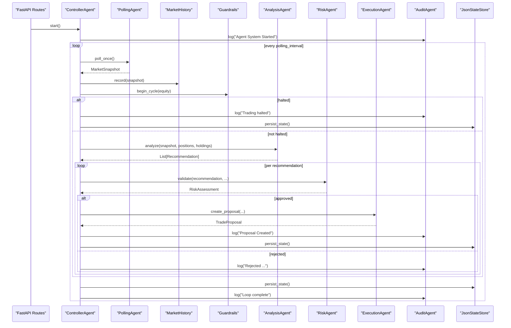
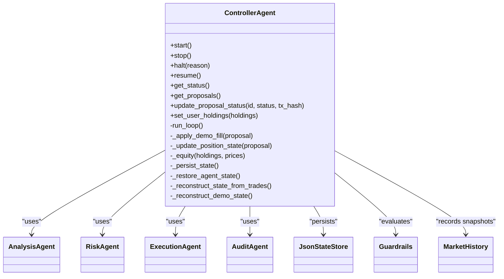
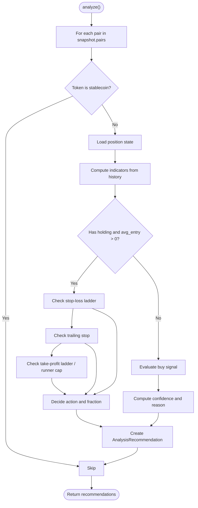
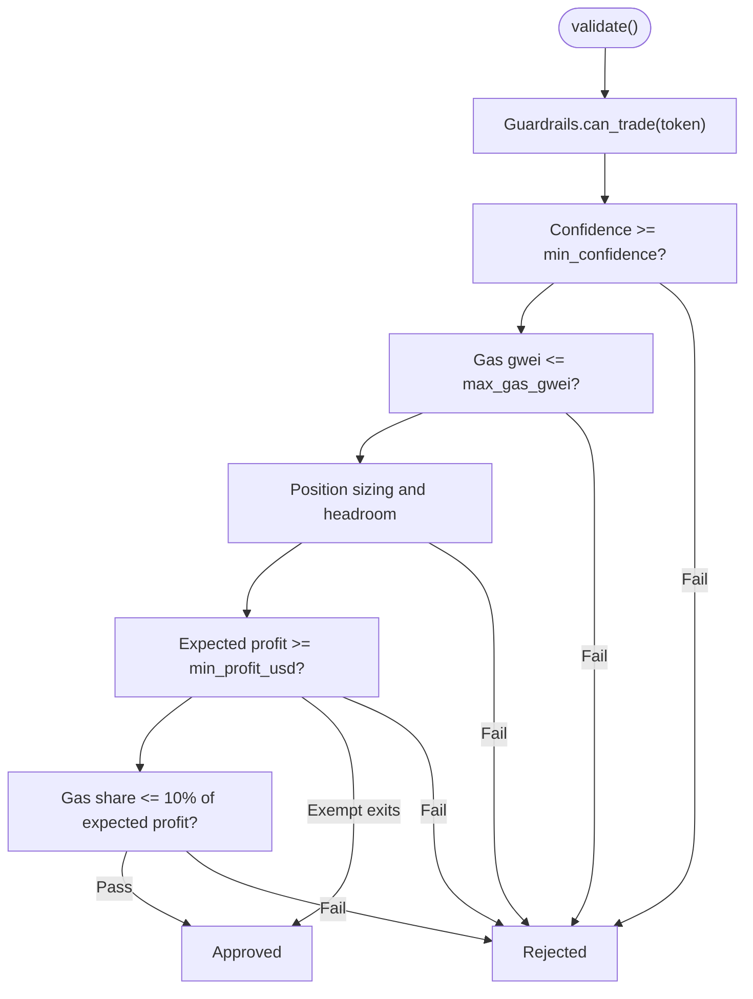
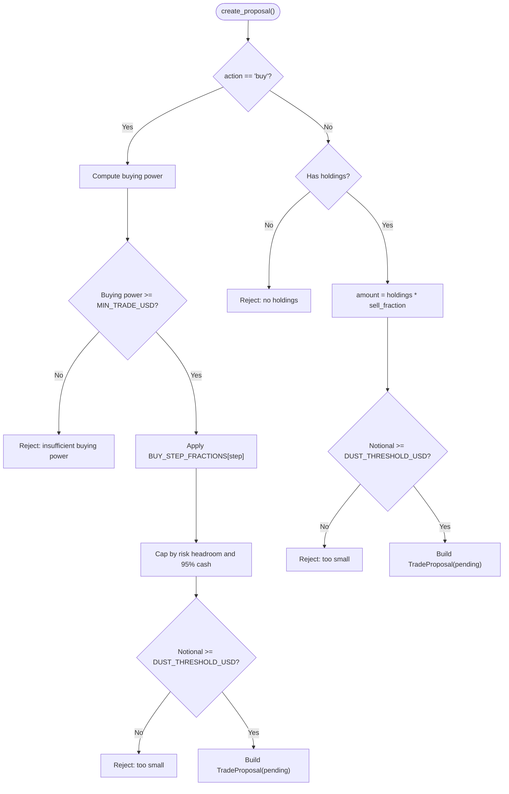
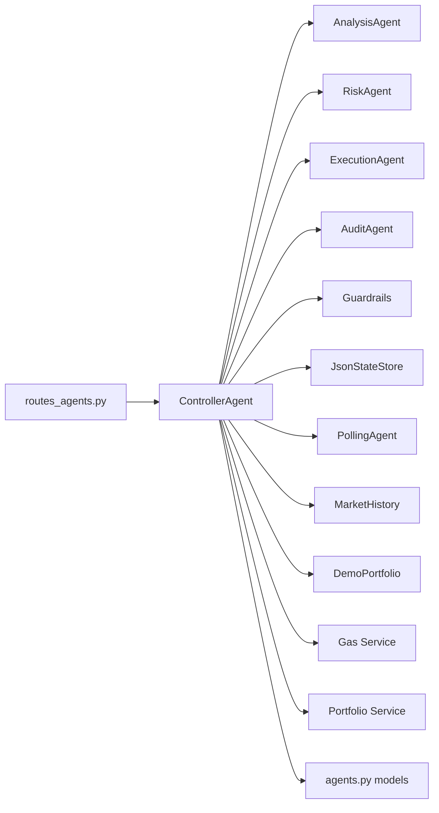

# Agent System Architecture

<cite>
**Referenced Files in This Document**
- [controller.py](file://backend/app/agents/controller.py)
- [analysis_agent.py](file://backend/app/agents/analysis_agent.py)
- [risk_agent.py](file://backend/app/agents/risk_agent.py)
- [execution_agent.py](file://backend/app/agents/execution_agent.py)
- [audit_agent.py](file://backend/app/agents/audit_agent.py)
- [polling_agent.py](file://backend/app/agents/polling_agent.py)
- [langchain_signals.py](file://backend/app/agents/langchain_signals.py)
- [agents.py](file://backend/app/models/agents.py)
- [guardrails.py](file://backend/app/services/guardrails.py)
- [state_store.py](file://backend/app/services/state_store.py)
- [routes_agents.py](file://backend/app/api/routes_agents.py)
</cite>

## Table of Contents
1. [Introduction](#introduction)
2. [Project Structure](#project-structure)
3. [Core Components](#core-components)
4. [Architecture Overview](#architecture-overview)
5. [Detailed Component Analysis](#detailed-component-analysis)
6. [Dependency Analysis](#dependency-analysis)
7. [Performance Considerations](#performance-considerations)
8. [Troubleshooting Guide](#troubleshooting-guide)
9. [Conclusion](#conclusion)

## Introduction
This document explains the agent-based architecture behind DexTrader’s automated trading pipeline. The system is centered on a Controller agent that orchestrates four specialized agents: Analysis, Risk, Execution, and Audit. Market data is polled at regular intervals, filtered to monitored tokens or user holdings, and then processed through a sequential pipeline that produces trade proposals. These proposals are persisted, exposed through API endpoints, and can be completed or rejected by external systems.

The design emphasizes deterministic rule-based analysis, layered risk validation, human-in-the-loop proposal approval, and comprehensive auditability. It also includes portfolio-level guardrails, state persistence, demo-mode simulation, and extensibility points for additional signal sources.

## Project Structure
The agent system lives under `backend/app/agents`, with supporting models, services, and API routes:

```mermaid
graph TB
subgraph "Agents"
C["ControllerAgent<br/>controller.py"]
A["AnalysisAgent<br/>analysis_agent.py"]
R["RiskAgent<br/>risk_agent.py"]
E["ExecutionAgent<br/>execution_agent.py"]
U["AuditAgent<br/>audit_agent.py"]
P["PollingAgent<br/>polling_agent.py"]
L["LangChain Signals<br/>langchain_signals.py"]
end
subgraph "Models"
M["agents.py"]
end
subgraph "Services"
G["Guardrails<br/>guardrails.py"]
S["State Store<br/>state_store.py"]
end
subgraph "API"
API["Agent Routes<br/>routes_agents.py"]
end
API --> C
C --> A
C --> R
C --> E
C --> U
C --> P
C --> G
C --> S
A --> M
R --> M
E --> M
U --> M
L --> M
```

**Diagram sources**
- [controller.py:24-72](file://backend/app/agents/controller.py#L24-L72)
- [analysis_agent.py:10-44](file://backend/app/agents/analysis_agent.py#L10-L44)
- [risk_agent.py:8-22](file://backend/app/agents/risk_agent.py#L8-L22)
- [execution_agent.py:9-25](file://backend/app/agents/execution_agent.py#L9-L25)
- [audit_agent.py:33-37](file://backend/app/agents/audit_agent.py#L33-L37)
- [polling_agent.py:26-43](file://backend/app/agents/polling_agent.py#L26-L43)
- [langchain_signals.py:15-37](file://backend/app/agents/langchain_signals.py#L15-L37)
- [agents.py:5-80](file://backend/app/models/agents.py#L5-L80)
- [guardrails.py:16-38](file://backend/app/services/guardrails.py#L16-L38)
- [state_store.py:22-59](file://backend/app/services/state_store.py#L22-L59)
- [routes_agents.py:1-10](file://backend/app/api/routes_agents.py#L1-L10)

**Section sources**
- [controller.py:24-72](file://backend/app/agents/controller.py#L24-L72)
- [routes_agents.py:1-10](file://backend/app/api/routes_agents.py#L1-L10)

## Core Components
- ControllerAgent: Central orchestrator that starts the polling loop, coordinates agents, manages state, applies guardrails, and persists lifecycle events.
- AnalysisAgent: Rule-based strategy producing buy/sell/hold recommendations using indicators such as RSI, VWAP, volume spikes, and position history.
- RiskAgent: Validation layer enforcing confidence thresholds, gas limits, position sizing, profit expectations, and circuit breaker rules.
- ExecutionAgent: Converts approved recommendations into sized TradeProposal objects with slippage, gas estimates, and status tracking.
- AuditAgent: In-memory log buffer plus rotating file logger for structured audit entries.
- PollingAgent: Cached market data fetcher providing periodic snapshots.
- LangChain Signals: Optional LLM-based signal generator (not part of the main controller pipeline).
- Guardrails: Portfolio-level circuit breakers and daily trade controls.
- StateStore: Atomic JSON persistence for agent state.
- Models: Pydantic schemas for recommendations, assessments, proposals, logs, and status.

**Section sources**
- [controller.py:24-72](file://backend/app/agents/controller.py#L24-L72)
- [analysis_agent.py:10-44](file://backend/app/agents/analysis_agent.py#L10-L44)
- [risk_agent.py:8-22](file://backend/app/agents/risk_agent.py#L8-L22)
- [execution_agent.py:9-25](file://backend/app/agents/execution_agent.py#L9-L25)
- [audit_agent.py:33-37](file://backend/app/agents/audit_agent.py#L33-L37)
- [polling_agent.py:26-43](file://backend/app/agents/polling_agent.py#L26-L43)
- [langchain_signals.py:15-37](file://backend/app/agents/langchain_signals.py#L15-L37)
- [guardrails.py:16-38](file://backend/app/services/guardrails.py#L16-L38)
- [state_store.py:22-59](file://backend/app/services/state_store.py#L22-L59)
- [agents.py:5-80](file://backend/app/models/agents.py#L5-L80)

## Architecture Overview
The Controller runs an asynchronous loop that:
1. Polls market data via PollingAgent.
2. Filters pairs to monitored tokens and user holdings.
3. Records snapshots in MarketHistory.
4. Computes equity and evaluates Guardrails.
5. Invokes AnalysisAgent to generate recommendations.
6. For each recommendation, invokes RiskAgent to validate.
7. If approved, invokes ExecutionAgent to create a TradeProposal.
8. Persists proposals and state, then sleeps until the next interval.



**Diagram sources**
- [controller.py:224-239](file://backend/app/agents/controller.py#L224-L239)
- [controller.py:499-674](file://backend/app/agents/controller.py#L499-L674)
- [polling_agent.py:26-43](file://backend/app/agents/polling_agent.py#L26-L43)
- [guardrails.py:46-71](file://backend/app/services/guardrails.py#L46-L71)
- [analysis_agent.py:76-255](file://backend/app/agents/analysis_agent.py#L76-L255)
- [risk_agent.py:24-190](file://backend/app/agents/risk_agent.py#L24-L190)
- [execution_agent.py:58-179](file://backend/app/agents/execution_agent.py#L58-L179)
- [audit_agent.py:39-60](file://backend/app/agents/audit_agent.py#L39-L60)
- [state_store.py:39-59](file://backend/app/services/state_store.py#L39-L59)

## Detailed Component Analysis

### ControllerAgent
Responsibilities:
- Lifecycle management: start, stop, halt, resume.
- Pipeline orchestration: fetch data, run analysis, risk checks, proposal creation.
- State reconstruction from trades or demo portfolio.
- Position state updates and simulated holdings tracking.
- Guardrail integration and equity computation.
- Proposal lifecycle: pending, approved, rejected, executed; idempotent execution handling.
- Persistence of proposals, position states, last trade times, and guardrail state.

Key behaviors:
- Filtering market pairs to monitored tokens and user holdings.
- Deduplicating pending proposals per token.
- Throttling repeated buy/sell signals within cooldown windows.
- Updating position state on executed proposals and recording trades.
- Persisting state after significant changes.



**Diagram sources**
- [controller.py:24-72](file://backend/app/agents/controller.py#L24-L72)
- [controller.py:224-239](file://backend/app/agents/controller.py#L224-L239)
- [controller.py:269-400](file://backend/app/agents/controller.py#L269-L400)
- [controller.py:499-674](file://backend/app/agents/controller.py#L499-L674)

**Section sources**
- [controller.py:24-72](file://backend/app/agents/controller.py#L24-L72)
- [controller.py:224-239](file://backend/app/agents/controller.py#L224-L239)
- [controller.py:269-400](file://backend/app/agents/controller.py#L269-L400)
- [controller.py:499-674](file://backend/app/agents/controller.py#L499-L674)

### AnalysisAgent
Responsibilities:
- Generate AnalysisRecommendation objects based on price, change, indicators, and position state.
- Implement exit logic: hard stop ladder, trailing stop, scale-out take-profit ladder, runner cap.
- Implement buy logic: dip detection, RSI gate, VWAP discount, volume spike filter, re-entry cooldown after stop-loss.
- Compute confidence and reasons for each recommendation.

Data flow:
- Input: MarketSnapshot, position_states, user_holdings.
- Output: List[AnalysisRecommendation].



**Diagram sources**
- [analysis_agent.py:76-255](file://backend/app/agents/analysis_agent.py#L76-L255)
- [analysis_agent.py:258-349](file://backend/app/agents/analysis_agent.py#L258-L349)

**Section sources**
- [analysis_agent.py:10-44](file://backend/app/agents/analysis_agent.py#L10-L44)
- [analysis_agent.py:76-255](file://backend/app/agents/analysis_agent.py#L76-L255)
- [analysis_agent.py:258-349](file://backend/app/agents/analysis_agent.py#L258-L349)

### RiskAgent
Responsibilities:
- Validate recommendations against confidence, gas caps, position sizing, expected profit, and gas-to-profit ratio.
- Integrate portfolio-level Guardrails for circuit breakers and frequency caps.
- Provide detailed check results for transparency.

Validation sequence:
- Circuit breaker and frequency caps.
- Confidence threshold.
- Gas price ceiling.
- Position sizing and exposure headroom.
- Minimum profit and gas cost proportion.



**Diagram sources**
- [risk_agent.py:24-190](file://backend/app/agents/risk_agent.py#L24-L190)
- [guardrails.py:92-107](file://backend/app/services/guardrails.py#L92-L107)

**Section sources**
- [risk_agent.py:8-22](file://backend/app/agents/risk_agent.py#L8-L22)
- [risk_agent.py:24-190](file://backend/app/agents/risk_agent.py#L24-L190)
- [guardrails.py:92-107](file://backend/app/services/guardrails.py#L92-L107)

### ExecutionAgent
Responsibilities:
- Convert approved recommendations into TradeProposal objects.
- Size buys using step fractions and target position percentage.
- Respect risk layer’s exposure headroom and cash constraints.
- Handle sell sizing based on current holdings and recommended fraction.
- Record successful executions to the trade ledger.

Proposal creation logic:
- For buys: compute buying power, apply step fraction, cap by risk headroom and cash, enforce minimum trade size and dust threshold.
- For sells: ensure holdings exist, compute amount from fraction, enforce dust threshold.



**Diagram sources**
- [execution_agent.py:58-179](file://backend/app/agents/execution_agent.py#L58-L179)

**Section sources**
- [execution_agent.py:9-25](file://backend/app/agents/execution_agent.py#L9-L25)
- [execution_agent.py:58-179](file://backend/app/agents/execution_agent.py#L58-L179)

### AuditAgent
Responsibilities:
- Maintain an in-memory deque of AuditLog entries.
- Write structured logs to a rotating file with levels INFO/WARNING/ERROR.
- Provide retrieval of recent logs.

Behavior:
- Each log entry includes timestamp, agent name, message, level, and optional data payload.
- File logging is resilient to read-only environments.

**Section sources**
- [audit_agent.py:33-64](file://backend/app/agents/audit_agent.py#L33-L64)

### PollingAgent
Responsibilities:
- Provide cached MarketSnapshot with a minimum cache duration of 60 seconds.
- Fetch fresh market pairs when cache expires.

Caching behavior:
- Global cache variables store snapshot and timestamp.
- Cache duration can be configured via API route.

**Section sources**
- [polling_agent.py:26-43](file://backend/app/agents/polling_agent.py#L26-L43)
- [routes_agents.py:141-150](file://backend/app/api/routes_agents.py#L141-L150)

### LangChain Signals
Responsibilities:
- Generate LLM-based trading signals using OpenAI or DeepSeek APIs.
- Parse outputs into Signal objects with source metadata.

Note:
- This module is independent of the Controller pipeline but demonstrates extensibility for AI-driven signals.

**Section sources**
- [langchain_signals.py:15-37](file://backend/app/agents/langchain_signals.py#L15-L37)
- [langchain_signals.py:40-58](file://backend/app/agents/langchain_signals.py#L40-L58)
- [langchain_signals.py:61-123](file://backend/app/agents/langchain_signals.py#L61-L123)

## Dependency Analysis
The Controller depends on multiple services and agents:
- Agents: AnalysisAgent, RiskAgent, ExecutionAgent, AuditAgent.
- Services: Guardrails, MarketHistory, DemoPortfolio, Gas pricing, Portfolio utilities, StateStore.
- Models: AgentStatus, TradeProposal, AnalysisRecommendation, RiskAssessment, AuditLog.
- API: FastAPI routes expose control and observation endpoints.



**Diagram sources**
- [controller.py:6-21](file://backend/app/agents/controller.py#L6-L21)
- [routes_agents.py:1-10](file://backend/app/api/routes_agents.py#L1-L10)

**Section sources**
- [controller.py:6-21](file://backend/app/agents/controller.py#L6-L21)
- [routes_agents.py:1-10](file://backend/app/api/routes_agents.py#L1-L10)

## Performance Considerations
- Polling cache: Market data is cached for at least 60 seconds to avoid redundant network calls and to keep indicator calculations meaningful.
- Loop sleep: The Controller sleeps for the configured polling interval between cycles.
- History usage: MarketHistory provides indicator summaries; warm-up periods may reduce confidence until indicators stabilize.
- State persistence: State is saved after significant changes; atomic writes minimize corruption risk.
- Demo mode: Simulated fills update internal state without blockchain transactions, enabling faster iteration.

[No sources needed since this section provides general guidance]

## Troubleshooting Guide
Common issues and strategies:
- Market data fetch errors: The Controller logs and retries after a short delay.
- Halted trading: Guardrails may halt due to drawdown or manual kill switch; use resume endpoint to continue.
- Duplicate proposals: Pending proposals per token are skipped to avoid duplication.
- Insufficient buying power or dust trades: ExecutionAgent rejects proposals below thresholds.
- Gas price too high: RiskAgent rejects if gas exceeds configured cap.
- State restoration failures: StateStore handles I/O errors gracefully; logs indicate issues.

Operational tips:
- Use `/status` and `/state` endpoints to inspect running state, positions, and indicators.
- Use `/logs` to review recent audit entries.
- Use `/proposals` to monitor pending, approved, rejected, and executed proposals.
- Use `/proposals/{id}/complete` to mark execution and optionally provide a transaction hash.
- Use `/halt` and `/resume` to manage the kill switch.

**Section sources**
- [controller.py:544-550](file://backend/app/agents/controller.py#L544-L550)
- [controller.py:676-678](file://backend/app/agents/controller.py#L676-L678)
- [routes_agents.py:48-58](file://backend/app/api/routes_agents.py#L48-L58)
- [routes_agents.py:97-116](file://backend/app/api/routes_agents.py#L97-L116)
- [state_store.py:39-59](file://backend/app/services/state_store.py#L39-L59)

## Conclusion
DexTrader’s agent system uses a clear, layered pipeline orchestrated by the ControllerAgent. Market data is polled and filtered, analyzed by rule-based logic, validated by risk controls, and converted into executable proposals. The system maintains robust state, supports demo-mode simulation, and exposes comprehensive observability through API endpoints and audit logs. Extensibility is supported through modular agents and optional LLM-based signal generation, while error handling ensures resilience across network, storage, and operational failures.