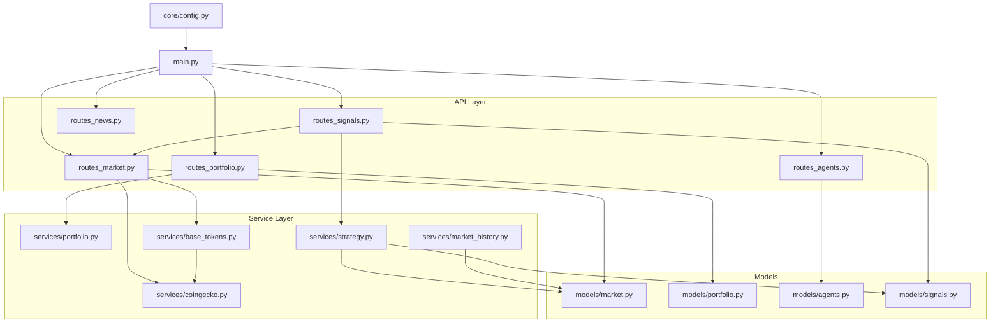
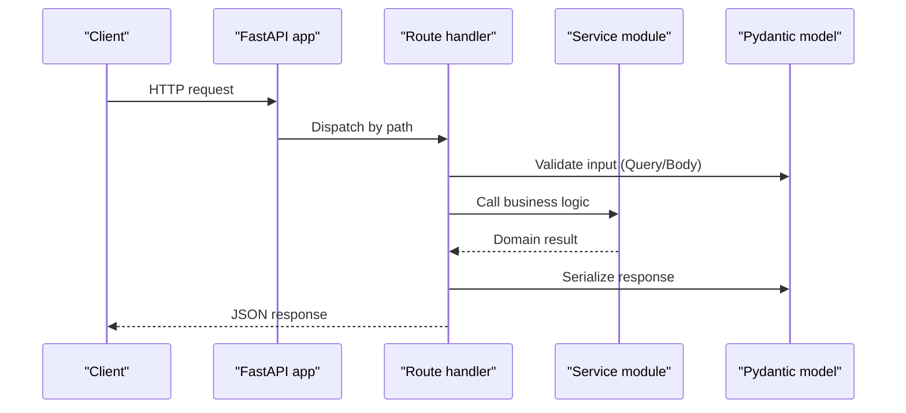
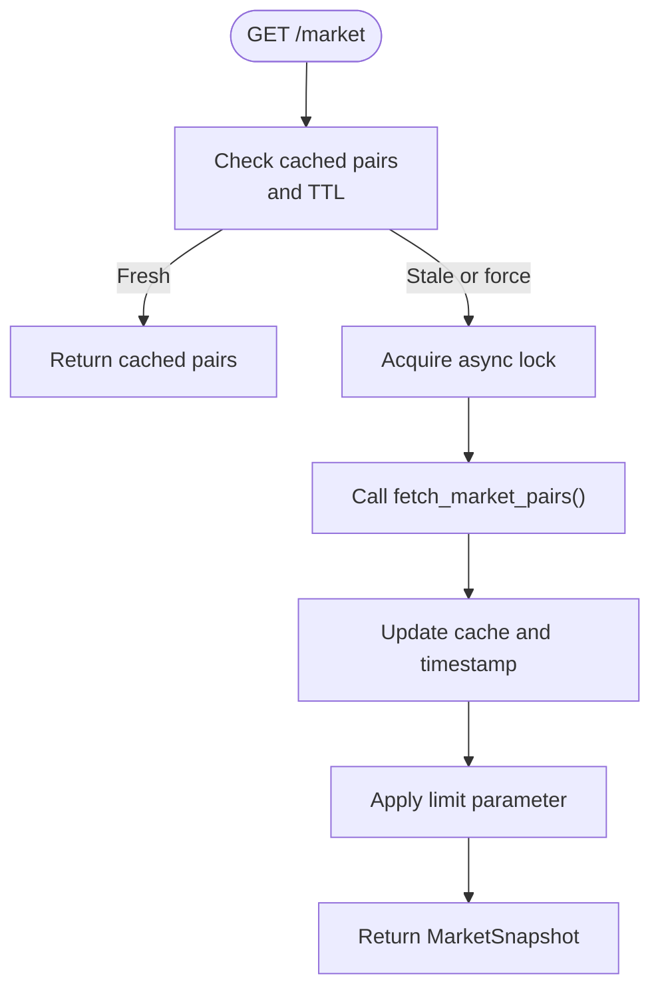
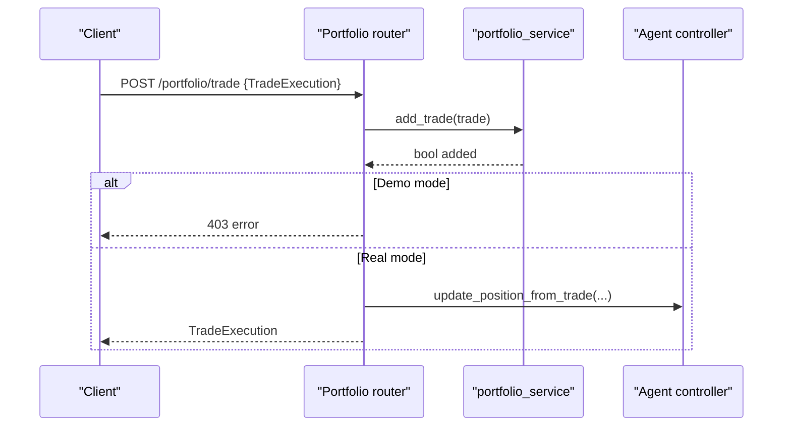
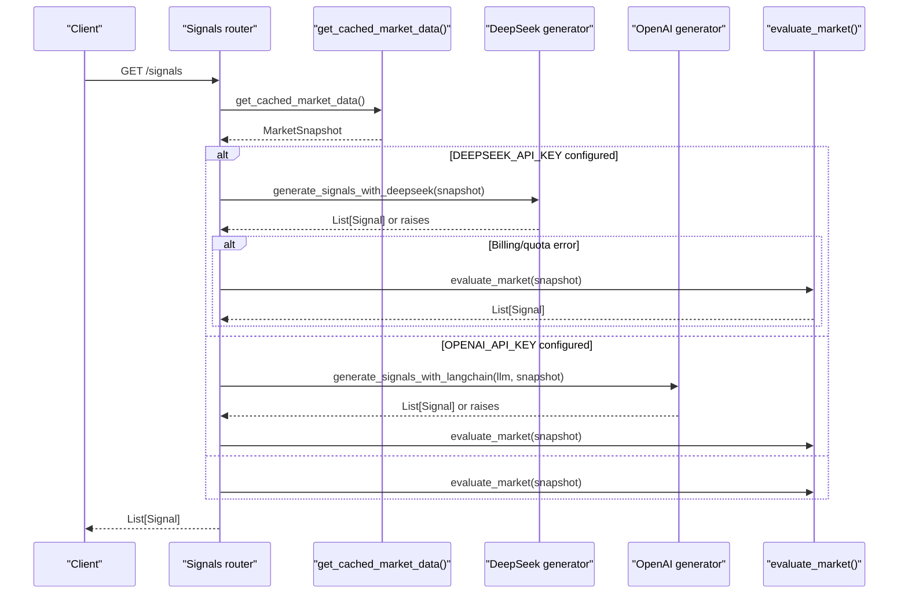
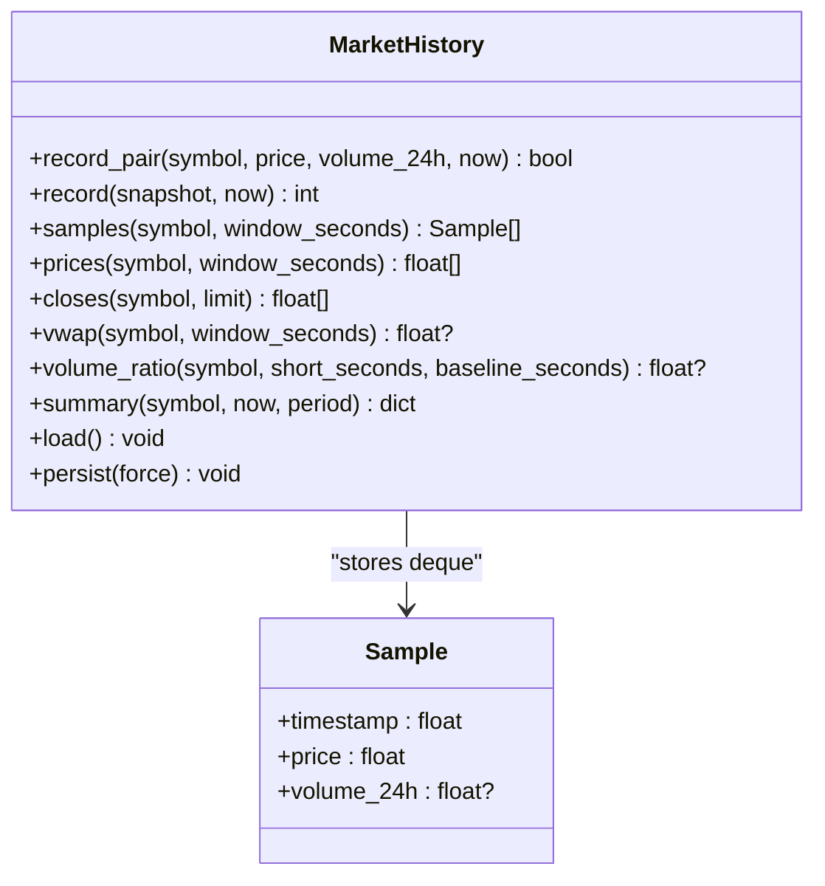
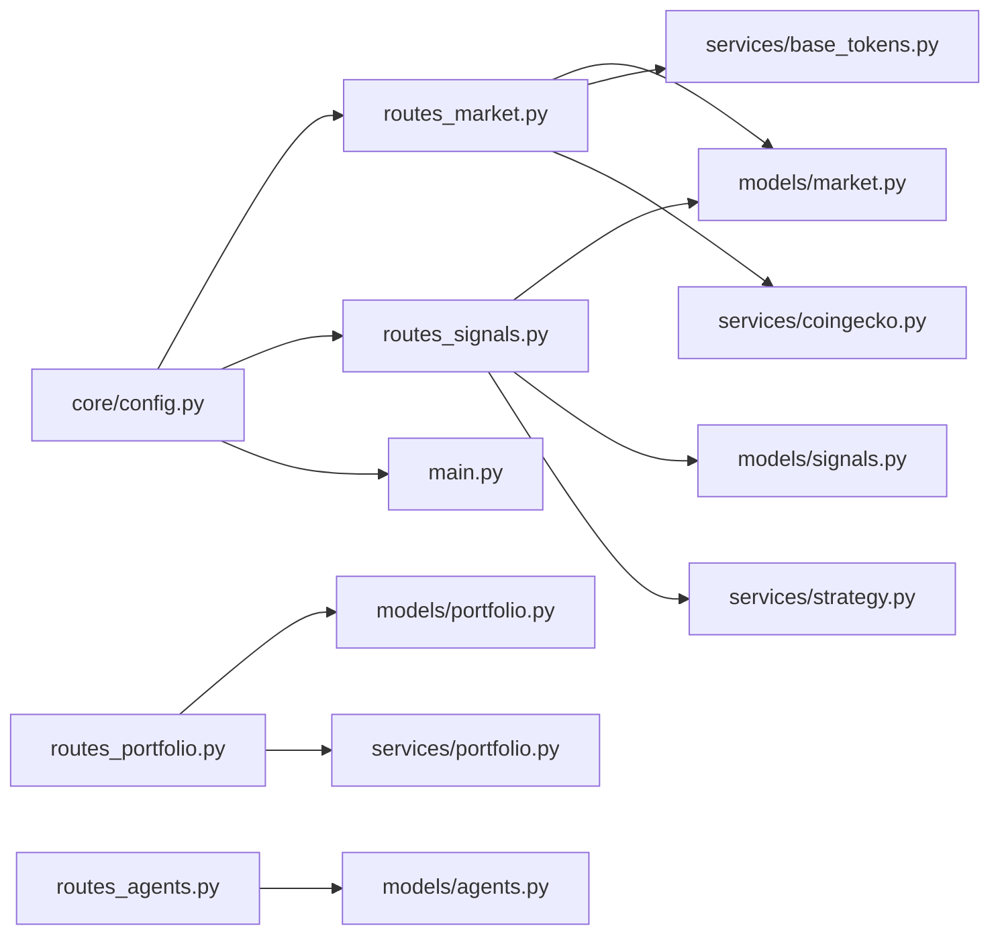

# Backend Architecture

<cite>
**Referenced Files in This Document**
- [main.py](file://backend/app/main.py)
- [config.py](file://backend/app/core/config.py)
- [routes_market.py](file://backend/app/api/routes_market.py)
- [routes_portfolio.py](file://backend/app/api/routes_portfolio.py)
- [routes_agents.py](file://backend/app/api/routes_agents.py)
- [routes_signals.py](file://backend/app/api/routes_signals.py)
- [routes_news.py](file://backend/app/api/routes_news.py)
- [market.py](file://backend/app/models/market.py)
- [portfolio.py](file://backend/app/models/portfolio.py)
- [agents.py](file://backend/app/models/agents.py)
- [signals.py](file://backend/app/models/signals.py)
- [portfolio_service.py](file://backend/app/services/portfolio.py)
- [strategy.py](file://backend/app/services/strategy.py)
- [market_history.py](file://backend/app/services/market_history.py)
- [base_tokens.py](file://backend/app/services/base_tokens.py)
- [coingecko.py](file://backend/app/services/coingecko.py)
</cite>

## Table of Contents
1. [Introduction](#introduction)
2. [Project Structure](#project-structure)
3. [Core Components](#core-components)
4. [Architecture Overview](#architecture-overview)
5. [Detailed Component Analysis](#detailed-component-analysis)
6. [Dependency Analysis](#dependency-analysis)
7. [Performance Considerations](#performance-considerations)
8. [Security and Validation](#security-and-validation)
9. [Troubleshooting Guide](#troubleshooting-guide)
10. [Conclusion](#conclusion)

## Introduction
This document describes the FastAPI backend architecture for DexTrader. The application exposes RESTful endpoints under clearly separated route modules, delegates business logic to service modules, and models all request/response payloads with Pydantic schemas. It supports asynchronous HTTP handling, caching, external market data aggregation, portfolio management, strategy evaluation, and agent control. Configuration is environment-driven, and the middleware stack includes CORS and startup pre-warming tasks.

## Project Structure
The backend follows a layered structure:
- API routes: `app/api/*` define REST endpoints and coordinate requests.
- Services: `app/services/*` implement business logic, external integrations, and stateful computations.
- Models: `app/models/*` define Pydantic schemas for validation and documentation.
- Core: `app/core/config.py` loads environment variables and feature flags.
- Entry point: `app/main.py` wires routers, middleware, and startup tasks.

**Diagram sources**
- [main.py:34-38](file://backend/app/main.py#L34-L38)
- [routes_market.py:10-13](file://backend/app/api/routes_market.py#L10-L13)
- [routes_signals.py:6-11](file://backend/app/api/routes_signals.py#L6-L11)
- [routes_portfolio.py:8-13](file://backend/app/api/routes_portfolio.py#L8-L13)
- [routes_agents.py:6-7](file://backend/app/api/routes_agents.py#L6-L7)
- [market.py:1-42](file://backend/app/models/market.py#L1-L42)
- [portfolio.py:1-37](file://backend/app/models/portfolio.py#L1-L37)
- [agents.py:1-81](file://backend/app/models/agents.py#L1-L81)
- [signals.py:1-16](file://backend/app/models/signals.py#L1-L16)
- [config.py:1-17](file://backend/app/core/config.py#L1-L17)

**Section sources**
- [main.py:14-38](file://backend/app/main.py#L14-L38)
- [config.py:1-17](file://backend/app/core/config.py#L1-L17)

## Core Components
- Application bootstrap and routing:
  - Creates the FastAPI app, registers CORS middleware, mounts routers under `/market`, `/portfolio`, `/agents`, `/signals`, `/news`.
  - Pre-populates caches on startup via background tasks.
  - Provides a health endpoint exposing demo mode status.
- Configuration:
  - Loads `.env` and exposes API keys and feature flags such as `DEMO_MODE`.
- Market data aggregation:
  - Caches aggregated trading pairs from multiple providers.
  - Exposes gainers/losers, base token rankings, and per-chain token volumes.
- Portfolio management:
  - Records trades idempotently, persists to JSON, computes holdings, and supports CSV export.
- Strategy execution:
  - Rule-based signal generation and optional LLM-assisted signals with fallbacks.
- Agent control:
  - Start/stop/halt/resume polling agents, query proposals, logs, and guardrail state.

**Section sources**
- [main.py:14-60](file://backend/app/main.py#L14-L60)
- [config.py:1-17](file://backend/app/core/config.py#L1-L17)
- [routes_market.py:17-58](file://backend/app/api/routes_market.py#L17-L58)
- [routes_portfolio.py:18-138](file://backend/app/api/routes_portfolio.py#L18-L138)
- [routes_signals.py:14-54](file://backend/app/api/routes_signals.py#L14-L54)
- [routes_agents.py:20-149](file://backend/app/api/routes_agents.py#L20-L149)

## Architecture Overview
The system uses a clear separation between HTTP concerns and business logic:
- Routes validate inputs using Pydantic models and FastAPI Query/Body parameters.
- Services encapsulate domain logic, external API calls, caching, and persistence.
- Models provide consistent contracts across layers and auto-generate OpenAPI schemas.

**Diagram sources**
- [main.py:34-38](file://backend/app/main.py#L34-L38)
- [routes_market.py:53-58](file://backend/app/api/routes_market.py#L53-L58)
- [routes_portfolio.py:75-96](file://backend/app/api/routes_portfolio.py#L75-L96)
- [routes_signals.py:20-54](file://backend/app/api/routes_signals.py#L20-L54)
- [market.py:1-42](file://backend/app/models/market.py#L1-L42)
- [portfolio.py:1-37](file://backend/app/models/portfolio.py#L1-L37)
- [signals.py:1-16](file://backend/app/models/signals.py#L1-L16)

## Detailed Component Analysis

### API Layer: Market Data Routes
Responsibilities:
- Aggregate and cache market pairs from provider services.
- Provide derived views: gainers/losers, base token rankings, and chain-specific token volumes.
- Implement robust caching with concurrency guards and rate-limit awareness.

Key behaviors:
- Global cache for market pairs with time-based expiration and refresh flag.
- Base token ranking with dual providers and graceful fallbacks.
- Token volume queries with strict input validation and bounded cache size.

**Diagram sources**
- [routes_market.py:26-58](file://backend/app/api/routes_market.py#L26-L58)

**Section sources**
- [routes_market.py:17-173](file://backend/app/api/routes_market.py#L17-L173)
- [coingecko.py:69-111](file://backend/app/services/coingecko.py#L69-L111)
- [base_tokens.py:315-321](file://backend/app/services/base_tokens.py#L315-L321)

### API Layer: Portfolio Routes
Responsibilities:
- Manage trade recording, retrieval, filtering, and CSV export.
- Support demo mode with simulated portfolio operations.
- Integrate with controller state for position tracking.

Key behaviors:
- Idempotent trade recording keyed by transaction hash.
- Filtering by network, action, and date range.
- Streaming CSV export for trade reports.

**Diagram sources**
- [routes_portfolio.py:75-96](file://backend/app/api/routes_portfolio.py#L75-L96)
- [portfolio_service.py:37-49](file://backend/app/services/portfolio.py#L37-L49)

**Section sources**
- [routes_portfolio.py:18-155](file://backend/app/api/routes_portfolio.py#L18-L155)
- [portfolio_service.py:1-96](file://backend/app/services/portfolio.py#L1-L96)
- [portfolio.py:1-37](file://backend/app/models/portfolio.py#L1-L37)

### API Layer: Agent Control Routes
Responsibilities:
- Start/stop/halt/resume agent polling loops.
- Query agent status, proposals, logs, and guardrail state.
- Complete or reject trade proposals and adjust runtime configuration.

Key behaviors:
- Accepts PollingConfig to set polling interval, monitored tokens, and user holdings.
- Returns structured AgentStatus and AuditLog models.
- Supports dynamic cache duration updates for agents.

**Section sources**
- [routes_agents.py:12-149](file://backend/app/api/routes_agents.py#L12-L149)
- [agents.py:1-81](file://backend/app/models/agents.py#L1-L81)

### API Layer: Signals Route
Responsibilities:
- Generate trading signals from market snapshots.
- Prefer DeepSeek if configured; fall back to OpenAI; finally use rule-based evaluation.

Key behaviors:
- Reuses cached market data to avoid redundant provider calls.
- Handles billing/quota errors gracefully by falling back to rules.

**Diagram sources**
- [routes_signals.py:20-54](file://backend/app/api/routes_signals.py#L20-L54)
- [routes_market.py:26-58](file://backend/app/api/routes_market.py#L26-L58)
- [strategy.py:8-39](file://backend/app/services/strategy.py#L8-L39)

**Section sources**
- [routes_signals.py:1-55](file://backend/app/api/routes_signals.py#L1-L55)
- [strategy.py:1-39](file://backend/app/services/strategy.py#L1-L39)
- [signals.py:1-16](file://backend/app/models/signals.py#L1-L16)

### API Layer: News Aggregation Routes
Responsibilities:
- Aggregate RSS feeds from multiple news sources.
- Clean summaries, extract thumbnails, and cache results.

Key behaviors:
- In-memory cache with configurable TTL.
- Graceful handling of feed failures without breaking other sources.

**Section sources**
- [routes_news.py:1-163](file://backend/app/api/routes_news.py#L1-L163)

### Service Layer: Market History and Indicators
Responsibilities:
- Maintain rolling price/volume history per token.
- Compute indicators like RSI, VWAP, and volume spikes.
- Persist history across restarts with pruning and throttled writes.

Key behaviors:
- Enforces minimum sample intervals and maximum age.
- Provides summary snapshots for analysis layers.

**Diagram sources**
- [market_history.py:30-189](file://backend/app/services/market_history.py#L30-L189)

**Section sources**
- [market_history.py:1-189](file://backend/app/services/market_history.py#L1-L189)

### Service Layer: Base Token Ranking and Provider Integration
Responsibilities:
- Resolve Base-chain token addresses and metrics.
- Rank tokens by market cap or volume with provider fallbacks.
- Cache address maps and platform mappings to reduce external calls.

Key behaviors:
- Uses CoinGecko for candidate pools and metadata.
- Falls back to DexScreener when GeckoTerminal is unavailable.
- Bounded budgets and timeouts prevent long stalls.

**Section sources**
- [base_tokens.py:1-321](file://backend/app/services/base_tokens.py#L1-L321)
- [coingecko.py:177-303](file://backend/app/services/coingecko.py#L177-L303)

## Dependency Analysis
High-level dependencies:
- Routes depend on models for validation and on services for business logic.
- Services depend on external providers (CoinGecko, DexScreener, GeckoTerminal) and internal utilities (indicators, state store).
- Configuration drives provider behavior and feature toggles.

**Diagram sources**
- [routes_market.py:10-13](file://backend/app/api/routes_market.py#L10-L13)
- [routes_signals.py:6-11](file://backend/app/api/routes_signals.py#L6-L11)
- [routes_portfolio.py:8-13](file://backend/app/api/routes_portfolio.py#L8-L13)
- [routes_agents.py:6-7](file://backend/app/api/routes_agents.py#L6-L7)
- [config.py:1-17](file://backend/app/core/config.py#L1-L17)

**Section sources**
- [routes_market.py:1-173](file://backend/app/api/routes_market.py#L1-L173)
- [routes_signals.py:1-55](file://backend/app/api/routes_signals.py#L1-L55)
- [routes_portfolio.py:1-155](file://backend/app/api/routes_portfolio.py#L1-L155)
- [routes_agents.py:1-150](file://backend/app/api/routes_agents.py#L1-L150)
- [config.py:1-17](file://backend/app/core/config.py#L1-L17)

## Performance Considerations
- Caching strategies:
  - Market pairs cache with TTL and concurrency locks to prevent thundering herds.
  - Base token rankings and platform maps cached on disk to survive restarts.
  - Token volumes cache with LRU-like eviction and bounded entries.
  - News feeds cached in memory with time-based expiry.
- External call budgets:
  - Timeouts and retry delays for provider calls to avoid long hangs.
  - Fallback providers (DexScreener) when primary providers fail.
- Asynchronous processing:
  - Startup tasks run in background to pre-warm caches.
  - Async HTTP clients for non-blocking I/O.

[No sources needed since this section provides general guidance]

## Security and Validation
- Input validation:
  - Pydantic models enforce types and constraints for all responses and many requests.
  - Query parameters validated with ge/le/min_length/max_length and regex checks where necessary.
- Authentication and authorization:
  - No built-in authentication middleware is present; access control should be implemented at the gateway or via custom middleware.
- Rate limiting:
  - Provider-side rate limits are handled with retries and fallbacks; application-level rate limiting is not implemented.
- CORS:
  - Configurable via environment variable; defaults to local development origins.
- Error responses:
  - Consistent use of FastAPI’s HTTPException with appropriate status codes and details.

**Section sources**
- [main.py:16-32](file://backend/app/main.py#L16-L32)
- [routes_market.py:121-172](file://backend/app/api/routes_market.py#L121-L172)
- [routes_portfolio.py:75-96](file://backend/app/api/routes_portfolio.py#L75-L96)
- [routes_signals.py:20-54](file://backend/app/api/routes_signals.py#L20-L54)

## Troubleshooting Guide
Common issues and resolutions:
- Market data cache pre-warm failure:
  - Check logs for “Market data cache pre-population failed” and verify provider availability.
- Base token ranking returns stale data:
  - On 429 responses, the route serves cached data; consider forcing refresh or waiting for provider recovery.
- Token volumes invalid query:
  - Ensure chain_id is one of the supported networks and addresses match the expected hex format.
- News feed partial failures:
  - Individual feed errors are logged; check source URLs and network connectivity.
- Demo mode restrictions:
  - Real trade recording is disabled in demo mode; use agent proposal completion to simulate fills.

**Section sources**
- [main.py:41-54](file://backend/app/main.py#L41-L54)
- [routes_market.py:76-109](file://backend/app/api/routes_market.py#L76-L109)
- [routes_market.py:121-172](file://backend/app/api/routes_market.py#L121-L172)
- [routes_news.py:140-146](file://backend/app/api/routes_news.py#L140-L146)
- [routes_portfolio.py:75-82](file://backend/app/api/routes_portfolio.py#L75-L82)

## Conclusion
The DexTrader backend implements a clean separation between HTTP routes, service logic, and data models. It leverages FastAPI’s asynchronous capabilities, Pydantic validation, and modular services to aggregate market data, manage portfolios, execute strategies, and control agents. Robust caching, provider fallbacks, and clear error handling improve reliability. For production deployments, consider adding authentication, authorization, and application-level rate limiting at the gateway or via middleware.

[No sources needed since this section summarizes without analyzing specific files]