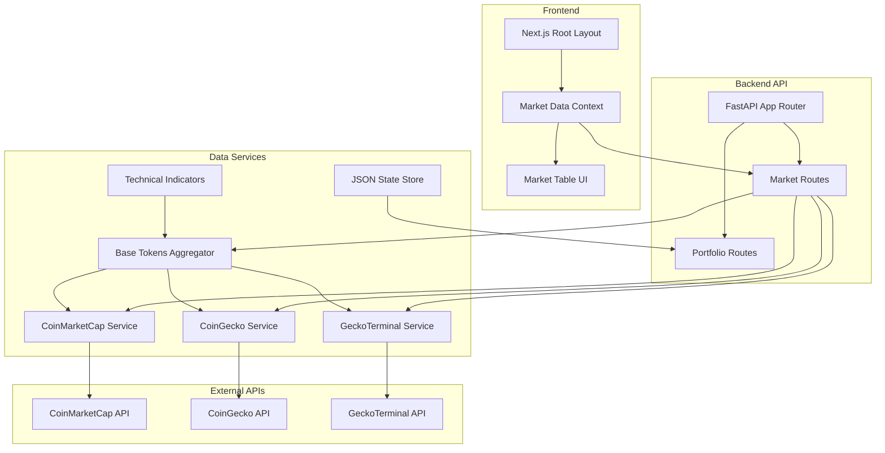
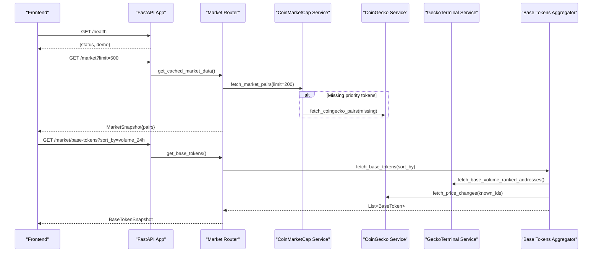
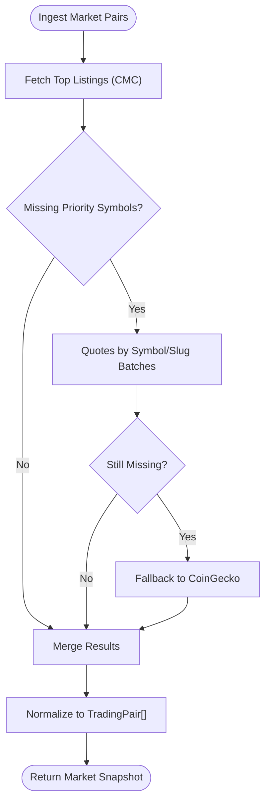
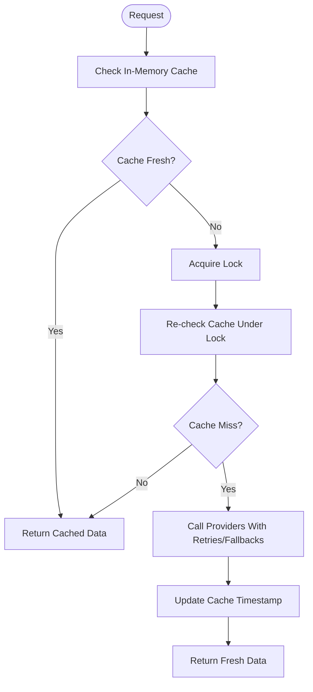
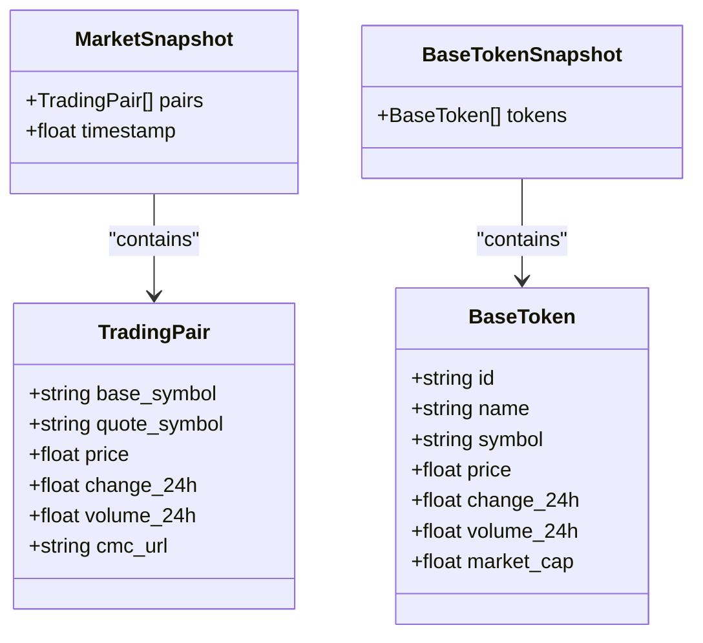
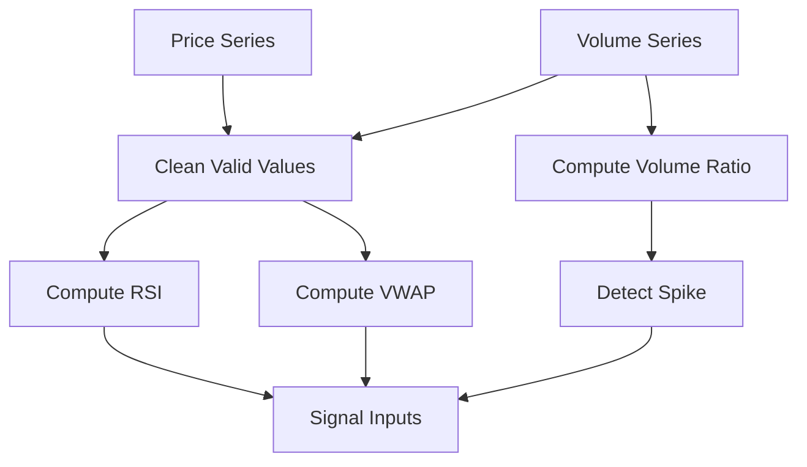
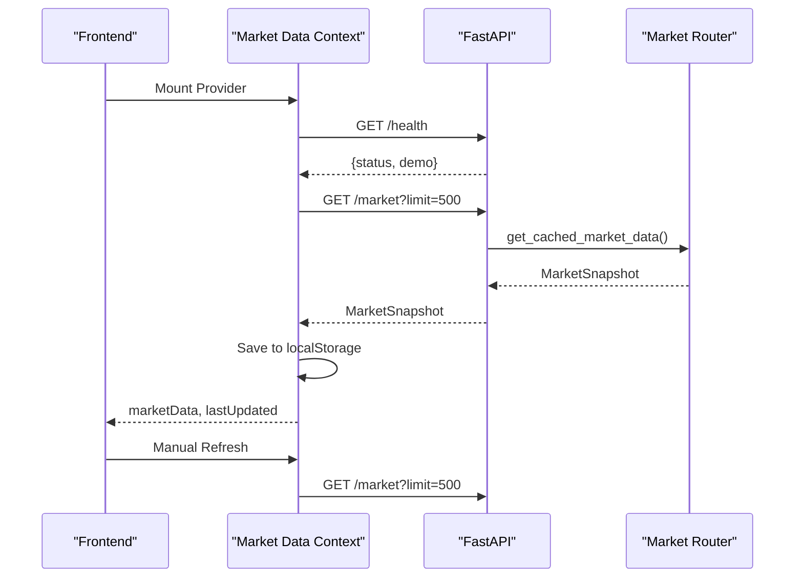
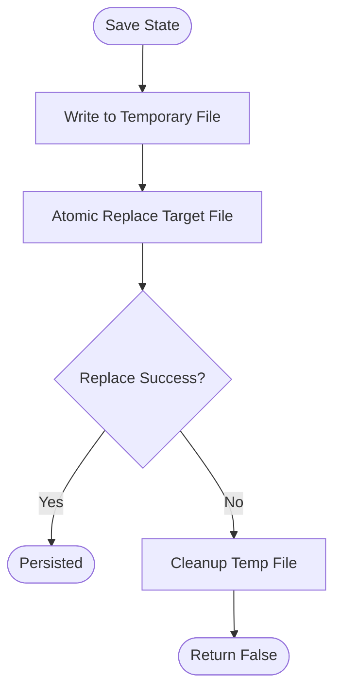
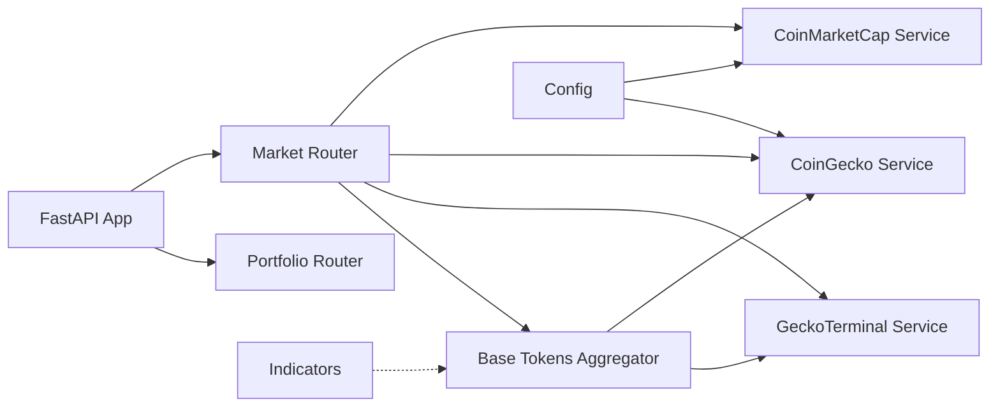

# Data Flow Patterns

<cite>
**Referenced Files in This Document**
- [main.py](file://backend/app/main.py)
- [routes_market.py](file://backend/app/api/routes_market.py)
- [coingecko.py](file://backend/app/services/coingecko.py)
- [coinmarketcap.py](file://backend/app/services/coinmarketcap.py)
- [geckoterminal.py](file://backend/app/services/geckoterminal.py)
- [base_tokens.py](file://backend/app/services/base_tokens.py)
- [indicators.py](file://backend/app/services/indicators.py)
- [state_store.py](file://backend/app/services/state_store.py)
- [market.py](file://backend/app/models/market.py)
- [portfolio.py](file://backend/app/models/portfolio.py)
- [config.py](file://backend/app/core/config.py)
- [layout.tsx](file://frontend/app/layout.tsx)
- [MarketDataContext.tsx](file://frontend/context/MarketDataContext.tsx)
- [MarketTable.tsx](file://frontend/components/MarketTable.tsx)
- [routes_portfolio.py](file://backend/app/api/routes_portfolio.py)
</cite>

## Table of Contents
1. [Introduction](#introduction)
2. [Project Structure](#project-structure)
3. [Core Components](#core-components)
4. [Architecture Overview](#architecture-overview)
5. [Detailed Component Analysis](#detailed-component-analysis)
6. [Dependency Analysis](#dependency-analysis)
7. [Performance Considerations](#performance-considerations)
8. [Troubleshooting Guide](#troubleshooting-guide)
9. [Conclusion](#conclusion)

## Introduction
This document explains DexTrader’s data flow patterns across the system. It covers multi-source market data ingestion from CoinGecko, CoinMarketCap, and GeckoTerminal; caching and error handling for external service failures; transformation from raw market data to normalized TradingPair objects; technical indicator calculations; signal generation inputs; bidirectional frontend-backend data flow including real-time updates; and persistence patterns for portfolio tracking, trade history, and configuration storage. It also documents data consistency, caching strategies, and performance optimization techniques used throughout the pipeline.

## Project Structure
DexTrader is a full-stack application:
- Backend: FastAPI server exposing REST endpoints for market data, portfolio, agents, signals, and news.
- Frontend: Next.js application with React contexts for market data, signals, settings, wallet, and auto-trading state.

**Diagram sources**
- [main.py:14-38](file://backend/app/main.py#L14-L38)
- [routes_market.py:15-58](file://backend/app/api/routes_market.py#L15-L58)
- [routes_portfolio.py:15-10](file://backend/app/api/routes_portfolio.py#L15-L10)
- [coinmarketcap.py:71-187](file://backend/app/services/coinmarketcap.py#L71-L187)
- [coingecko.py:69-111](file://backend/app/services/coingecko.py#L69-L111)
- [geckoterminal.py:149-176](file://backend/app/services/geckoterminal.py#L149-L176)
- [base_tokens.py:315-320](file://backend/app/services/base_tokens.py#L315-L320)
- [indicators.py:17-96](file://backend/app/services/indicators.py#L17-L96)
- [state_store.py:22-59](file://backend/app/services/state_store.py#L22-L59)
- [layout.tsx:16-40](file://frontend/app/layout.tsx#L16-L40)
- [MarketDataContext.tsx:28-142](file://frontend/context/MarketDataContext.tsx#L28-L142)
- [MarketTable.tsx:21-103](file://frontend/components/MarketTable.tsx#L21-L103)

**Section sources**
- [main.py:14-38](file://backend/app/main.py#L14-L38)
- [layout.tsx:16-40](file://frontend/app/layout.tsx#L16-L40)

## Core Components
- Market data ingestion services:
  - CoinMarketCap: top listings plus priority token resolution via quotes by symbol/slug, with fallback to CoinGecko when needed.
  - CoinGecko: price and metadata for symbols mapped to stable coin IDs; ecosystem candidate discovery and Base address mapping.
  - GeckoTerminal: Base-chain DEX metrics (price, FDV, volume), pool scanning for volume ranking, and per-token volumes.
- Normalized models:
  - TradingPair, MarketSnapshot, GainersLosers, BaseToken, BaseTokenSnapshot, TokenVolumesSnapshot.
- Technical indicators:
  - RSI, VWAP, volume ratio, spike detection, percentage change helpers.
- Persistence:
  - JSON-based atomic state store for agent/guardrail/price history and cached mappings.
  - Trade execution records persisted as JSON files through portfolio service.
- Frontend context:
  - Market data provider with local storage cache, health check, and refresh mechanism.

**Section sources**
- [coinmarketcap.py:71-187](file://backend/app/services/coinmarketcap.py#L71-L187)
- [coingecko.py:69-111](file://backend/app/services/coingecko.py#L69-L111)
- [geckoterminal.py:149-176](file://backend/app/services/geckoterminal.py#L149-L176)
- [market.py:5-41](file://backend/app/models/market.py#L5-L41)
- [indicators.py:17-96](file://backend/app/services/indicators.py#L17-L96)
- [state_store.py:22-59](file://backend/app/services/state_store.py#L22-L59)
- [routes_portfolio.py:75-138](file://backend/app/api/routes_portfolio.py#L75-L138)
- [MarketDataContext.tsx:28-142](file://frontend/context/MarketDataContext.tsx#L28-L142)

## Architecture Overview
The backend orchestrates multiple external data providers and caches results to reduce load and latency. The frontend consumes normalized data via REST endpoints and maintains a local cache for resilience.

**Diagram sources**
- [main.py:41-54](file://backend/app/main.py#L41-L54)
- [routes_market.py:26-58](file://backend/app/api/routes_market.py#L26-L58)
- [coinmarketcap.py:71-187](file://backend/app/services/coinmarketcap.py#L71-L187)
- [coingecko.py:69-111](file://backend/app/services/coingecko.py#L69-L111)
- [base_tokens.py:315-320](file://backend/app/services/base_tokens.py#L315-L320)
- [geckoterminal.py:195-241](file://backend/app/services/geckoterminal.py#L195-L241)

## Detailed Component Analysis

### Multi-Source Market Data Ingestion
- CoinMarketCap:
  - Fetches top listings and resolves missing priority tokens via quotes by symbol or slug in batches.
  - Falls back to CoinGecko for any still-missing priority tokens.
  - Uses trial vs pro base URL selection based on configured API key.
- CoinGecko:
  - Maps trading symbols to stable coin IDs and fetches prices, 24h changes, and volumes.
  - Provides ecosystem candidates and Base contract address mapping; rate-limited retry logic.
- GeckoTerminal:
  - Batch-fetches Base-chain token metrics (price, FDV, volume).
  - Scans top pools to rank tokens by attributed 24h DEX volume, skipping quote-to-quote pools.
  - Rate-limit aware retries and page delays.

**Diagram sources**
- [coinmarketcap.py:71-187](file://backend/app/services/coinmarketcap.py#L71-L187)
- [coingecko.py:69-111](file://backend/app/services/coingecko.py#L69-L111)

**Section sources**
- [coinmarketcap.py:71-187](file://backend/app/services/coinmarketcap.py#L71-L187)
- [coingecko.py:69-111](file://backend/app/services/coingecko.py#L69-L111)
- [geckoterminal.py:149-176](file://backend/app/services/geckoterminal.py#L149-L176)

### Caching Strategies and Error Handling
- In-memory caches:
  - Market pairs cache with 1-hour TTL and lock-guarded refresh.
  - Base tokens cache keyed by sort mode with 5-minute TTL.
  - Token volumes cache with LRU eviction and per-address freshness.
- External service resilience:
  - Retry-on-429 with Retry-After respect for CoinGecko.
  - GeckoTerminal retry once on 429 and page delay to stay within public API limits.
  - Fallbacks: CMC -> CoinGecko; GeckoTerminal -> DexScreener for Base metrics; pool scan timeout -> candidate-based ranking.
- Startup pre-population:
  - Background tasks pre-warm market data cache and news feeds on app startup.

**Diagram sources**
- [routes_market.py:17-51](file://backend/app/api/routes_market.py#L17-L51)
- [routes_market.py:70-109](file://backend/app/api/routes_market.py#L70-L109)
- [routes_market.py:112-172](file://backend/app/api/routes_market.py#L112-L172)
- [coingecko.py:155-174](file://backend/app/services/coingecko.py#L155-L174)
- [geckoterminal.py:110-118](file://backend/app/services/geckoterminal.py#L110-L118)
- [main.py:41-54](file://backend/app/main.py#L41-L54)

**Section sources**
- [routes_market.py:17-51](file://backend/app/api/routes_market.py#L17-L51)
- [routes_market.py:70-109](file://backend/app/api/routes_market.py#L70-L109)
- [routes_market.py:112-172](file://backend/app/api/routes_market.py#L112-L172)
- [coingecko.py:155-174](file://backend/app/services/coingecko.py#L155-L174)
- [geckoterminal.py:110-118](file://backend/app/services/geckoterminal.py#L110-L118)
- [main.py:41-54](file://backend/app/main.py#L41-L54)

### Transformation Pipeline: Raw Data to Normalized Models
- Raw payloads from providers are parsed into domain models:
  - TradingPair: base_symbol, quote_symbol, price, change_24h, volume_24h, cmc_url.
  - BaseToken: id, name, symbol, price, change_24h, volume_24h, market_cap.
- Aggregation:
  - Base tokens ranking merges CoinGecko ecosystem candidates, GeckoTerminal/DexScreener metrics, and optional CoinGecko price changes.
- Validation:
  - Numeric fields validated for finiteness and sign; invalid entries skipped or raise errors at boundaries.

**Diagram sources**
- [market.py:5-41](file://backend/app/models/market.py#L5-L41)

**Section sources**
- [market.py:5-41](file://backend/app/models/market.py#L5-L41)
- [base_tokens.py:189-228](file://backend/app/services/base_tokens.py#L189-L228)
- [base_tokens.py:270-312](file://backend/app/services/base_tokens.py#L270-L312)

### Technical Indicator Calculations and Signal Inputs
- Indicators are pure functions operating on sequences of prices/volumes:
  - RSI over closing prices with minimum sample requirements.
  - VWAP using valid price-volume pairs.
  - Volume ratio and spike detection for short vs baseline windows.
  - Percentage change helper for time-series deltas.
- These outputs feed signal generation logic elsewhere in the system (agents/signals routes consume these values to compute actionable signals).

**Diagram sources**
- [indicators.py:17-96](file://backend/app/services/indicators.py#L17-L96)

**Section sources**
- [indicators.py:17-96](file://backend/app/services/indicators.py#L17-L96)

### Bidirectional Frontend-Backend Data Flow
- Frontend:
  - Root layout composes providers for wallet, settings, market data, signals, and auto-trading.
  - Market data context performs health checks, fetches market data, persists to localStorage, and exposes refresh.
  - Market table displays pairs, supports search/filter/sort, and triggers manual refresh.
- Backend:
  - Health endpoint indicates status and demo mode.
  - Market endpoints serve normalized snapshots with caching.
  - Portfolio endpoints accept holdings updates and record trades.

**Diagram sources**
- [layout.tsx:16-40](file://frontend/app/layout.tsx#L16-L40)
- [MarketDataContext.tsx:28-142](file://frontend/context/MarketDataContext.tsx#L28-L142)
- [MarketTable.tsx:21-103](file://frontend/components/MarketTable.tsx#L21-L103)
- [main.py:57-59](file://backend/app/main.py#L57-L59)
- [routes_market.py:53-58](file://backend/app/api/routes_market.py#L53-L58)

**Section sources**
- [layout.tsx:16-40](file://frontend/app/layout.tsx#L16-L40)
- [MarketDataContext.tsx:28-142](file://frontend/context/MarketDataContext.tsx#L28-L142)
- [MarketTable.tsx:21-103](file://frontend/components/MarketTable.tsx#L21-L103)
- [main.py:57-59](file://backend/app/main.py#L57-L59)
- [routes_market.py:53-58](file://backend/app/api/routes_market.py#L53-L58)

### Data Persistence Patterns
- JSON state store:
  - Atomic file writes with temporary files and replace semantics.
  - Thread-safe read/write with reentrant locks.
  - Configurable directory via environment variable.
- Portfolio and trade history:
  - TradeExecution model standardizes trade records across producers/consumers.
  - Portfolio routes expose endpoints to update holdings, record trades, list/export trades, reload from disk, and debug recent trades.
  - Demo mode uses controller-managed simulated portfolio fills.

**Diagram sources**
- [state_store.py:39-59](file://backend/app/services/state_store.py#L39-L59)

**Section sources**
- [state_store.py:22-59](file://backend/app/services/state_store.py#L22-L59)
- [portfolio.py:5-36](file://backend/app/models/portfolio.py#L5-L36)
- [routes_portfolio.py:75-138](file://backend/app/api/routes_portfolio.py#L75-L138)

## Dependency Analysis
Key dependencies and relationships:
- FastAPI app includes routers for market, portfolio, agents, signals, and news.
- Market router depends on services for CoinMarketCap, CoinGecko, GeckoTerminal, and Base tokens aggregation.
- Base tokens aggregator depends on CoinGecko and GeckoTerminal (with DexScreener fallback).
- Indicators are independent utilities consumed by higher-level logic.
- Configuration loads API keys and feature flags from environment.

**Diagram sources**
- [main.py:14-38](file://backend/app/main.py#L14-L38)
- [routes_market.py:10-13](file://backend/app/api/routes_market.py#L10-L13)
- [base_tokens.py:10-20](file://backend/app/services/base_tokens.py#L10-L20)
- [config.py:9-15](file://backend/app/core/config.py#L9-L15)

**Section sources**
- [main.py:14-38](file://backend/app/main.py#L14-L38)
- [routes_market.py:10-13](file://backend/app/api/routes_market.py#L10-L13)
- [base_tokens.py:10-20](file://backend/app/services/base_tokens.py#L10-L20)
- [config.py:9-15](file://backend/app/core/config.py#L9-L15)

## Performance Considerations
- Caching layers:
  - In-process caches with TTLs for market pairs, base tokens, and token volumes.
  - Disk-backed caches for platform maps and address resolution to survive restarts.
- Concurrency control:
  - Async locks prevent thundering herds during cache misses.
  - Ordered LRU cache for token volumes to bound memory usage.
- External API constraints:
  - Respect Retry-After headers and implement bounded retries.
  - Page delays and batch sizes tuned to public API quotas.
- Timeout budgets:
  - Metrics and pool scans have timeouts to avoid long stalls; fallback paths ensure responsiveness.
- Frontend resilience:
  - LocalStorage cache ensures immediate display while fresh data is fetched.
  - Health checks provide early feedback about backend readiness.

[No sources needed since this section provides general guidance]

## Troubleshooting Guide
Common issues and resolutions:
- External API rate limits:
  - Symptoms: HTTP 429 responses, degraded rankings.
  - Behavior: Services retry once with backoff; stale cache may be served for base tokens if refreshed under rate limit.
- Provider outages:
  - Symptoms: Empty or partial data.
  - Behavior: Fallbacks to alternative providers (CMC -> CG; GeckoTerminal -> DexScreener; pool scan -> candidate ranking).
- Frontend connectivity:
  - Symptoms: “Backend not ready” messages.
  - Behavior: Health check fails; context shows error but may return stored data if available.
- Persistence failures:
  - Symptoms: State save returns false.
  - Behavior: Atomic write attempts cleanup; logs I/O errors without crashing requests.

**Section sources**
- [routes_market.py:76-105](file://backend/app/api/routes_market.py#L76-L105)
- [coingecko.py:155-174](file://backend/app/services/coingecko.py#L155-L174)
- [geckoterminal.py:110-118](file://backend/app/services/geckoterminal.py#L110-L118)
- [base_tokens.py:173-187](file://backend/app/services/base_tokens.py#L173-L187)
- [MarketDataContext.tsx:70-120](file://frontend/context/MarketDataContext.tsx#L70-L120)
- [state_store.py:39-59](file://backend/app/services/state_store.py#L39-L59)

## Conclusion
DexTrader implements a robust, multi-source data pipeline that normalizes heterogeneous market data into consistent models, applies technical indicators, and exposes them through a responsive frontend. Caching, concurrency controls, and provider-specific resilience strategies ensure reliability and performance even under rate limits and outages. Persistence mechanisms support portfolio tracking and configuration storage with atomicity guarantees. Together, these patterns deliver a scalable architecture suitable for real-time trading assistance.

[No sources needed since this section summarizes without analyzing specific files]