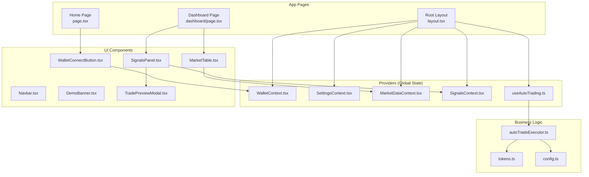
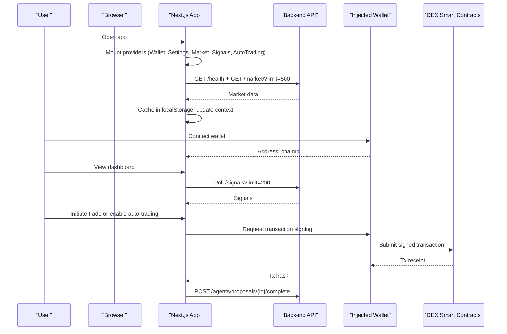
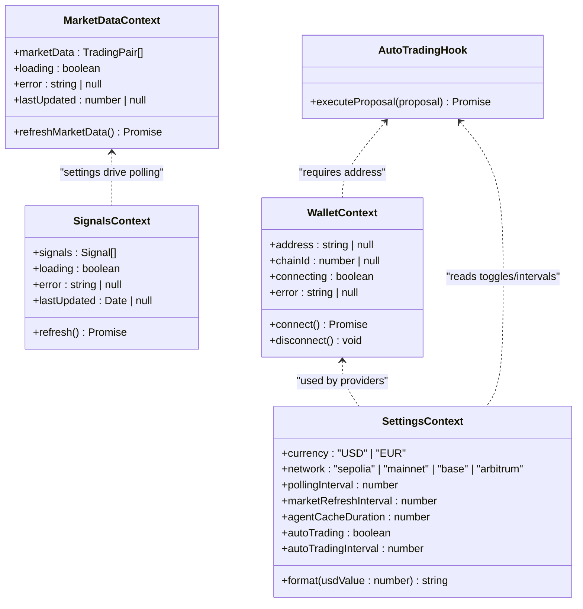
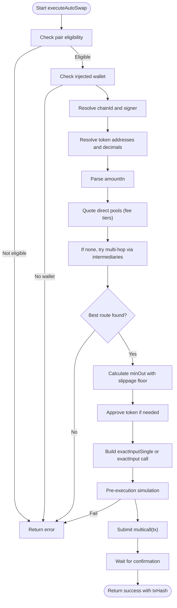
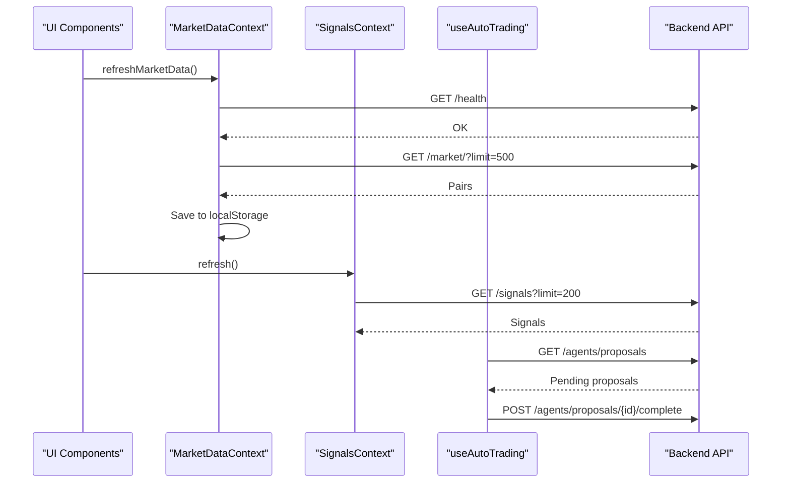
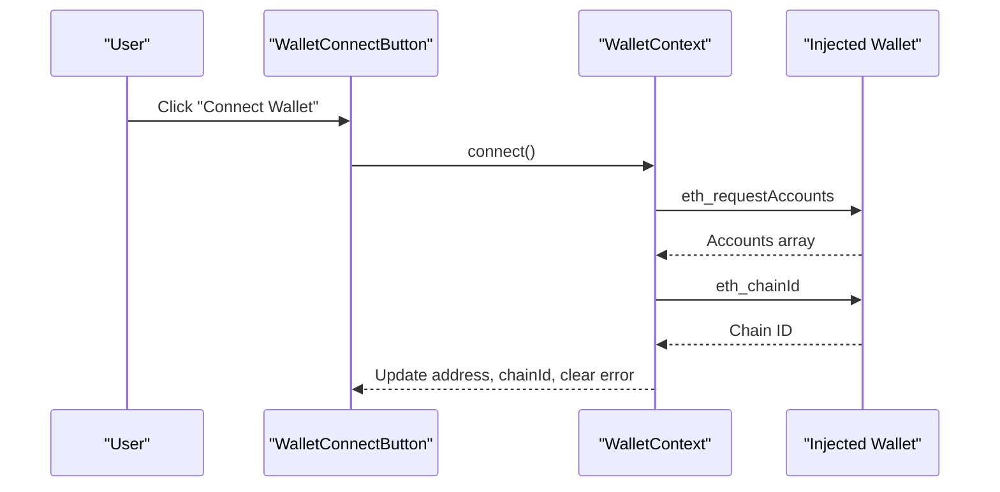
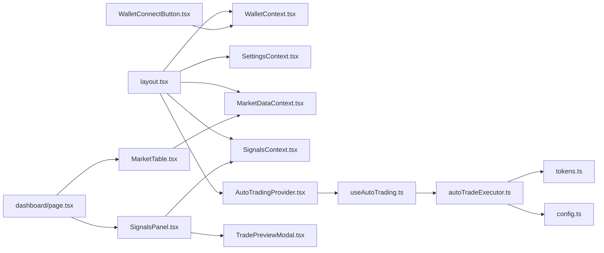

# Frontend Architecture

<cite>
**Referenced Files in This Document**
- [layout.tsx](file://frontend/app/layout.tsx)
- [page.tsx](file://frontend/app/page.tsx)
- [dashboard/page.tsx](file://frontend/app/dashboard/page.tsx)
- [MarketDataContext.tsx](file://frontend/context/MarketDataContext.tsx)
- [SettingsContext.tsx](file://frontend/context/SettingsContext.tsx)
- [SignalsContext.tsx](file://frontend/context/SignalsContext.tsx)
- [WalletContext.tsx](file://frontend/context/WalletContext.tsx)
- [useAutoTrading.ts](file://frontend/hooks/useAutoTrading.ts)
- [autoTradeExecutor.ts](file://frontend/lib/autoTradeExecutor.ts)
- [WalletConnectButton.tsx](file://frontend/components/WalletConnectButton.tsx)
- [MarketTable.tsx](file://frontend/components/MarketTable.tsx)
- [SignalsPanel.tsx](file://frontend/components/SignalsPanel.tsx)
- [TradePreviewModal.tsx](file://frontend/components/TradePreviewModal.tsx)
- [tokens.ts](file://frontend/constants/tokens.ts)
- [config.ts](file://frontend/constants/config.ts)
</cite>

## Table of Contents
1. [Introduction](#introduction)
2. [Project Structure](#project-structure)
3. [Core Components](#core-components)
4. [Architecture Overview](#architecture-overview)
5. [Detailed Component Analysis](#detailed-component-analysis)
6. [Dependency Analysis](#dependency-analysis)
7. [Performance Considerations](#performance-considerations)
8. [Troubleshooting Guide](#troubleshooting-guide)
9. [Conclusion](#conclusion)

## Introduction
This document explains the Next.js frontend architecture for DexTrader, focusing on React with TypeScript, separation of concerns between UI components and context providers, global state management via React Context, and the client-side trading execution model where private keys remain in the browser while the backend provides reasoning and proposal generation. It also covers API integration patterns, real-time data updates, wallet connection flow, responsive design considerations, and modular component architecture.

## Project Structure
The frontend is organized by feature and layer:
- App pages under `app/` define routes and page-level composition.
- Shared UI components live under `components/`.
- Global state and side effects are provided through `context/` providers.
- Business logic for blockchain interactions is encapsulated in `lib/`.
- Network-specific constants (token addresses, routers, quoters) are centralized in `constants/`.
- Configuration such as backend URL and demo mode flags is defined in `constants/config.ts`.

**Diagram sources**
- [layout.tsx:1-41](file://frontend/app/layout.tsx#L1-L41)
- [page.tsx:1-40](file://frontend/app/page.tsx#L1-L40)
- [dashboard/page.tsx:1-76](file://frontend/app/dashboard/page.tsx#L1-L76)
- [MarketDataContext.tsx:1-150](file://frontend/context/MarketDataContext.tsx#L1-L150)
- [SettingsContext.tsx:1-201](file://frontend/context/SettingsContext.tsx#L1-L201)
- [SignalsContext.tsx:1-100](file://frontend/context/SignalsContext.tsx#L1-L100)
- [WalletContext.tsx:1-118](file://frontend/context/WalletContext.tsx#L1-L118)
- [useAutoTrading.ts:1-208](file://frontend/hooks/useAutoTrading.ts#L1-L208)
- [autoTradeExecutor.ts:1-298](file://frontend/lib/autoTradeExecutor.ts#L1-L298)
- [tokens.ts:1-128](file://frontend/constants/tokens.ts#L1-L128)
- [config.ts:1-8](file://frontend/constants/config.ts#L1-L8)

**Section sources**
- [layout.tsx:1-41](file://frontend/app/layout.tsx#L1-L41)
- [page.tsx:1-40](file://frontend/app/page.tsx#L1-L40)
- [dashboard/page.tsx:1-76](file://frontend/app/dashboard/page.tsx#L1-L76)

## Core Components
- Providers:
  - WalletProvider manages injected wallet state (address, chainId), connection lifecycle, and error handling.
  - SettingsProvider persists user preferences (currency, network, polling intervals, auto-trading toggles) to localStorage and exposes formatting utilities.
  - MarketDataProvider fetches market data from the backend, caches it in localStorage, and exposes refresh capabilities.
  - SignalsProvider polls backend signals at a configurable interval and exposes them to UI.
  - AutoTradingProvider mounts useAutoTrading hook to orchestrate proposal polling and execution when conditions are met.

- UI Components:
  - WalletConnectButton renders connect/disconnect controls and displays errors.
  - MarketTable displays filtered/sorted market pairs and supports manual refresh.
  - SignalsPanel lists actionable signals and opens TradePreviewModal for buy/sell flows.
  - TradePreviewModal orchestrates quoting across multiple DEX protocols and networks, then executes trades via the wallet.

- Business Logic:
  - autoTradeExecutor implements automated swap execution on Uniswap V3 (and related routing) using ethers, including approval, slippage handling, gas configuration, and pre-execution simulation.
  - tokens.ts centralizes token addresses and router/quoter contracts per network.
  - config.ts defines BACKEND_URL and DEMO_MODE flags.

**Section sources**
- [WalletContext.tsx:1-118](file://frontend/context/WalletContext.tsx#L1-L118)
- [SettingsContext.tsx:1-201](file://frontend/context/SettingsContext.tsx#L1-L201)
- [MarketDataContext.tsx:1-150](file://frontend/context/MarketDataContext.tsx#L1-L150)
- [SignalsContext.tsx:1-100](file://frontend/context/SignalsContext.tsx#L1-L100)
- [useAutoTrading.ts:1-208](file://frontend/hooks/useAutoTrading.ts#L1-L208)
- [WalletConnectButton.tsx:1-31](file://frontend/components/WalletConnectButton.tsx#L1-L31)
- [MarketTable.tsx:1-259](file://frontend/components/MarketTable.tsx#L1-L259)
- [SignalsPanel.tsx:1-154](file://frontend/components/SignalsPanel.tsx#L1-L154)
- [TradePreviewModal.tsx:1-800](file://frontend/components/TradePreviewModal.tsx#L1-L800)
- [autoTradeExecutor.ts:1-298](file://frontend/lib/autoTradeExecutor.ts#L1-L298)
- [tokens.ts:1-128](file://frontend/constants/tokens.ts#L1-L128)
- [config.ts:1-8](file://frontend/constants/config.ts#L1-L8)

## Architecture Overview
The application follows a provider-driven architecture:
- The root layout wraps all pages with providers to share global state.
- UI components consume contexts via hooks to render data and trigger actions.
- Blockchain interactions occur entirely in the browser; private keys never leave the user’s environment.
- The backend serves market data, signals, and proposals; the frontend executes trades directly against DEX smart contracts.

**Diagram sources**
- [layout.tsx:1-41](file://frontend/app/layout.tsx#L1-L41)
- [MarketDataContext.tsx:66-125](file://frontend/context/MarketDataContext.tsx#L66-L125)
- [SignalsContext.tsx:43-83](file://frontend/context/SignalsContext.tsx#L43-L83)
- [useAutoTrading.ts:124-204](file://frontend/hooks/useAutoTrading.ts#L124-L204)
- [autoTradeExecutor.ts:45-282](file://frontend/lib/autoTradeExecutor.ts#L45-L282)

## Detailed Component Analysis

### Global State Management with React Context
- WalletContext:
  - Manages address, chainId, connecting state, and errors.
  - Subscribes to injected wallet events (accountsChanged, chainChanged).
  - Provides connect/disconnect methods that call eth_requestAccounts and read chainId.

- SettingsContext:
  - Persists currency, network, polling intervals, auto-trading toggle, and auto-trading interval.
  - Loads initial values from localStorage and fetches exchange rates.
  - Exposes format function to display values in selected currency.

- MarketDataContext:
  - On mount, loads cached market data from localStorage, then fetches fresh data after health check.
  - Caches new data back to localStorage and exposes refreshMarketData.

- SignalsContext:
  - Polls /signals endpoint at configured intervals.
  - Tracks loading, error, lastUpdated, and exposes refresh.

- AutoTradingProvider and useAutoTrading:
  - When enabled, polls /agents/proposals and executes eligible ones via autoTradeExecutor.
  - Enforces constraints: demo mode disabled, wallet connected, correct network (Base), allowed targets.

**Diagram sources**
- [WalletContext.tsx:1-118](file://frontend/context/WalletContext.tsx#L1-L118)
- [SettingsContext.tsx:1-201](file://frontend/context/SettingsContext.tsx#L1-L201)
- [MarketDataContext.tsx:1-150](file://frontend/context/MarketDataContext.tsx#L1-L150)
- [SignalsContext.tsx:1-100](file://frontend/context/SignalsContext.tsx#L1-L100)
- [useAutoTrading.ts:1-208](file://frontend/hooks/useAutoTrading.ts#L1-L208)

**Section sources**
- [WalletContext.tsx:1-118](file://frontend/context/WalletContext.tsx#L1-L118)
- [SettingsContext.tsx:1-201](file://frontend/context/SettingsContext.tsx#L1-L201)
- [MarketDataContext.tsx:1-150](file://frontend/context/MarketDataContext.tsx#L1-L150)
- [SignalsContext.tsx:1-100](file://frontend/context/SignalsContext.tsx#L1-L100)
- [useAutoTrading.ts:1-208](file://frontend/hooks/useAutoTrading.ts#L1-L208)

### Client-Side Trading Execution Model
Private keys remain in the browser. The frontend uses ethers to interact with DEX smart contracts:
- Approval: For non-ETH inputs, the executor checks allowance and approves the router if needed.
- Quoting: Executes static calls to QuoterV2 across fee tiers and multi-hop paths to find best output.
- Slippage: Applies dynamic slippage floors for volatile tokens.
- Gas: Configures maxFeePerGas/maxPriorityFeePerGas or legacy gasPrice based on network suggestions.
- Simulation: Runs multicall.staticCall before opening MetaMask to avoid costly failures.
- Execution: Submits multicall with deadline, waits for confirmation, and reports txHash.

**Diagram sources**
- [autoTradeExecutor.ts:45-282](file://frontend/lib/autoTradeExecutor.ts#L45-L282)

**Section sources**
- [autoTradeExecutor.ts:1-298](file://frontend/lib/autoTradeExecutor.ts#L1-L298)

### API Integration Patterns
- Health and Market Data:
  - MarketDataProvider performs a short-lived health check before fetching market data.
  - Data is cached in localStorage and refreshed automatically on mount.

- Signals Polling:
  - SignalsContext polls /signals at intervals derived from settings.
  - UI components can manually trigger refresh.

- Proposals and Completion:
  - useAutoTrading polls /agents/proposals and posts completion with tx_hash upon successful execution.

**Diagram sources**
- [MarketDataContext.tsx:66-125](file://frontend/context/MarketDataContext.tsx#L66-L125)
- [SignalsContext.tsx:43-83](file://frontend/context/SignalsContext.tsx#L43-L83)
- [useAutoTrading.ts:124-204](file://frontend/hooks/useAutoTrading.ts#L124-L204)

**Section sources**
- [MarketDataContext.tsx:1-150](file://frontend/context/MarketDataContext.tsx#L1-L150)
- [SignalsContext.tsx:1-100](file://frontend/context/SignalsContext.tsx#L1-L100)
- [useAutoTrading.ts:1-208](file://frontend/hooks/useAutoTrading.ts#L1-L208)

### Wallet Connection Flow
- WalletConnectButton triggers connect(), which requests accounts via the injected wallet.
- WalletContext listens to account and chain change events to keep state synchronized.
- Error states are surfaced to the UI for user feedback.

**Diagram sources**
- [WalletConnectButton.tsx:1-31](file://frontend/components/WalletConnectButton.tsx#L1-L31)
- [WalletContext.tsx:74-102](file://frontend/context/WalletContext.tsx#L74-L102)

**Section sources**
- [WalletConnectButton.tsx:1-31](file://frontend/components/WalletConnectButton.tsx#L1-L31)
- [WalletContext.tsx:1-118](file://frontend/context/WalletContext.tsx#L1-L118)

### Responsive Design and Modular Architecture
- Responsive layouts:
  - Tailwind utility classes are used throughout for responsive grids, spacing, typography, and color schemes.
  - Dashboard uses conditional grid columns to adapt to screen sizes.

- Modular components:
  - Each feature has its own page and supporting components.
  - Providers encapsulate cross-cutting concerns (wallet, settings, market data, signals, auto-trading).
  - Constants separate token/router definitions from business logic.

**Section sources**
- [dashboard/page.tsx:54-73](file://frontend/app/dashboard/page.tsx#L54-L73)
- [MarketTable.tsx:109-259](file://frontend/components/MarketTable.tsx#L109-L259)
- [tokens.ts:1-128](file://frontend/constants/tokens.ts#L1-L128)

## Dependency Analysis
The following diagram shows key dependencies among providers, hooks, and components:

**Diagram sources**
- [layout.tsx:1-41](file://frontend/app/layout.tsx#L1-L41)
- [useAutoTrading.ts:1-208](file://frontend/hooks/useAutoTrading.ts#L1-L208)
- [autoTradeExecutor.ts:1-298](file://frontend/lib/autoTradeExecutor.ts#L1-L298)
- [tokens.ts:1-128](file://frontend/constants/tokens.ts#L1-L128)
- [config.ts:1-8](file://frontend/constants/config.ts#L1-L8)
- [dashboard/page.tsx:1-76](file://frontend/app/dashboard/page.tsx#L1-L76)
- [MarketTable.tsx:1-259](file://frontend/components/MarketTable.tsx#L1-L259)
- [SignalsPanel.tsx:1-154](file://frontend/components/SignalsPanel.tsx#L1-L154)
- [TradePreviewModal.tsx:1-800](file://frontend/components/TradePreviewModal.tsx#L1-L800)
- [WalletConnectButton.tsx:1-31](file://frontend/components/WalletConnectButton.tsx#L1-L31)

**Section sources**
- [layout.tsx:1-41](file://frontend/app/layout.tsx#L1-L41)
- [useAutoTrading.ts:1-208](file://frontend/hooks/useAutoTrading.ts#L1-L208)
- [autoTradeExecutor.ts:1-298](file://frontend/lib/autoTradeExecutor.ts#L1-L298)
- [tokens.ts:1-128](file://frontend/constants/tokens.ts#L1-L128)
- [config.ts:1-8](file://frontend/constants/config.ts#L1-L8)
- [dashboard/page.tsx:1-76](file://frontend/app/dashboard/page.tsx#L1-L76)
- [MarketTable.tsx:1-259](file://frontend/components/MarketTable.tsx#L1-L259)
- [SignalsPanel.tsx:1-154](file://frontend/components/SignalsPanel.tsx#L1-L154)
- [TradePreviewModal.tsx:1-800](file://frontend/components/TradePreviewModal.tsx#L1-L800)
- [WalletConnectButton.tsx:1-31](file://frontend/components/WalletConnectButton.tsx#L1-L31)

## Performance Considerations
- LocalStorage caching:
  - Market data is persisted to reduce perceived latency and provide instant display while fresh data is fetched.
- Polling intervals:
  - Signals and auto-trading rely on configurable intervals to balance freshness and network load.
- Efficient quoting:
  - Static calls are used for quotes and simulations to avoid unnecessary on-chain operations.
- Gas optimization:
  - Gas parameters are set based on network suggestions; multi-hop routes receive higher gas limits.
- Staleness guard:
  - Auto-trading skips stale proposals to prevent outdated trades after system sleep/wake.

[No sources needed since this section provides general guidance]

## Troubleshooting Guide
- Backend not ready:
  - MarketDataProvider surfaces a friendly message when the backend health check fails.
- No injected wallet:
  - WalletContext sets an error when no ethereum object is detected.
- Wrong network:
  - Auto-trading disables itself unless the network matches the expected chain (Base).
- No liquidity route:
  - autoTradeExecutor returns a descriptive error when no direct or multi-hop route is found.
- Pre-execution simulation failure:
  - Errors from staticCall are surfaced to the user before opening the wallet confirmation.

**Section sources**
- [MarketDataContext.tsx:70-120](file://frontend/context/MarketDataContext.tsx#L70-L120)
- [WalletContext.tsx:74-97](file://frontend/context/WalletContext.tsx#L74-L97)
- [useAutoTrading.ts:95-117](file://frontend/hooks/useAutoTrading.ts#L95-L117)
- [autoTradeExecutor.ts:151-153](file://frontend/lib/autoTradeExecutor.ts#L151-L153)
- [autoTradeExecutor.ts:252-259](file://frontend/lib/autoTradeExecutor.ts#L252-L259)

## Conclusion
The DexTrader frontend employs a clean separation of concerns: UI components focus on presentation and user interaction, while providers manage global state and side effects. The client-side trading model ensures private keys remain in the browser, with the backend providing market data, signals, and proposals. Robust quoting, simulation, and error handling make the execution path reliable and user-friendly. Responsive design and modular architecture support maintainability and scalability.