# System Architecture

<cite>
**Referenced Files in This Document**
- [README.md](file://README.md)
- [docker-compose.yml](file://docker-compose.yml)
- [backend/app/main.py](file://backend/app/main.py)
- [backend/app/api/routes_agents.py](file://backend/app/api/routes_agents.py)
- [backend/app/agents/controller.py](file://backend/app/agents/controller.py)
- [backend/app/agents/analysis_agent.py](file://backend/app/agents/analysis_agent.py)
- [backend/app/agents/risk_agent.py](file://backend/app/agents/risk_agent.py)
- [backend/app/agents/execution_agent.py](file://backend/app/agents/execution_agent.py)
- [backend/app/agents/audit_agent.py](file://backend/app/agents/audit_agent.py)
- [backend/app/models/agents.py](file://backend/app/models/agents.py)
- [backend/app/services/state_store.py](file://backend/app/services/state_store.py)
- [frontend/app/layout.tsx](file://frontend/app/layout.tsx)
- [frontend/components/WalletConnectButton.tsx](file://frontend/components/WalletConnectButton.tsx)
- [frontend/context/WalletContext.tsx](file://frontend/context/WalletContext.tsx)
- [frontend/lib/autoTradeExecutor.ts](file://frontend/lib/autoTradeExecutor.ts)
</cite>

## Table of Contents
1. [Introduction](#introduction)
2. [Project Structure](#project-structure)
3. [Core Components](#core-components)
4. [Architecture Overview](#architecture-overview)
5. [Detailed Component Analysis](#detailed-component-analysis)
6. [Dependency Analysis](#dependency-analysis)
7. [Performance Considerations](#performance-considerations)
8. [Security Model](#security-model)
9. [Deployment Topology and Scalability](#deployment-topology-and-scalability)
10. [Client-Server Communication Model](#client-server-communication-model)
11. [State Management Approach](#state-management-approach)
12. [Troubleshooting Guide](#troubleshooting-guide)
13. [Conclusion](#conclusion)

## Introduction
DexTrader is a semi-autonomous crypto trading system with a clear separation between server-side reasoning and client-side execution. The FastAPI backend ingests market data, runs an agent pipeline, and produces trade proposals. The Next.js frontend connects to the user’s browser wallet, reviews or auto-executes proposals, signs transactions on-chain, and reports results back to the backend. Private keys never leave the browser; the backend only proposes trades.

The system implements rule-based analysis (RSI, VWAP, volume spikes), mechanical exits (stop ladder, trailing stop, scale-out ladder), risk validation (position caps, gas limits, profit filters, circuit breakers), and audit logging. State is persisted as JSON files rather than a database, making it simple but not multi-process safe.

**Section sources**
- [README.md:1-20](file://README.md#L1-L20)
- [README.md:15-20](file://README.md#L15-L20)
- [README.md:101-115](file://README.md#L101-L115)
- [README.md:168-183](file://README.md#L168-L183)

## Project Structure
The repository is split into two main layers:

- **Backend (`backend/`)**: FastAPI application with routers, agents, services, models, and JSON-backed persistence.
- **Frontend (`frontend/`)**: Next.js App Router application with React contexts for wallet, settings, market data, signals, and auto-trading.

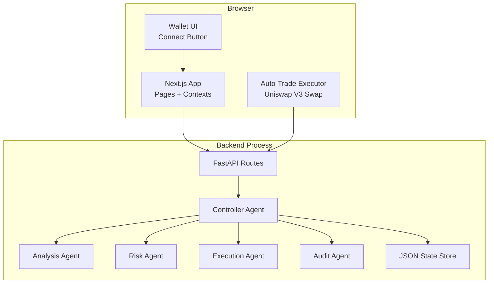

**Diagram sources**
- [backend/app/main.py:14-38](file://backend/app/main.py#L14-L38)
- [backend/app/api/routes_agents.py:20-149](file://backend/app/api/routes_agents.py#L20-L149)
- [backend/app/agents/controller.py:24-72](file://backend/app/agents/controller.py#L24-L72)
- [backend/app/services/state_store.py:22-59](file://backend/app/services/state_store.py#L22-L59)
- [frontend/app/layout.tsx:16-40](file://frontend/app/layout.tsx#L16-L40)
- [frontend/components/WalletConnectButton.tsx:4-30](file://frontend/components/WalletConnectButton.tsx#L4-L30)
- [frontend/lib/autoTradeExecutor.ts:44-282](file://frontend/lib/autoTradeExecutor.ts#L44-L282)

**Section sources**
- [README.md:116-144](file://README.md#L116-L144)
- [backend/app/main.py:14-38](file://backend/app/main.py#L14-L38)
- [frontend/app/layout.tsx:16-40](file://frontend/app/layout.tsx#L16-L40)

## Core Components
The core runtime is centered around the `ControllerAgent`, which orchestrates four specialized agents:

| Component | Responsibility | Key Behavior |
|---|---|---|
| `ControllerAgent` | Orchestrates the polling loop, lifecycle, state reconstruction, proposal management, and guardrail integration | Runs market polling, filters tokens, updates holdings, computes equity, coordinates Analysis → Risk → Execution, persists state |
| `AnalysisAgent` | Rule-based strategy engine | Generates buy/sell/hold recommendations using RSI(14), VWAP deviation, volume spike filter, stop ladder, trailing stop, and scale-out ladder |
| `RiskAgent` | Validation layer | Enforces confidence thresholds, gas ceilings, position exposure, minimum profit, gas-to-profit ratio, and guardrail circuit breakers |
| `ExecutionAgent` | Proposal factory | Converts approved recommendations into sized `TradeProposal` objects with slippage, gas estimates, and auto-trade eligibility |
| `AuditAgent` | Observability | Writes rotating file logs and keeps a bounded in-memory log buffer for the UI |

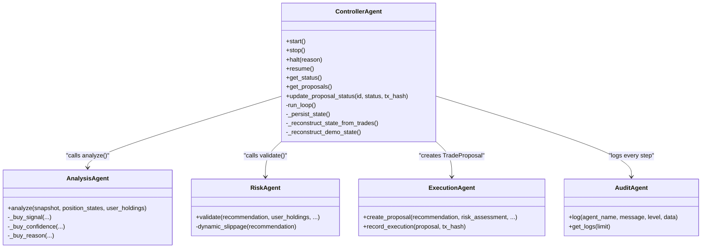

**Diagram sources**
- [backend/app/agents/controller.py:24-72](file://backend/app/agents/controller.py#L24-L72)
- [backend/app/agents/controller.py:224-260](file://backend/app/agents/controller.py#L224-L260)
- [backend/app/agents/controller.py:499-683](file://backend/app/agents/controller.py#L499-L683)
- [backend/app/agents/analysis_agent.py:10-81](file://backend/app/agents/analysis_agent.py#L10-L81)
- [backend/app/agents/risk_agent.py:8-33](file://backend/app/agents/risk_agent.py#L8-L33)
- [backend/app/agents/execution_agent.py:9-25](file://backend/app/agents/execution_agent.py#L9-L25)
- [backend/app/agents/audit_agent.py:33-63](file://backend/app/agents/audit_agent.py#L33-L63)

**Section sources**
- [backend/app/agents/controller.py:24-72](file://backend/app/agents/controller.py#L24-L72)
- [backend/app/agents/analysis_agent.py:10-81](file://backend/app/agents/analysis_agent.py#L10-L81)
- [backend/app/agents/risk_agent.py:8-33](file://backend/app/agents/risk_agent.py#L8-L33)
- [backend/app/agents/execution_agent.py:9-25](file://backend/app/agents/execution_agent.py#L9-L25)
- [backend/app/agents/audit_agent.py:33-63](file://backend/app/agents/audit_agent.py#L33-L63)

## Architecture Overview
DexTrader follows a microservices-style boundary between a browser-hosted frontend and a single FastAPI backend process. The frontend owns the wallet connection and on-chain signing; the backend owns market data ingestion, signal generation, agent reasoning, proposal creation, and ledger persistence.

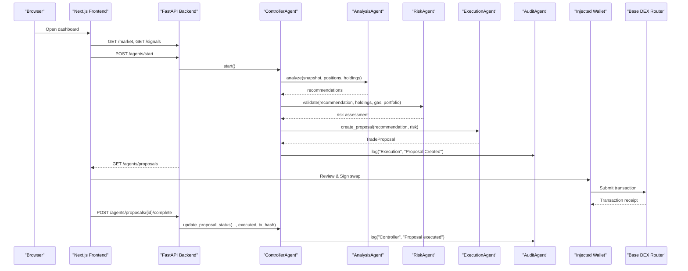

**Diagram sources**
- [backend/app/main.py:34-38](file://backend/app/main.py#L34-L38)
- [backend/app/api/routes_agents.py:30-39](file://backend/app/api/routes_agents.py#L30-L39)
- [backend/app/api/routes_agents.py:87-116](file://backend/app/api/routes_agents.py#L87-L116)
- [backend/app/agents/controller.py:224-260](file://backend/app/agents/controller.py#L224-L260)
- [backend/app/agents/controller.py:499-683](file://backend/app/agents/controller.py#L499-L683)
- [frontend/lib/autoTradeExecutor.ts:44-282](file://frontend/lib/autoTradeExecutor.ts#L44-L282)

**Section sources**
- [README.md:3-10](file://README.md#L3-L10)
- [README.md:15-20](file://README.md#L15-L20)
- [backend/app/api/routes_agents.py:30-116](file://backend/app/api/routes_agents.py#L30-L116)
- [backend/app/agents/controller.py:499-683](file://backend/app/agents/controller.py#L499-L683)

## Detailed Component Analysis

### Controller Agent
The controller is the central orchestrator. It maintains running state, polls market data, filters monitored tokens and current holdings, records indicator samples, computes equity, enforces guardrails, and drives the Analysis → Risk → Execution pipeline. It also reconstructs position state from the trade ledger or demo portfolio and persists proposals, guardrail counters, and per-token strategy state.

Key responsibilities:
- Lifecycle control: `start`, `stop`, `halt`, `resume`.
- Market data polling and snapshot filtering.
- Equity calculation and daily drawdown tracking.
- Duplicate proposal prevention and proposal timing guards.
- Demo-mode fill simulation versus real trade recording.
- Position state updates for buys, sells, stop-losses, trailing stops, and scale-outs.

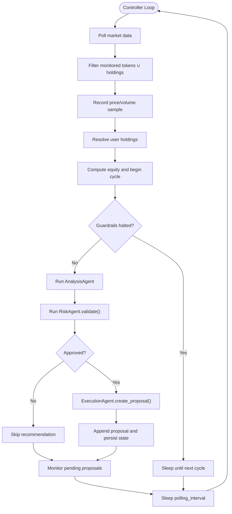

**Diagram sources**
- [backend/app/agents/controller.py:499-683](file://backend/app/agents/controller.py#L499-L683)

**Section sources**
- [backend/app/agents/controller.py:24-72](file://backend/app/agents/controller.py#L24-L72)
- [backend/app/agents/controller.py:127-221](file://backend/app/agents/controller.py#L127-L221)
- [backend/app/agents/controller.py:268-478](file://backend/app/agents/controller.py#L268-L478)
- [backend/app/agents/controller.py:499-683](file://backend/app/agents/controller.py#L499-L683)

### Analysis Agent
The analysis agent implements the trading strategy rules. It evaluates exits first (stop ladder, trailing stop, scale-out ladder), then considers buys when no exit is triggered. It uses RSI, VWAP, and a volume-spike proxy derived from rolling history. Indicators that are still warming up return `None`, and the agent avoids fabricating neutral values.

Important behaviors:
- Stablecoins are excluded from analysis and position state.
- Exit kinds include `stop_loss`, `trailing_stop`, and `take_profit`.
- Buy steps are capped at four, with increasing target fractions.
- Confidence is adjusted by indicator readiness, RSI depth, VWAP discount, volume spike, and dip severity.

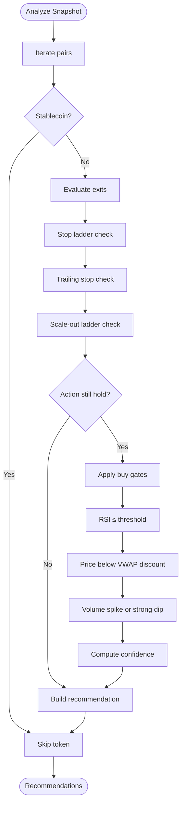

**Diagram sources**
- [backend/app/agents/analysis_agent.py:10-81](file://backend/app/agents/analysis_agent.py#L10-L81)
- [backend/app/agents/analysis_agent.py:125-255](file://backend/app/agents/analysis_agent.py#L125-L255)
- [backend/app/agents/analysis_agent.py:258-349](file://backend/app/agents/analysis_agent.py#L258-L349)

**Section sources**
- [backend/app/agents/analysis_agent.py:10-81](file://backend/app/agents/analysis_agent.py#L10-L81)
- [backend/app/agents/analysis_agent.py:125-255](file://backend/app/agents/analysis_agent.py#L125-L255)
- [backend/app/agents/analysis_agent.py:258-349](file://backend/app/agents/analysis_agent.py#L258-L349)

### Risk Agent
The risk agent validates each recommendation before a proposal is created. It checks circuit breakers, confidence, gas ceiling, holdings for sells, position exposure, minimum expected profit, and gas-to-profit ratio. It also computes dynamic slippage based on price change magnitude and volume spikes.

Key validations:
- Circuit breaker must allow trading for the token.
- Confidence must meet the configured minimum.
- Live gas price must be under the configured cap.
- Sells require existing holdings; buys require buying power and headroom.
- Expected profit must exceed a minimum dollar threshold.
- Gas cost must not exceed a percentage of expected profit.

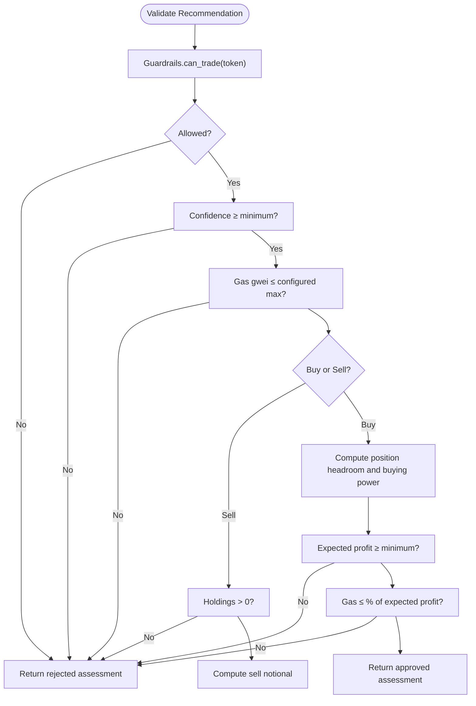

**Diagram sources**
- [backend/app/agents/risk_agent.py:8-33](file://backend/app/agents/risk_agent.py#L8-L33)
- [backend/app/agents/risk_agent.py:24-190](file://backend/app/agents/risk_agent.py#L24-L190)
- [backend/app/agents/risk_agent.py:203-215](file://backend/app/agents/risk_agent.py#L203-L215)

**Section sources**
- [backend/app/agents/risk_agent.py:8-33](file://backend/app/agents/risk_agent.py#L8-L33)
- [backend/app/agents/risk_agent.py:24-190](file://backend/app/agents/risk_agent.py#L24-L190)
- [backend/app/agents/risk_agent.py:203-215](file://backend/app/agents/risk_agent.py#L203-L215)

### Execution Agent
The execution agent converts approved recommendations into human-readable trade proposals. For buys, it calculates target position size, applies step fractions, respects risk-layer exposure headroom, enforces minimum trade size and dust thresholds, and rejects insufficient buying power. For sells, it derives the amount from the holding and recommended fraction, then applies dust and minimum notional checks.

Important outputs:
- `TradeProposal` includes token, action, amount, price, slippage, gas limit, gas cost estimate, expected profit, auto-trade eligibility, and status.
- Executed trades can be recorded through the portfolio service using the transaction hash.

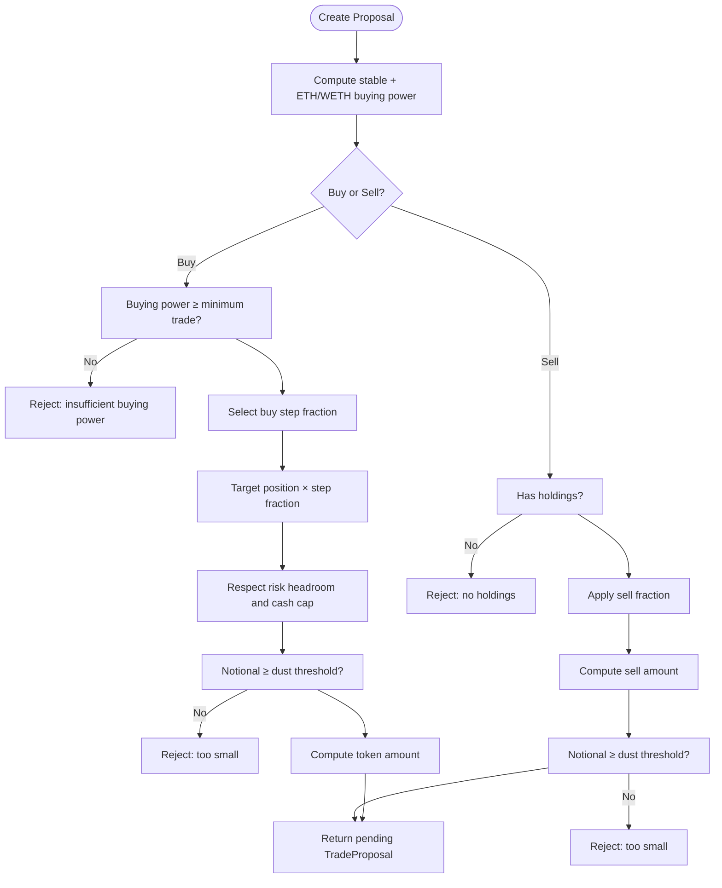

**Diagram sources**
- [backend/app/agents/execution_agent.py:9-25](file://backend/app/agents/execution_agent.py#L9-L25)
- [backend/app/agents/execution_agent.py:58-179](file://backend/app/agents/execution_agent.py#L58-L179)

**Section sources**
- [backend/app/agents/execution_agent.py:9-25](file://backend/app/agents/execution_agent.py#L9-L25)
- [backend/app/agents/execution_agent.py:58-179](file://backend/app/agents/execution_agent.py#L58-L179)

### Audit Agent
The audit agent provides structured logging for the entire agent pipeline. It writes to a rotating file and keeps a bounded in-memory deque for live UI consumption. Errors and warnings are logged at appropriate levels, while routine events use info-level messages.

**Section sources**
- [backend/app/agents/audit_agent.py:11-30](file://backend/app/agents/audit_agent.py#L11-L30)
- [backend/app/agents/audit_agent.py:33-63](file://backend/app/agents/audit_agent.py#L33-L63)

## Dependency Analysis
The backend routes depend on the controller singleton, which depends on the four agents and shared services. Models define the contract between components and the API.

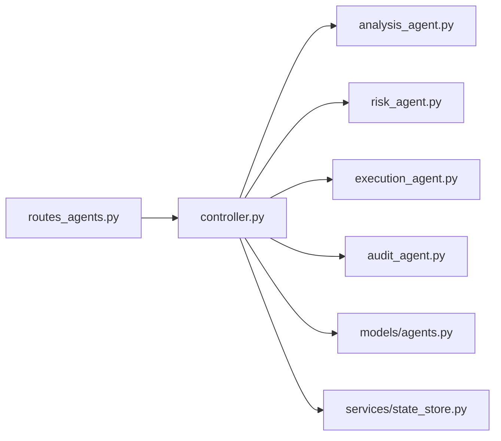

**Diagram sources**
- [backend/app/api/routes_agents.py:1-150](file://backend/app/api/routes_agents.py#L1-L150)
- [backend/app/agents/controller.py:1-21](file://backend/app/agents/controller.py#L1-L21)
- [backend/app/models/agents.py:1-81](file://backend/app/models/agents.py#L1-L81)
- [backend/app/services/state_store.py:1-59](file://backend/app/services/state_store.py#L1-L59)

**Section sources**
- [backend/app/api/routes_agents.py:1-150](file://backend/app/api/routes_agents.py#L1-L150)
- [backend/app/agents/controller.py:1-21](file://backend/app/agents/controller.py#L1-L21)
- [backend/app/models/agents.py:1-81](file://backend/app/models/agents.py#L1-L81)

## Performance Considerations
- **Market data caching**: The backend pre-populates market and news caches on startup to reduce duplicate upstream calls. The dashboard caches market data for longer periods, while the agent loop uses shorter intervals for fresher signals.
- **Indicator warm-up**: RSI and VWAP need historical samples. During warm-up, the analysis agent falls back to reduced-confidence decisions rather than fabricating indicator values.
- **Proposal deduplication**: The controller prevents duplicate pending proposals per token and applies time-based cooldowns for repeated buy and sell signals.
- **Gas estimation**: The risk layer estimates gas costs using live gas prices and a fixed gas limit, rejecting trades where gas consumes too much expected profit.
- **JSON persistence**: State is written atomically via temporary files, but there is no database or multi-process safety. Concurrent writes from multiple Uvicorn workers would race.

**Section sources**
- [backend/app/main.py:41-54](file://backend/app/main.py#L41-L54)
- [backend/app/agents/analysis_agent.py:10-18](file://backend/app/agents/analysis_agent.py#L10-L18)
- [backend/app/agents/controller.py:601-617](file://backend/app/agents/controller.py#L601-L617)
- [backend/app/agents/risk_agent.py:71-79](file://backend/app/agents/risk_agent.py#L71-L79)
- [backend/app/services/state_store.py:39-59](file://backend/app/services/state_store.py#L39-L59)
- [README.md:168-183](file://README.md#L168-L183)

## Security Model
DexTrader’s security model is built around keeping private keys in the browser:

- The backend never signs or sends transactions. Its responsibility ends at producing trade proposals.
- The frontend connects to `window.ethereum`, reads accounts and chain information, and performs swaps directly on-chain.
- CORS is configurable and defaults to localhost origins. It is not a security boundary; additional authentication should be added if exposing the API publicly.
- No user addresses or private keys are persisted server-side.
- Demo mode blocks real trade submissions and replaces wallet flows with simulated fills.

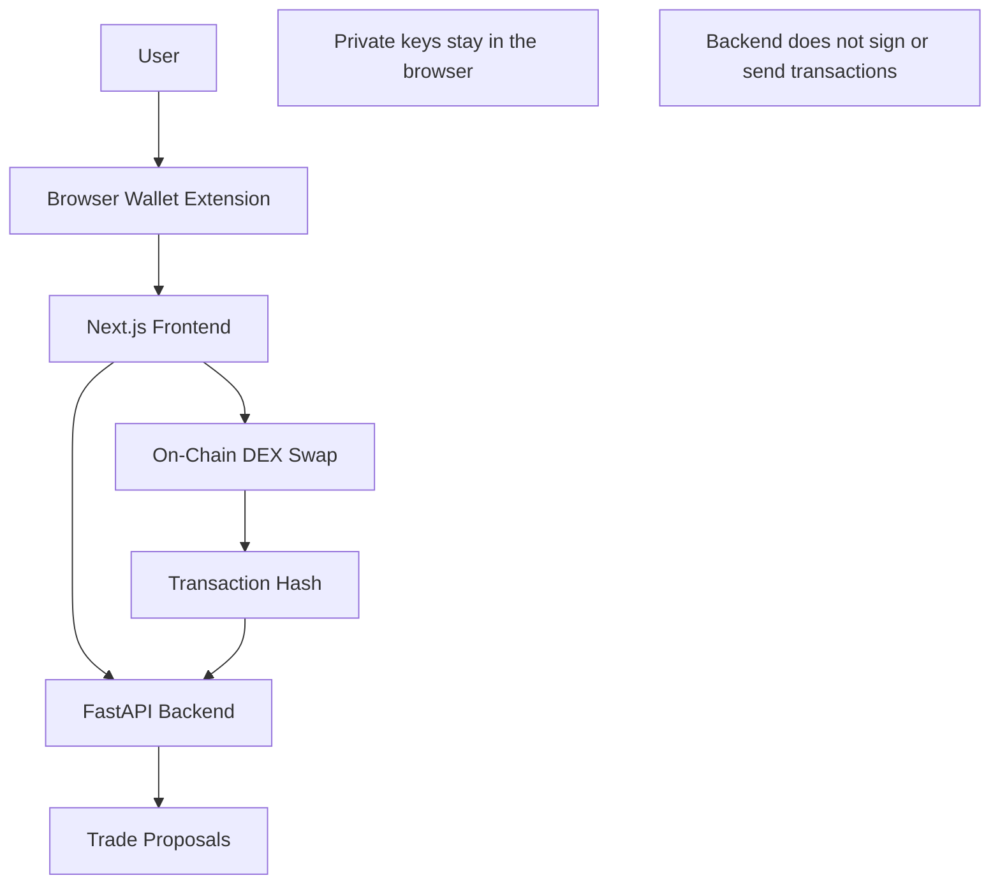

**Diagram sources**
- [README.md:3-6](file://README.md#L3-L6)
- [frontend/context/WalletContext.tsx:38-98](file://frontend/context/WalletContext.tsx#L38-L98)
- [frontend/lib/autoTradeExecutor.ts:44-282](file://frontend/lib/autoTradeExecutor.ts#L44-L282)
- [backend/app/main.py:16-32](file://backend/app/main.py#L16-L32)

**Section sources**
- [README.md:3-6](file://README.md#L3-L6)
- [README.md:101-103](file://README.md#L101-L103)
- [backend/app/main.py:16-32](file://backend/app/main.py#L16-L32)
- [frontend/context/WalletContext.tsx:38-98](file://frontend/context/WalletContext.tsx#L38-L98)
- [frontend/lib/autoTradeExecutor.ts:44-282](file://frontend/lib/autoTradeExecutor.ts#L44-L282)

## Deployment Topology and Scalability
The provided deployment configuration runs both services bound to loopback, with Caddy terminating TLS and proxying to them. The backend exposes its state directory through a Docker volume, and demo mode is enabled through environment variables.

Current topology characteristics:
- Single FastAPI process with in-process agent loop.
- JSON file persistence without database migrations or multi-process safety.
- Frontend builds with a configurable backend URL and demo flag.
- Health endpoint returns status and demo mode.

Scalability considerations:
- Horizontal scaling requires replacing JSON state with a distributed store or externalizing state to a database.
- Multiple backend workers would conflict on file writes unless state is centralized.
- Market data and LLM calls introduce external dependencies; rate limits and failures should be handled with retries and fallbacks.
- Auto-trade execution is constrained to Base and a limited token set; expanding chains or pools requires updating frontend routing logic.

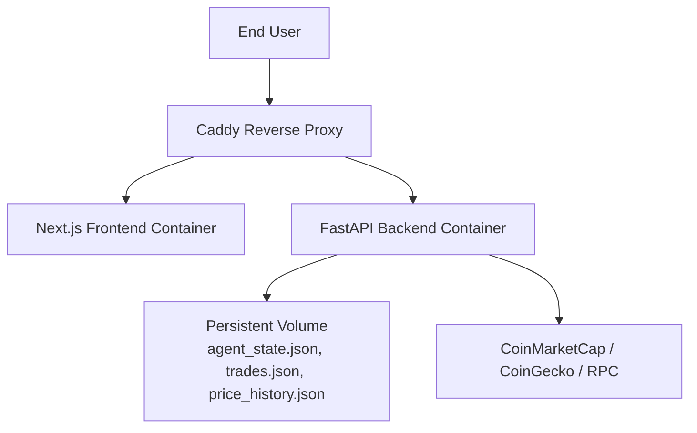

**Diagram sources**
- [docker-compose.yml:1-36](file://docker-compose.yml#L1-L36)
- [backend/app/main.py:57-59](file://backend/app/main.py#L57-L59)
- [backend/app/services/state_store.py:15-19](file://backend/app/services/state_store.py#L15-L19)

**Section sources**
- [docker-compose.yml:1-36](file://docker-compose.yml#L1-L36)
- [README.md:168-183](file://README.md#L168-L183)
- [README.md:185-191](file://README.md#L185-L191)

## Client-Server Communication Model
The frontend communicates with the backend through REST endpoints:

| Area | Typical Flow |
|---|---|
| Market data | Frontend polls `/market` and `/signals` |
| Agent control | Frontend calls `/agents/start`, `/agents/stop`, `/agents/halt`, `/agents/resume` |
| Proposal queue | Frontend polls `/agents/proposals` |
| Execution result | Frontend posts `/agents/proposals/{id}/complete` with `tx_hash` |
| Portfolio updates | Frontend posts `/portfolio/trade` after successful on-chain execution |
| Settings and holdings | Frontend posts `/agents/config/cache-duration` and `/agents/holdings` |

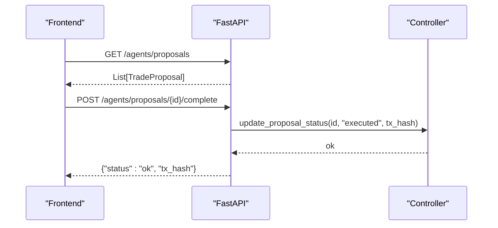

**Diagram sources**
- [backend/app/api/routes_agents.py:87-116](file://backend/app/api/routes_agents.py#L87-L116)
- [backend/app/agents/controller.py:296-330](file://backend/app/agents/controller.py#L296-L330)

**Section sources**
- [README.md:101-115](file://README.md#L101-L115)
- [backend/app/api/routes_agents.py:20-149](file://backend/app/api/routes_agents.py#L20-L149)

## State Management Approach
State is split across three concerns:

1. **Agent state**: proposals, per-token strategy state, last trade times, and guardrail counters are persisted through `JsonStateStore`.
2. **Portfolio state**: trades are stored in a JSON ledger and reconstructed into holdings and average entry prices on startup.
3. **Indicator history**: rolling price and volume samples are persisted separately for technical indicators.

The state store uses atomic file replacement with a lock to reduce corruption risk, but it is not safe for concurrent processes.

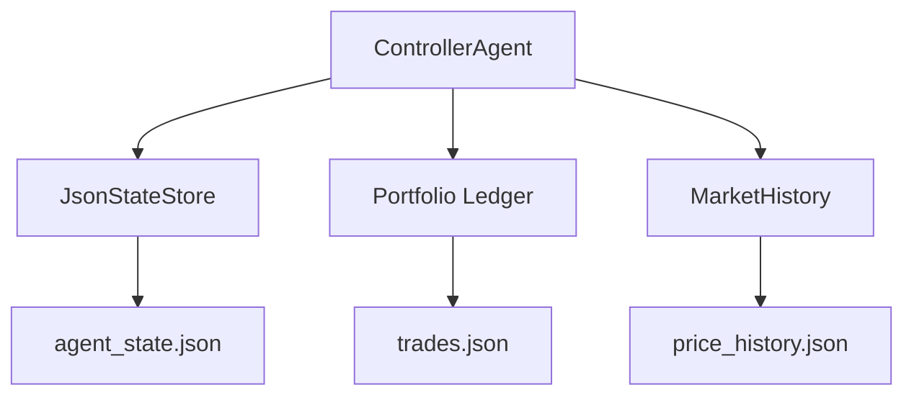

**Diagram sources**
- [backend/app/agents/controller.py:49-52](file://backend/app/agents/controller.py#L49-L52)
- [backend/app/agents/controller.py:118-125](file://backend/app/agents/controller.py#L118-L125)
- [backend/app/services/state_store.py:22-59](file://backend/app/services/state_store.py#L22-L59)

**Section sources**
- [backend/app/agents/controller.py:118-125](file://backend/app/agents/controller.py#L118-L125)
- [backend/app/services/state_store.py:1-59](file://backend/app/services/state_store.py#L1-L59)
- [README.md:18-20](file://README.md#L18-L20)
- [README.md:168-183](file://README.md#L168-L183)

## Troubleshooting Guide
Common issues and their likely causes:

| Symptom | Likely Cause | Recommended Check |
|---|---|---|
| No proposals appear | Agent loop not started or halted | Check `/agents/status`; verify `running` and `halted` fields |
| Proposals are rejected | Insufficient buying power, low confidence, gas too high, or position cap reached | Inspect risk assessment checks and proposal reason |
| Auto-trade fails | Wrong network, unsupported token pair, no liquidity route, or wallet unavailable | Verify Base chainId, token eligibility, and injected wallet presence |
| Market data errors on startup | Upstream API rate limits or transient failures | Check health endpoint and backend logs; retry after cache warm-up |
| State loss after restart | JSON file missing or corrupted | Verify state directory permissions and file integrity |
| Demo mode behaves unexpectedly | Frontend and backend demo flags mismatch | Ensure `DEMO_MODE` and `NEXT_PUBLIC_DEMO_MODE` agree |

**Section sources**
- [backend/app/api/routes_agents.py:61-84](file://backend/app/api/routes_agents.py#L61-L84)
- [backend/app/agents/risk_agent.py:54-190](file://backend/app/agents/risk_agent.py#L54-L190)
- [frontend/lib/autoTradeExecutor.ts:44-63](file://frontend/lib/autoTradeExecutor.ts#L44-L63)
- [backend/app/main.py:57-59](file://backend/app/main.py#L57-L59)
- [README.md:88-99](file://README.md#L88-L99)

## Conclusion
DexTrader’s architecture cleanly separates reasoning from execution: the backend generates validated trade proposals, while the frontend owns wallet interaction and on-chain settlement. The agent-based design makes the pipeline explicit—Analysis, Risk, Execution, and Audit—and the controller ties them together with lifecycle control, state persistence, and observability.

For production use, the most important improvements are replacing JSON state with a durable, concurrent-safe store; adding authentication and stricter API boundaries; formalizing multi-chain support; and strengthening error handling around upstream market data and LLM providers. Until then, DexTrader remains a transparent, testable reference implementation of semi-autonomous trading with private keys kept safely in the browser.