# Testing Strategy

<cite>
**Referenced Files in This Document**
- [README.md](file://README.md)
- [.github/workflows/ci.yml](file://.github/workflows/ci.yml)
- [scripts/test_auto_trade_policy.cjs](file://scripts/test_auto_trade_policy.cjs)
- [scripts/test_base_token_support.cjs](file://scripts/test_base_token_support.cjs)
- [scripts/test_portfolio_display.py](file://scripts/test_portfolio_display.py)
- [backend/test_base_market.py](file://backend/test_base_market.py)
- [backend/test_indicators.py](file://backend/test_indicators.py)
- [backend/test_analysis_agent.py](file://backend/test_analysis_agent.py)
- [backend/test_risk_agent.py](file://backend/test_risk_agent.py)
- [backend/test_execution_agent.py](file://backend/test_execution_agent.py)
- [backend/test_auto_trade_policy.py](file://backend/test_auto_trade_policy.py)
- [backend/test_base_token_support.py](file://backend/test_base_token_support.py)
</cite>

## Table of Contents
1. [Introduction](#introduction)
2. [Project Structure](#project-structure)
3. [Core Components](#core-components)
4. [Architecture Overview](#architecture-overview)
5. [Detailed Component Analysis](#detailed-component-analysis)
6. [Dependency Analysis](#dependency-analysis)
7. [Performance Considerations](#performance-considerations)
8. [Troubleshooting Guide](#troubleshooting-guide)
9. [Conclusion](#conclusion)
10. [Appendices](#appendices)

## Introduction
This document explains the testing strategy for DexTrader, covering:
- Backend unit tests built with Python’s `unittest` framework.
- Frontend policy tests using Node.js `node:test`.
- A Playwright browser smoke test for portfolio display and Base token support.
- CI/CD execution, mocking strategies, and quality expectations.
- Guidelines for writing new tests, debugging failures, and maintaining test quality.

The repository ships 116 backend unit tests plus frontend policy tests and a browser smoke test. The backend tests cover agents, indicators, guardrails, API routes, market data integration, and demo behavior. The frontend tests validate auto-trading eligibility, settlement logic, Base token configuration, and UI defaults. The browser test drives a real Next.js page against a mocked backend to verify portfolio display, volume columns, chain-specific behavior, and trade modal UX.

**Section sources**
- [README.md:146-154](file://README.md#L146-L154)

## Project Structure
Testing is split across three layers:

| Layer | Location | Purpose |
|---|---|---|
| Backend unit tests | `backend/test_*.py` | FastAPI route contracts, agent logic, indicators, guardrails, market data services, and demo portfolio behavior. |
| Frontend policy tests | `scripts/*.cjs` | TypeScript source validation through `node:test`, including auto-trade policy and Base token configuration. |
| Browser smoke test | `scripts/test_portfolio_display.py` | Playwright-driven assertions over the live Next.js portfolio page. |

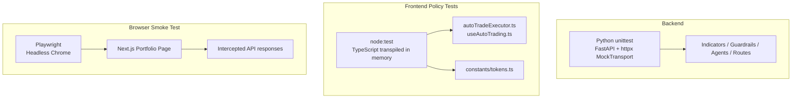

**Diagram sources**
- [backend/test_base_market.py:80-158](file://backend/test_base_market.py#L80-L158)
- [scripts/test_auto_trade_policy.cjs:1-36](file://scripts/test_auto_trade_policy.cjs#L1-L36)
- [scripts/test_base_token_support.cjs:1-11](file://scripts/test_base_token_support.cjs#L1-L11)
- [scripts/test_portfolio_display.py:84-115](file://scripts/test_portfolio_display.py#L84-L115)

**Section sources**
- [README.md:116-144](file://README.md#L116-L144)
- [README.md:146-154](file://README.md#L146-L154)

## Core Components
The test suite is organized around four main concerns:

1. **Market data and Base token ranking**
   - Validates CoinGecko, GeckoTerminal, and DexScreener fallbacks.
   - Checks caching, rate-limit handling, malformed payloads, concurrent request deduplication, and safe 502 errors.
   - Verifies top-50 limits, stable sorting, and address resolution persistence.

2. **Strategy indicators and history**
   - RSI warm-up behavior, saturation, and flat-series neutrality.
   - VWAP weighting and missing-sample handling.
   - Volume ratio and spike threshold logic.

3. **Agent pipeline**
   - AnalysisAgent: stablecoin exclusion, stop-loss exits, take-profit ladder, trailing stop, buy gating, and re-entry rules.
   - RiskAgent: gas cap, kill switch, position cap, minimum profit, sell-without-holdings rejection, and dynamic slippage.
   - ExecutionAgent: buying power checks, step sizing, risk headroom, and auto-tradeable flag alignment.

4. **Policy and UI defaults**
   - Frontend auto-trade targets, excluded tokens, Base network requirement, hook polling behavior, and shared target list usage.
   - Base token contract addresses, decimal defaults, and per-network enablement.
   - Portfolio display volume column, wallet-chain-driven volume selection, unsupported chains, error recovery, and trade modal behavior.

**Section sources**
- [backend/test_base_market.py:245-800](file://backend/test_base_market.py#L245-L800)
- [backend/test_indicators.py:6-33](file://backend/test_indicators.py#L6-L33)
- [backend/test_analysis_agent.py:28-123](file://backend/test_analysis_agent.py#L28-L123)
- [backend/test_risk_agent.py:53-103](file://backend/test_risk_agent.py#L53-L103)
- [backend/test_execution_agent.py:37-75](file://backend/test_execution_agent.py#L37-L75)
- [scripts/test_auto_trade_policy.cjs:66-220](file://scripts/test_auto_trade_policy.cjs#L66-L220)
- [scripts/test_base_token_support.cjs:13-41](file://scripts/test_base_token_support.cjs#L13-L41)
- [scripts/test_portfolio_display.py:165-469](file://scripts/test_portfolio_display.py#L165-L469)

## Architecture Overview
The testing architecture separates fast deterministic unit tests from slower browser-based verification.

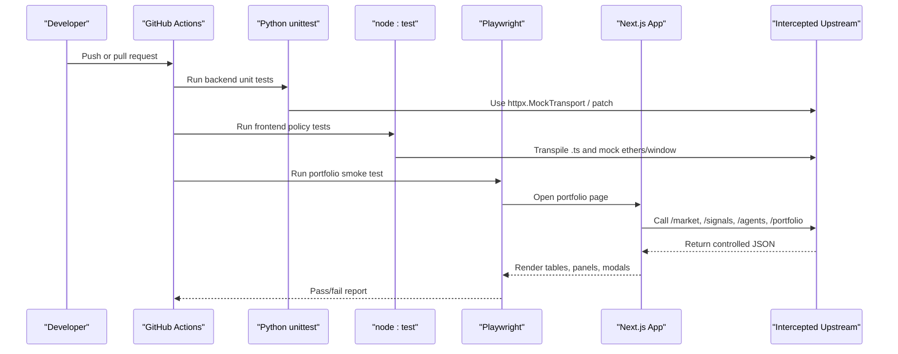

**Diagram sources**
- [.github/workflows/ci.yml:8-43](file://.github/workflows/ci.yml#L8-L43)
- [backend/test_base_market.py:80-158](file://backend/test_base_market.py#L80-L158)
- [scripts/test_auto_trade_policy.cjs:18-59](file://scripts/test_auto_trade_policy.cjs#L18-L59)
- [scripts/test_portfolio_display.py:120-157](file://scripts/test_portfolio_display.py#L120-L157)

## Detailed Component Analysis

### Backend Unit Testing Approach
The backend uses plain `unittest`, not pytest. Tests import application modules directly and isolate external dependencies through mocking.

Key patterns:
- FastAPI router isolation: create an app, include only the tested router, and use `httpx.ASGITransport` for synchronous-like async routing.
- External HTTP mocking: replace `httpx.AsyncClient` with a `MockTransport` that records requests and returns controlled payloads.
- Service-level patches: override module-level constants such as base URLs, cache paths, retry delays, and platform maps.
- Temporary state directories: prevent test leakage by isolating JSON state files.
- Concurrency control: use events and timers to assert single-flight fetches and cache completion semantics.

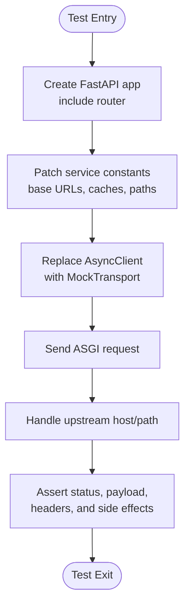

**Diagram sources**
- [backend/test_base_market.py:80-158](file://backend/test_base_market.py#L80-L158)
- [backend/test_base_market.py:160-237](file://backend/test_base_market.py#L160-L237)

**Section sources**
- [backend/test_base_market.py:80-158](file://backend/test_base_market.py#L80-L158)
- [backend/test_base_market.py:245-800](file://backend/test_base_market.py#L245-L800)

### Indicators and Market History Tests
Indicator tests focus on numerical correctness and warm-up behavior rather than network calls.

Highlights:
- RSI requires enough samples; during warm-up it returns `None`.
- Monotonic series saturate at 0 or 100; flat series are neutral.
- VWAP ignores missing samples and returns `None` when weights are invalid.
- Volume ratio and spike thresholds are validated numerically.

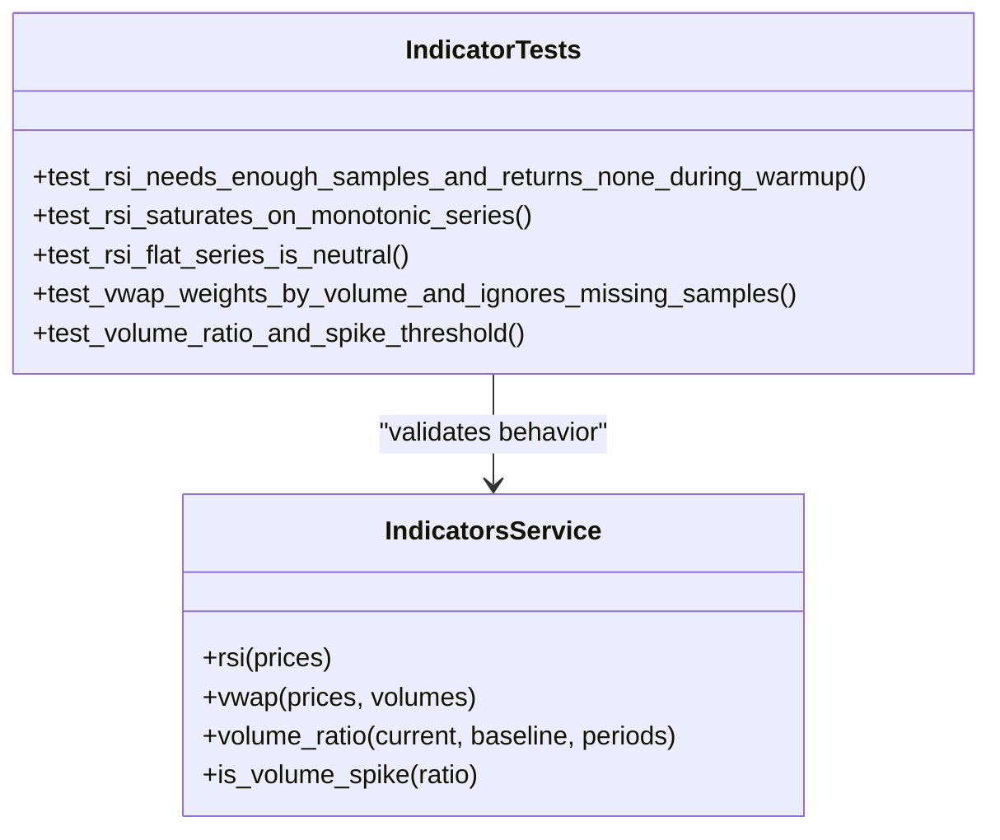

**Diagram sources**
- [backend/test_indicators.py:6-33](file://backend/test_indicators.py#L6-L33)

**Section sources**
- [backend/test_indicators.py:6-33](file://backend/test_indicators.py#L6-L33)

### Agent Pipeline Tests
The agent tests model the full proposal lifecycle: analysis, risk assessment, and execution.

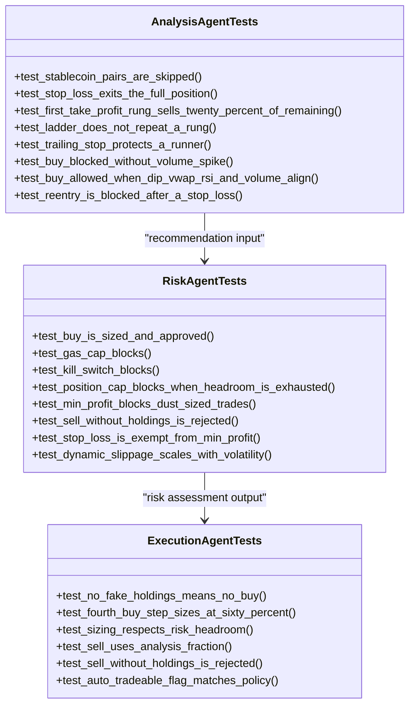

**Diagram sources**
- [backend/test_analysis_agent.py:11-123](file://backend/test_analysis_agent.py#L11-L123)
- [backend/test_risk_agent.py:38-103](file://backend/test_risk_agent.py#L38-L103)
- [backend/test_execution_agent.py:33-75](file://backend/test_execution_agent.py#L33-L75)

**Section sources**
- [backend/test_analysis_agent.py:11-123](file://backend/test_analysis_agent.py#L11-L123)
- [backend/test_risk_agent.py:38-103](file://backend/test_risk_agent.py#L38-L103)
- [backend/test_execution_agent.py:33-75](file://backend/test_execution_agent.py#L33-L75)

### Backend Auto-Trade Policy Controller Test
This test isolates the controller module, replaces audit/portfolio/gas/polling dependencies, and verifies default monitoring tokens and proposal generation.

Key behaviors:
- Default monitored tokens include the seven auto-trade targets plus other non-auto assets.
- Removed defaults are excluded.
- All seven targets can generate pending proposals under a simulated cycle.
- Monitoring is editable while manual assets remain manual.

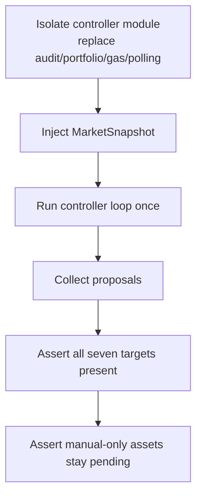

**Diagram sources**
- [backend/test_auto_trade_policy.py:21-46](file://backend/test_auto_trade_policy.py#L21-L46)
- [backend/test_auto_trade_policy.py:62-93](file://backend/test_auto_trade_policy.py#L62-L93)

**Section sources**
- [backend/test_auto_trade_policy.py:21-93](file://backend/test_auto_trade_policy.py#L21-L93)

### Backend Base Token Support Test
This test validates configuration-level support for new Base tokens:
- New symbols are priority market assets.
- Verified CoinGecko IDs are mapped.
- Base URL selection honors API keys and overrides.
- Pricing fallback fetches each new asset by ID in one batched request.

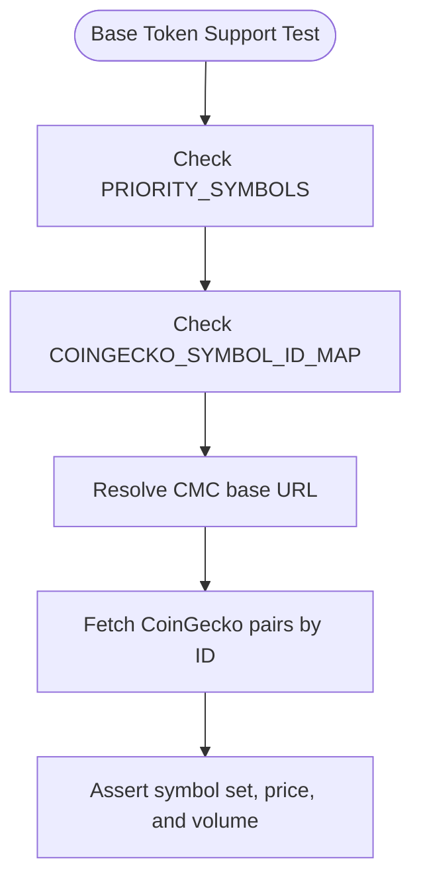

**Diagram sources**
- [backend/test_base_token_support.py:20-67](file://backend/test_base_token_support.py#L20-L67)

**Section sources**
- [backend/test_base_token_support.py:20-67](file://backend/test_base_token_support.py#L20-L67)

### Frontend Policy Tests Using node:test
Frontend policy tests run under `node:test` and transpile TypeScript in memory. They do not start a browser; they evaluate real `.ts` sources against minimal mocks.

Two scripts:
- `scripts/test_auto_trade_policy.cjs`: validates auto-trade eligibility, Base network enforcement, hook polling, proposal settlement, and UI defaults.
- `scripts/test_base_token_support.cjs`: validates Base token addresses, decimals, and per-network enablement.

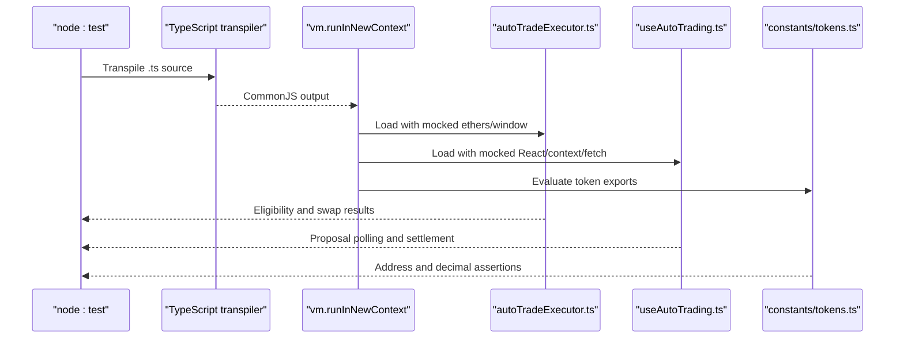

**Diagram sources**
- [scripts/test_auto_trade_policy.cjs:1-36](file://scripts/test_auto_trade_policy.cjs#L1-L36)
- [scripts/test_auto_trade_policy.cjs:38-59](file://scripts/test_auto_trade_policy.cjs#L38-L59)
- [scripts/test_auto_trade_policy.cjs:127-168](file://scripts/test_auto_trade_policy.cjs#L127-L168)
- [scripts/test_base_token_support.cjs:1-11](file://scripts/test_base_token_support.cjs#L1-L11)

**Section sources**
- [scripts/test_auto_trade_policy.cjs:1-220](file://scripts/test_auto_trade_policy.cjs#L1-L220)
- [scripts/test_base_token_support.cjs:1-41](file://scripts/test_base_token_support.cjs#L1-L41)

### Playwright Portfolio Display Smoke Test
The browser smoke test launches headless Chrome, opens the portfolio page, intercepts all backend calls, injects a fake `window.ethereum`, and asserts UI behavior.

Coverage includes:
- Volume column presence and formatting.
- Wallet balance and decimal handling.
- Chain-specific volume selection.
- Unsupported chain and disconnected wallet states.
- Error recovery and refresh behavior.
- Ranked Base token panel scrolling and ranking changes.
- Trade modal availability for new Base tokens.
- ICP eight-decimal handling and quote fallback.
- Partial-fill quote rejection.
- Agents page monitored defaults and auto-trade targets.

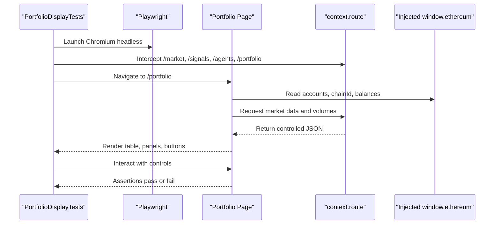

**Diagram sources**
- [scripts/test_portfolio_display.py:84-115](file://scripts/test_portfolio_display.py#L84-L115)
- [scripts/test_portfolio_display.py:120-157](file://scripts/test_portfolio_display.py#L120-L157)
- [scripts/test_portfolio_display.py:159-163](file://scripts/test_portfolio_display.py#L159-L163)

**Section sources**
- [scripts/test_portfolio_display.py:84-473](file://scripts/test_portfolio_display.py#L84-L473)

## Dependency Analysis
The test suite has clear dependency boundaries:

- Backend tests depend on FastAPI, httpx, and internal application modules.
- Frontend policy tests depend on Node.js, TypeScript, and the frontend’s installed dependencies.
- The browser smoke test depends on Playwright and a running Next.js dev server.
- CI orchestrates all three layers without requiring real wallets, real DEX pools, or live market APIs.

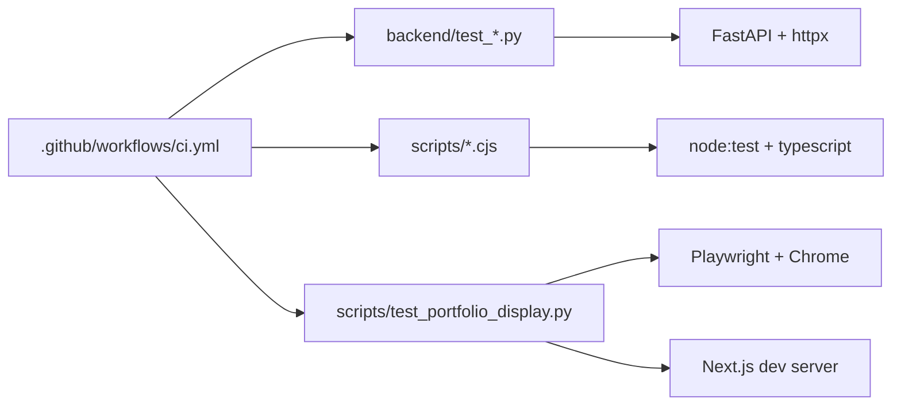

**Diagram sources**
- [.github/workflows/ci.yml:8-43](file://.github/workflows/ci.yml#L8-L43)
- [backend/test_base_market.py:80-158](file://backend/test_base_market.py#L80-L158)
- [scripts/test_auto_trade_policy.cjs:1-36](file://scripts/test_auto_trade_policy.cjs#L1-L36)
- [scripts/test_portfolio_display.py:84-115](file://scripts/test_portfolio_display.py#L84-L115)

**Section sources**
- [.github/workflows/ci.yml:8-43](file://.github/workflows/ci.yml#L8-L43)
- [README.md:146-154](file://README.md#L146-L154)

## Performance Considerations
- Backend unit tests are fast because they avoid real network calls and use in-memory state where possible.
- Frontend policy tests avoid starting a browser or bundling the app; they only transpile selected TypeScript files.
- The Playwright test is intentionally slow and should be treated as a smoke test, not a high-frequency regression suite.
- Avoid adding heavy fixtures or real RPC calls to unit tests; prefer mocks and small deterministic datasets.
- Keep browser tests focused on critical user flows: portfolio display, volume column, chain switching, and trade modal entry points.

[No sources needed since this section provides general guidance]

## Troubleshooting Guide

### Backend Test Failures
Common causes:
- Missing or incorrect mock for an upstream host.
- Cache state leaking between tests due to module-level variables.
- Incorrect temporary directory setup for state persistence.
- Unexpected exception escaping from async handlers.

Debugging steps:
- Inspect recorded requests in the mock transport.
- Verify patched constants before importing the tested module.
- Confirm that temporary directories are created and cleaned up.
- Add subtests for malformed payloads and timeouts to reproduce provider failures.

**Section sources**
- [backend/test_base_market.py:160-237](file://backend/test_base_market.py#L160-L237)
- [backend/test_base_market.py:626-712](file://backend/test_base_market.py#L626-L712)

### Frontend Policy Test Failures
Common causes:
- Missing `npm install` so TypeScript cannot be loaded from `frontend/node_modules`.
- Unexpected imports not provided to the isolated VM context.
- Target lists or token configurations changed without updating assertions.
- Network or wallet boundary assumptions violated.

Debugging steps:
- Run the failing script directly with `node --test`.
- Check diagnostics from `ts.transpileModule`.
- Verify that mocked `ethers`, `react`, `fetch`, and context modules match expected shapes.
- Confirm that `AUTO_TRADE_TARGETS` and Base token constants are aligned with policy.

**Section sources**
- [scripts/test_auto_trade_policy.cjs:18-36](file://scripts/test_auto_trade_policy.cjs#L18-L36)
- [scripts/test_auto_trade_policy.cjs:38-59](file://scripts/test_auto_trade_policy.cjs#L38-L59)
- [scripts/test_base_token_support.cjs:1-11](file://scripts/test_base_token_support.cjs#L1-L11)

### Playwright Smoke Test Failures
Common causes:
- Next.js dev server not running or reachable.
- Wrong `PORTFOLIO_TEST_URL`.
- Playwright not installed locally even though it is not in `requirements.txt`.
- Fake `window.ethereum` not injected before navigation.
- Backend responses not matching expected shape.

Debugging steps:
- Start the frontend dev server and confirm the portfolio page loads.
- Override `PORTFOLIO_TEST_URL` if testing against a different origin.
- Inspect intercepted requests in the route handler.
- Add console or page error collection to capture client-side exceptions.
- Reduce the test to a single assertion to isolate timing issues.

**Section sources**
- [scripts/test_portfolio_display.py:9-10](file://scripts/test_portfolio_display.py#L9-L10)
- [scripts/test_portfolio_display.py:84-115](file://scripts/test_portfolio_display.py#L84-L115)
- [scripts/test_portfolio_display.py:120-157](file://scripts/test_portfolio_display.py#L120-L157)

## Conclusion
DexTrader’s testing strategy balances speed and confidence:
- Backend unit tests provide fast, deterministic coverage of agents, indicators, guardrails, routes, and market data integration.
- Frontend policy tests validate TypeScript-based trading policy and Base token configuration without launching a browser.
- The Playwright smoke test covers the most visible user flow: portfolio display, volume data, chain behavior, and trade modal entry.
- CI enforces backend tests, frontend policy tests, TypeScript compilation, and Next.js build, while rejecting tracked runtime data.

When extending the suite, follow the existing patterns: isolate external dependencies, keep tests deterministic, prefer mocks over real networks, and reserve browser tests for critical end-to-end flows.

[No sources needed since this section summarizes without analyzing specific files]

## Appendices

### CI/CD Pipeline Configuration
The CI pipeline runs three jobs:
- Backend: installs Python dependencies and discovers `test_*.py`.
- Frontend: installs Node dependencies, runs policy tests, checks TypeScript, and builds Next.js.
- Personal-data check: fails if runtime JSON or log files are tracked.

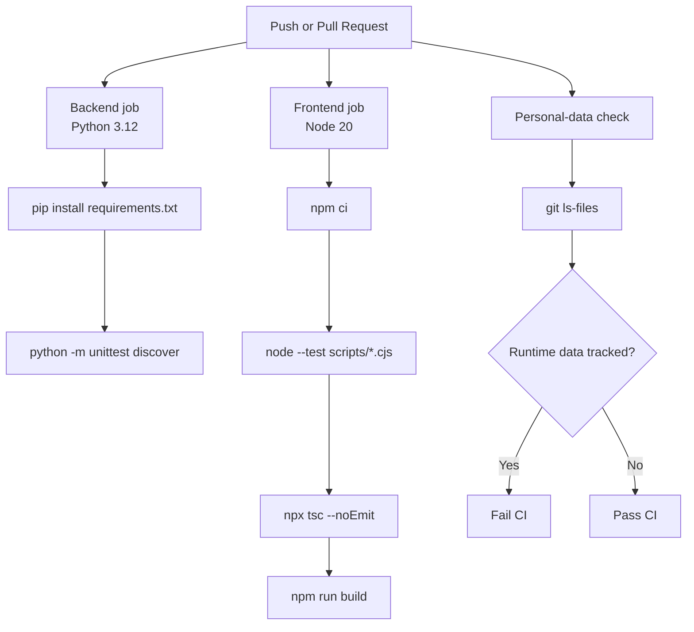

**Diagram sources**
- [.github/workflows/ci.yml:8-54](file://.github/workflows/ci.yml#L8-L54)

**Section sources**
- [.github/workflows/ci.yml:8-54](file://.github/workflows/ci.yml#L8-L54)

### Test Execution Commands
- Backend unit tests: run from `backend/` using `python -m unittest discover -p "test_*.py"`.
- Frontend policy tests: run from `frontend/` using `npm test`, or directly with `node --test scripts/test_auto_trade_policy.cjs scripts/test_base_token_support.cjs`.
- Browser smoke test: run `scripts/test_portfolio_display.py` with a running Next.js dev server; override the target URL with `PORTFOLIO_TEST_URL`.

**Section sources**
- [README.md:146-154](file://README.md#L146-L154)

### Mocking Strategies Summary
| Area | Strategy |
|---|---|
| Backend HTTP | Replace `httpx.AsyncClient` with `MockTransport`; record and assert requests. |
| Backend services | Patch module-level constants, caches, locks, and paths. |
| Backend state | Use temporary directories and isolated controllers. |
| Frontend TypeScript | Transpile in memory and execute in a sandboxed VM with explicit imports. |
| Frontend wallet/network | Mock `ethers`, `window.ethereum`, `react`, `fetch`, and contexts. |
| Browser tests | Route all backend traffic through Playwright’s `context.route` and inject fake wallet behavior. |

**Section sources**
- [backend/test_base_market.py:80-158](file://backend/test_base_market.py#L80-L158)
- [backend/test_auto_trade_policy.py:21-46](file://backend/test_auto_trade_policy.py#L21-L46)
- [scripts/test_auto_trade_policy.cjs:18-59](file://scripts/test_auto_trade_policy.cjs#L18-L59)
- [scripts/test_portfolio_display.py:120-157](file://scripts/test_portfolio_display.py#L120-L157)

### Writing New Tests: Guidelines
- Prefer unit tests for pure logic: indicators, guardrails, policy decisions, and model transformations.
- Use FastAPI router isolation for route tests; never rely on global app startup unless explicitly intended.
- Mock every external dependency: market APIs, LLM providers, gas RPC, and file system state.
- Keep frontend policy tests free of browser startup; transpile only what is necessary.
- Reserve Playwright tests for flows that require DOM rendering, wallet interaction simulation, or cross-component UI behavior.
- Add negative cases: malformed payloads, rate limits, timeouts, unsupported chains, and disconnected wallets.
- Ensure tests are deterministic: avoid wall-clock sleeps, random values, and shared mutable state.

[No sources needed since this section provides general guidance]