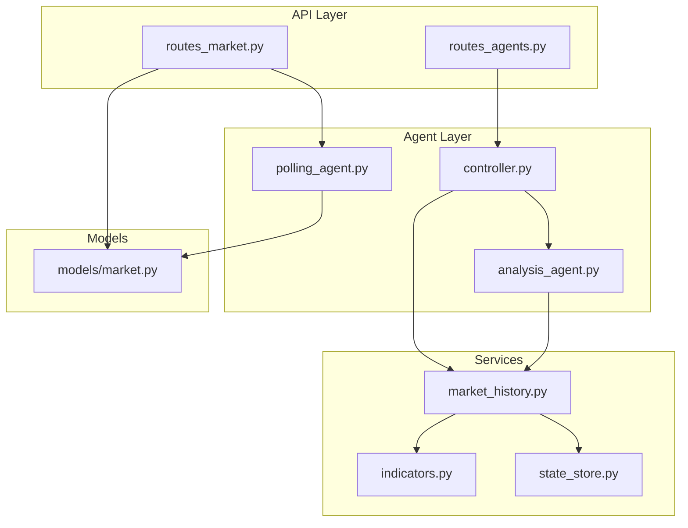
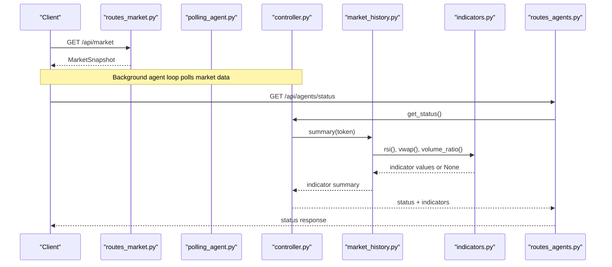
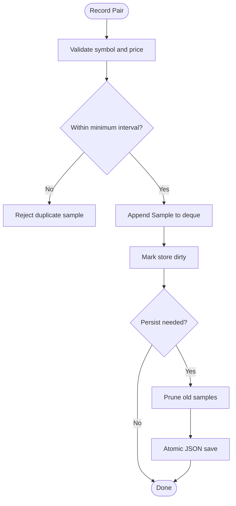
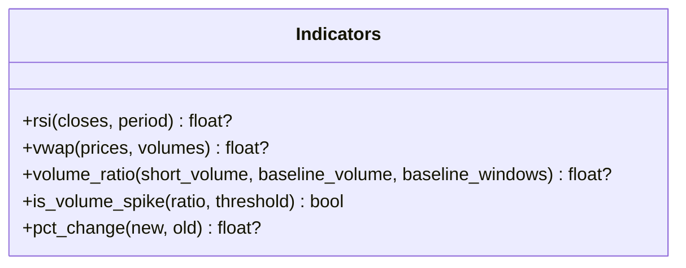
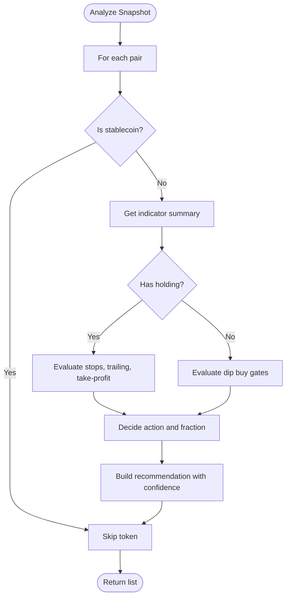
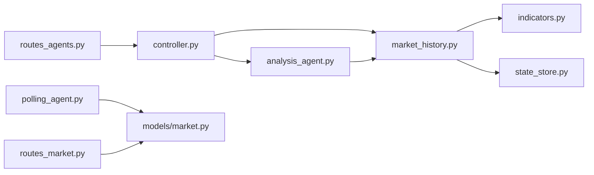

# Market History Analysis

<cite>
**Referenced Files in This Document**
- [market_history.py](file://backend/app/services/market_history.py)
- [indicators.py](file://backend/app/services/indicators.py)
- [state_store.py](file://backend/app/services/state_store.py)
- [market.py](file://backend/app/models/market.py)
- [analysis_agent.py](file://backend/app/agents/analysis_agent.py)
- [controller.py](file://backend/app/agents/controller.py)
- [routes_agents.py](file://backend/app/api/routes_agents.py)
- [polling_agent.py](file://backend/app/agents/polling_agent.py)
- [routes_market.py](file://backend/app/api/routes_market.py)
- [test_market_history.py](file://backend/test_market_history.py)
</cite>

## Table of Contents
1. [Introduction](#introduction)
2. [Project Structure](#project-structure)
3. [Core Components](#core-components)
4. [Architecture Overview](#architecture-overview)
5. [Detailed Component Analysis](#detailed-component-analysis)
6. [Dependency Analysis](#dependency-analysis)
7. [Performance Considerations](#performance-considerations)
8. [Troubleshooting Guide](#troubleshooting-guide)
9. [Conclusion](#conclusion)

## Introduction
This document explains how the system collects, stores, and analyzes historical market data to detect trends, identify support/resistance-like conditions, and compute momentum indicators that inform trading decisions. The core pipeline is:

- Real-time or cached market snapshots are polled from external sources.
- Each snapshot is recorded as a rolling time series per token.
- Technical indicators such as RSI, VWAP, and volume ratio are computed over configurable windows.
- A rule-based analysis agent consumes these indicators to generate buy/sell recommendations with confidence scores.
- Historical state is persisted so indicators remain meaningful across restarts.

The design intentionally avoids fabricating values during warm-up: if there is not enough history for an indicator, it returns `None`, and higher layers lower confidence or skip signals rather than pretending the market is neutral.

## Project Structure
The market history analysis spans services, models, agents, API routes, and tests:

**Diagram sources**
- [routes_market.py:1-173](file://backend/app/api/routes_market.py#L1-L173)
- [routes_agents.py:1-150](file://backend/app/api/routes_agents.py#L1-L150)
- [polling_agent.py:1-43](file://backend/app/agents/polling_agent.py#L1-L43)
- [controller.py:47-72](file://backend/app/agents/controller.py#L47-L72)
- [analysis_agent.py:1-349](file://backend/app/agents/analysis_agent.py#L1-L349)
- [market_history.py:1-189](file://backend/app/services/market_history.py#L1-L189)
- [indicators.py:1-97](file://backend/app/services/indicators.py#L1-L97)
- [state_store.py:1-59](file://backend/app/services/state_store.py#L1-L59)
- [market.py:1-42](file://backend/app/models/market.py#L1-L42)

**Section sources**
- [routes_market.py:1-173](file://backend/app/api/routes_market.py#L1-L173)
- [routes_agents.py:1-150](file://backend/app/api/routes_agents.py#L1-L150)
- [polling_agent.py:1-43](file://backend/app/agents/polling_agent.py#L1-L43)
- [controller.py:47-72](file://backend/app/agents/controller.py#L47-L72)
- [analysis_agent.py:1-349](file://backend/app/agents/analysis_agent.py#L1-L349)
- [market_history.py:1-189](file://backend/app/services/market_history.py#L1-L189)
- [indicators.py:1-97](file://backend/app/services/indicators.py#L1-L97)
- [state_store.py:1-59](file://backend/app/services/state_store.py#L1-L59)
- [market.py:1-42](file://backend/app/models/market.py#L1-L42)

## Core Components
- **MarketHistory**: Rolling per-token price/volume history with persistence, rate limiting, pruning, and indicator summaries.
- **Indicators**: Pure technical helpers for RSI, VWAP, volume ratio, spike detection, and percentage change.
- **JsonStateStore**: Thread-safe atomic JSON persistence used by MarketHistory.
- **AnalysisAgent**: Rule-based strategy layer using RSI, VWAP, and volume spikes to decide buys, exits, and confidence.
- **Controller**: Orchestrates agents, holds the shared MarketHistory instance, and exposes status/state via API.
- **PollingAgent**: Caches and returns fresh market snapshots at a minimum one-minute cadence.
- **Market API Routes**: Provide market pairs, gainers/losers, base tokens, and token volumes; also cache results.
- **Agent API Routes**: Expose controller status, indicator summaries, proposals, logs, and lifecycle controls.

Key responsibilities:
- Data ingestion: polling and recording samples.
- Storage: bounded deque plus persistent JSON file.
- Computation: rolling indicators over time windows.
- Decision-making: rule-based signals with confidence and reasons.
- Exposure: REST endpoints for dashboard and automation.

**Section sources**
- [market_history.py:1-189](file://backend/app/services/market_history.py#L1-L189)
- [indicators.py:1-97](file://backend/app/services/indicators.py#L1-L97)
- [state_store.py:1-59](file://backend/app/services/state_store.py#L1-L59)
- [analysis_agent.py:1-349](file://backend/app/agents/analysis_agent.py#L1-L349)
- [controller.py:47-72](file://backend/app/agents/controller.py#L47-L72)
- [polling_agent.py:1-43](file://backend/app/agents/polling_agent.py#L1-L43)
- [routes_market.py:1-173](file://backend/app/api/routes_market.py#L1-L173)
- [routes_agents.py:1-150](file://backend/app/api/routes_agents.py#L1-L150)

## Architecture Overview
The market history analysis integrates real-time market data with historical context to produce actionable signals.

**Diagram sources**
- [routes_market.py:53-58](file://backend/app/api/routes_market.py#L53-L58)
- [polling_agent.py:26-43](file://backend/app/agents/polling_agent.py#L26-L43)
- [controller.py:47-72](file://backend/app/agents/controller.py#L47-L72)
- [market_history.py:168-188](file://backend/app/services/market_history.py#L168-L188)
- [indicators.py:17-97](file://backend/app/services/indicators.py#L17-L97)
- [routes_agents.py:61-84](file://backend/app/api/routes_agents.py#L61-L84)

## Detailed Component Analysis

### MarketHistory: Rolling History and Indicator Summary
MarketHistory maintains a bounded deque of samples per token, enforces a minimum sample interval, prunes old data, and persists changes to disk. It provides:

- Recording:
  - Per-pair recording with timestamp, price, and optional cumulative 24h volume.
  - Batch recording from a MarketSnapshot.
- Querying:
  - Time-windowed samples, prices, and closing prices.
  - VWAP over a window using deltas between cumulative volumes.
  - Volume ratio comparing short-term volume to baseline average.
- Persistence:
  - Atomic JSON save/load with thread safety.
  - Age-based pruning on load and before persist.
- Summary:
  - Aggregates RSI, VWAP, volume ratio, spike flag, sample count, and readiness flags.

Time window configuration:
- Maximum age: two days.
- Minimum sample interval: 55 seconds.
- Maximum samples per token: 3000.
- Default VWAP window: 24 hours.
- Default volume ratio: 5 minutes vs 1 hour baseline.

Complexity characteristics:
- Recording is O(1) amortized due to bounded deque.
- Sampling within a window is linear in number of retained samples.
- VWAP and volume ratio computations are linear in the number of samples considered.

Error handling:
- Invalid or malformed persisted rows are skipped.
- Negative or zero prices are rejected.
- Missing or insufficient data yields `None` for indicators instead of fake values.

**Diagram sources**
- [market_history.py:88-114](file://backend/app/services/market_history.py#L88-L114)
- [market_history.py:62-86](file://backend/app/services/market_history.py#L62-L86)
- [state_store.py:39-59](file://backend/app/services/state_store.py#L39-L59)

**Section sources**
- [market_history.py:25-28](file://backend/app/services/market_history.py#L25-L28)
- [market_history.py:37-114](file://backend/app/services/market_history.py#L37-L114)
- [market_history.py:117-188](file://backend/app/services/market_history.py#L117-L188)
- [state_store.py:22-59](file://backend/app/services/state_store.py#L22-L59)

### Indicators: Momentum and Volume Helpers
Indicators provide pure functions without global state:

- RSI (Wilder’s method):
  - Requires at least period + 1 valid closes.
  - Returns 0–100 or `None`.
- VWAP:
  - Uses paired price and volume sequences.
  - Ignores invalid entries; returns `None` if no valid volume.
- Volume Ratio:
  - Compares short bucket to expected baseline average.
  - Returns `None` if inputs are missing or invalid.
- Spike Detection:
  - Boolean threshold check against ratio.
- Percentage Change:
  - Safe computation returning `None` when inputs are invalid.

These functions are designed to return `None` under warm-up or insufficient data, allowing callers to adjust confidence or skip signals.

**Diagram sources**
- [indicators.py:13-97](file://backend/app/services/indicators.py#L13-L97)

**Section sources**
- [indicators.py:1-97](file://backend/app/services/indicators.py#L1-97)

### AnalysisAgent: Trend Detection and Pattern Recognition
The analysis agent translates historical indicators into trade recommendations:

- Buy logic:
  - Dip thresholds based on 24h change.
  - RSI gate to avoid catching falling knives.
  - VWAP discount requirement when indicators are ready.
  - Volume-spike filter to confirm momentum.
  - Re-entry rules after stop-losses requiring cooldown and confirmation.
- Exit logic:
  - Hard stop ladder.
  - Trailing stop after profit arm.
  - Scale-out take-profit ladder.
  - Discretionary pump exit when entry price is unknown.
- Confidence scoring:
  - Adjusted by RSI level, volume spike, VWAP discount, step number, and indicator readiness.

Trend detection patterns:
- Oversold RSI combined with price below VWAP suggests potential reversal zones.
- Volume spikes confirm breakout or dip-buy momentum.
- Stop-loss and trailing-stop mechanics act as dynamic resistance levels.

**Diagram sources**
- [analysis_agent.py:76-255](file://backend/app/agents/analysis_agent.py#L76-L255)
- [analysis_agent.py:257-349](file://backend/app/agents/analysis_agent.py#L257-L349)

**Section sources**
- [analysis_agent.py:10-43](file://backend/app/agents/analysis_agent.py#L10-L43)
- [analysis_agent.py:76-255](file://backend/app/agents/analysis_agent.py#L76-L255)
- [analysis_agent.py:257-349](file://backend/app/agents/analysis_agent.py#L257-L349)

### Controller: Orchestration and Shared State
The controller initializes and wires together:
- JsonStateStore for agent state.
- MarketHistory for rolling price/volume data.
- Guardrails and analysis agent.
- Demo portfolio and holdings reconstruction.

It exposes:
- Status, guardrail state, position states, and indicator summaries via API.
- Lifecycle methods: start, stop, halt, resume.
- Proposal management and audit logs.

**Section sources**
- [controller.py:47-72](file://backend/app/agents/controller.py#L47-L72)
- [routes_agents.py:20-84](file://backend/app/api/routes_agents.py#L20-L84)

### PollingAgent and Market API: Real-Time Data Integration
PollingAgent caches market snapshots with a minimum one-minute duration to ensure meaningful indicator updates. Market API routes provide:
- Market pairs with caching and refresh control.
- Gainers/losers sorted by 24h change.
- Base tokens with rate-limit fallback to stale cache.
- Token volumes with validation, batching, and LRU-style cache eviction.

Integration points:
- Controller uses polling to feed MarketHistory.
- AnalysisAgent consumes MarketHistory summaries.
- Dashboard reads indicator readiness and values through agent routes.

**Section sources**
- [polling_agent.py:1-43](file://backend/app/agents/polling_agent.py#L1-L43)
- [routes_market.py:17-58](file://backend/app/api/routes_market.py#L17-L58)
- [routes_market.py:61-109](file://backend/app/api/routes_market.py#L61-L109)
- [routes_market.py:112-173](file://backend/app/api/routes_market.py#L112-L173)

### Data Models: Market Snapshot and Trading Pairs
Market models define:
- TradingPair: base/quote symbols, price, 24h change, optional volume and URL.
- MarketSnapshot: list of pairs and timestamp.
- GainersLosers: top gainers and losers.
- BaseToken and related snapshots for ranking and volume queries.

These models standardize data passed between API routes, agents, and services.

**Section sources**
- [market.py:5-17](file://backend/app/models/market.py#L5-L17)
- [market.py:19-42](file://backend/app/models/market.py#L19-L42)

## Dependency Analysis
The following diagram shows key dependencies among components involved in market history analysis:

**Diagram sources**
- [routes_agents.py:1-150](file://backend/app/api/routes_agents.py#L1-L150)
- [controller.py:47-72](file://backend/app/agents/controller.py#L47-L72)
- [analysis_agent.py:1-349](file://backend/app/agents/analysis_agent.py#L1-L349)
- [market_history.py:1-189](file://backend/app/services/market_history.py#L1-L189)
- [indicators.py:1-97](file://backend/app/services/indicators.py#L1-L97)
- [state_store.py:1-59](file://backend/app/services/state_store.py#L1-L59)
- [polling_agent.py:1-43](file://backend/app/agents/polling_agent.py#L1-L43)
- [routes_market.py:1-173](file://backend/app/api/routes_market.py#L1-L173)
- [market.py:1-42](file://backend/app/models/market.py#L1-L42)

Coupling and cohesion:
- MarketHistory depends only on indicators and state store, keeping computation and persistence decoupled.
- AnalysisAgent depends on MarketHistory but not directly on network I/O, improving testability.
- Controllers orchestrate multiple agents while exposing clean API boundaries.

Potential circular dependencies:
- No direct cycles observed; dependencies flow from API to agents to services to models.

External integration points:
- Market API routes call external providers for market pairs and token volumes.
- PollingAgent caches provider responses to reduce load and stabilize indicator calculations.

**Section sources**
- [market_history.py:1-189](file://backend/app/services/market_history.py#L1-L189)
- [analysis_agent.py:1-349](file://backend/app/agents/analysis_agent.py#L1-L349)
- [routes_market.py:1-173](file://backend/app/api/routes_market.py#L1-L173)
- [polling_agent.py:1-43](file://backend/app/agents/polling_agent.py#L1-L43)

## Performance Considerations
- Bounded deque prevents unbounded memory growth per token.
- Minimum sample interval avoids redundant writes and stabilizes indicators.
- Age-based pruning ensures only relevant history is retained.
- Atomic JSON saves prevent partial writes and corruption.
- Polling cache duration aligns with indicator sensitivity; too long would make RSI/VWAP stale.
- Volume ratio and VWAP computations are linear in sample count; keep windows reasonable.

Optimization opportunities:
- Precompute deltas for volume metrics if sample frequency increases.
- Batch indicator computations across tokens where possible.
- Tune MAX_SAMPLES_PER_TOKEN and MAX_AGE_SECONDS based on storage constraints and required lookback.

[No sources needed since this section provides general guidance]

## Troubleshooting Guide
Common issues and resolutions:

- Indicators return `None`:
  - Cause: insufficient history or missing volume data.
  - Resolution: allow warm-up; do not force trades based on missing indicators.
- Duplicate samples ignored:
  - Cause: sample interval shorter than configured minimum.
  - Resolution: adjust polling cadence or accept natural gaps.
- Persistence failures:
  - Cause: disk I/O errors or permission issues.
  - Resolution: verify state directory permissions and available disk space; inspect logs.
- Stale market data:
  - Cause: cache duration too long or provider rate limits.
  - Resolution: refresh cache or tune cache duration; handle 429 gracefully.
- Warm-up behavior validated by tests:
  - Tests assert that RSI can be `None` while VWAP may be available, and that volume spikes require sufficient history.

**Section sources**
- [test_market_history.py:27-50](file://backend/test_market_history.py#L27-L50)
- [test_market_history.py:52-65](file://backend/test_market_history.py#L52-L65)
- [routes_market.py:76-109](file://backend/app/api/routes_market.py#L76-L109)
- [state_store.py:39-59](file://backend/app/services/state_store.py#L39-L59)

## Conclusion
The market history analysis system combines robust historical data management with practical technical indicators to support trend detection and pattern recognition. By enforcing honest warm-up behavior, bounded storage, and clear indicator readiness flags, the system produces reliable buy/sell signals grounded in RSI, VWAP, and volume dynamics. The architecture cleanly separates data ingestion, persistence, computation, decision-making, and exposure, enabling comprehensive analysis that integrates seamlessly with real-time market data.

[No sources needed since this section summarizes without analyzing specific files]