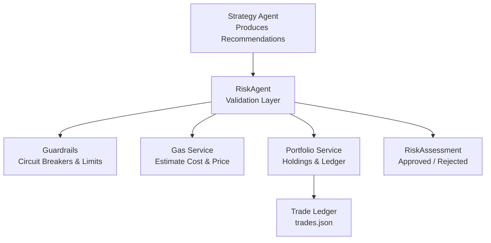
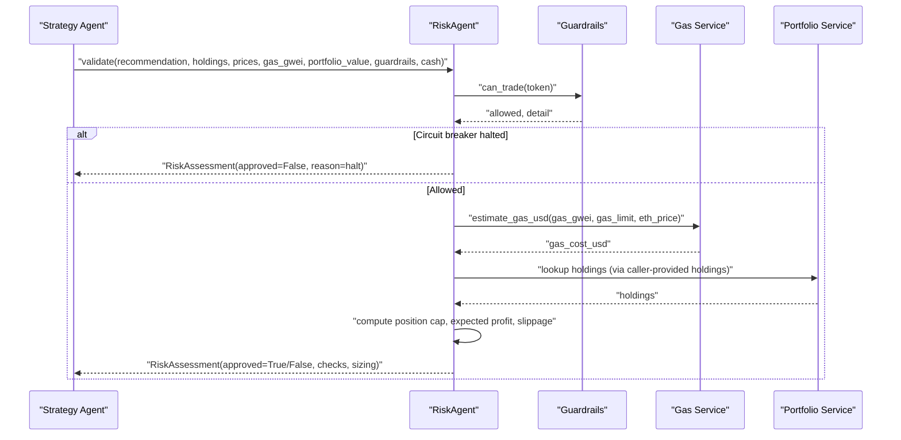
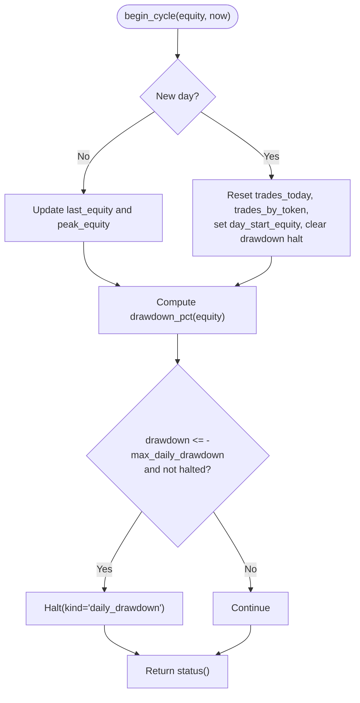
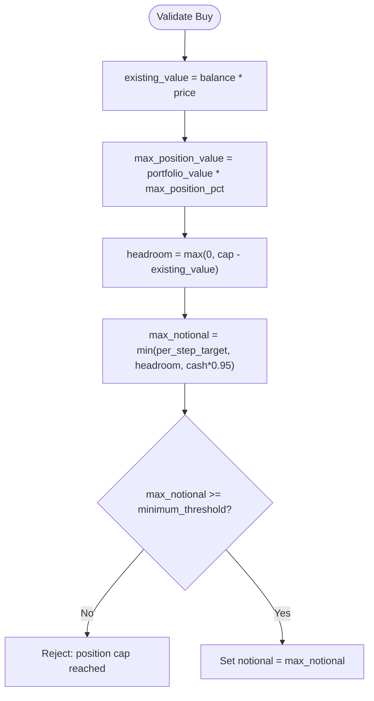
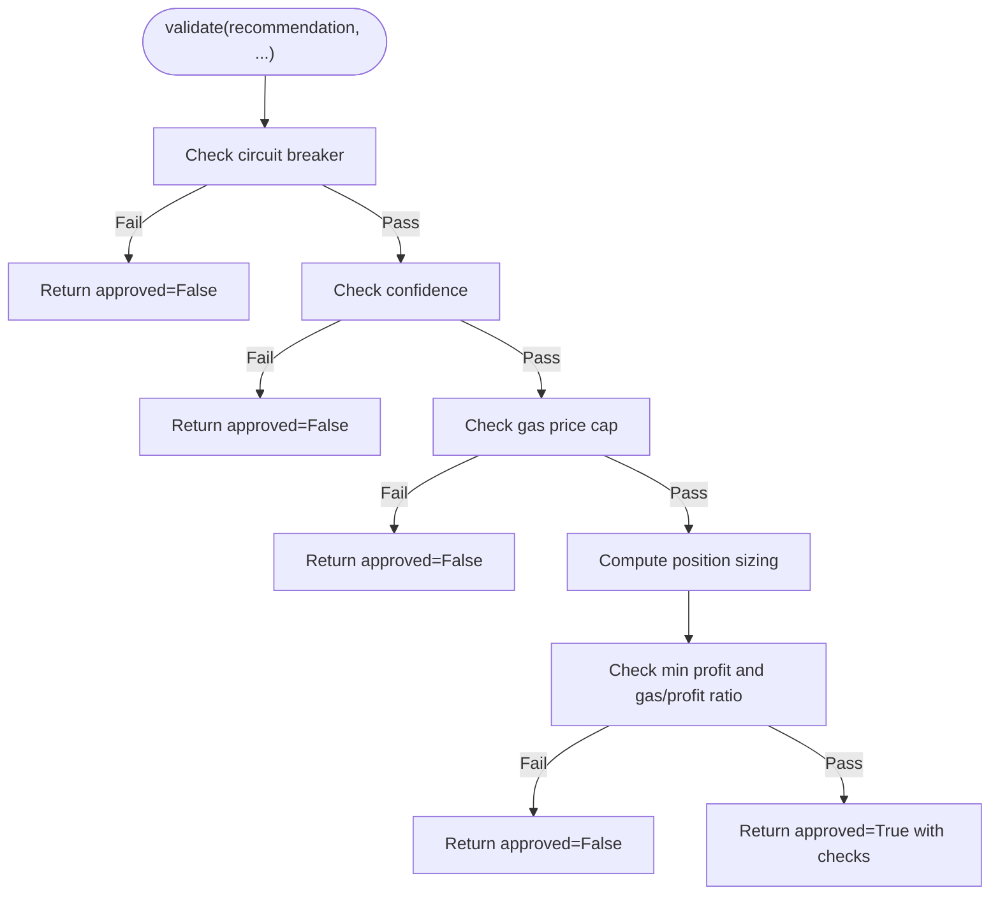
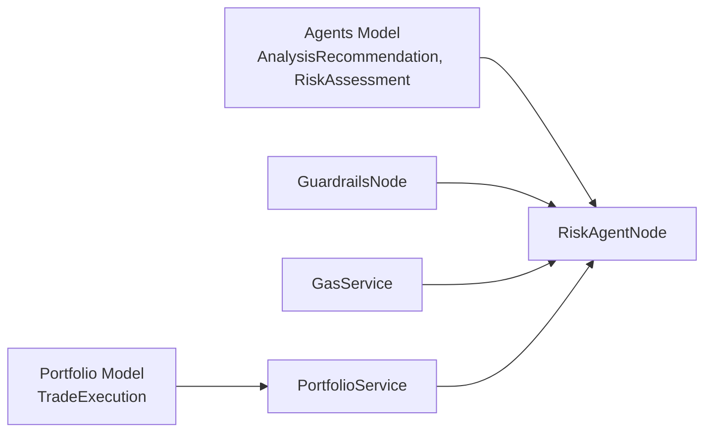

# Risk Management Rules

<cite>
**Referenced Files in This Document**
- [guardrails.py](file://backend/app/services/guardrails.py)
- [risk_agent.py](file://backend/app/agents/risk_agent.py)
- [gas.py](file://backend/app/services/gas.py)
- [portfolio.py](file://backend/app/services/portfolio.py)
- [portfolio_model.py](file://backend/app/models/portfolio.py)
- [agents_model.py](file://backend/app/models/agents.py)
- [policy.py](file://backend/app/services/policy.py)
- [test_guardrails.py](file://backend/test_guardrails.py)
- [test_risk_agent.py](file://backend/test_risk_agent.py)
</cite>

## Table of Contents
1. [Introduction](#introduction)
2. [Project Structure](#project-structure)
3. [Core Components](#core-components)
4. [Architecture Overview](#architecture-overview)
5. [Detailed Component Analysis](#detailed-component-analysis)
6. [Dependency Analysis](#dependency-analysis)
7. [Performance Considerations](#performance-considerations)
8. [Troubleshooting Guide](#troubleshooting-guide)
9. [Conclusion](#conclusion)
10. [Appendices](#appendices)

## Introduction
This document explains the risk management framework that protects trading operations from excessive exposure, adverse market conditions, and operational failures. It covers:

- The guardrail system that enforces portfolio-level circuit breakers, daily trade limits, per-token trade limits, and drawdown protection.
- The kill switch mechanism for manual or automatic halts.
- Position sizing rules based on account equity and existing exposure.
- Gas price limits and gas-to-profit filters.
- Confidence thresholds and dynamic slippage estimation.
- How positions are sized from account equity and how the system responds to stress scenarios.
- Example configurations, scenario testing guidance, and emergency response procedures.

The goal is to make the risk layer transparent, auditable, and resilient while allowing strategy agents to propose trades safely.

## Project Structure
The risk management logic is implemented primarily in Python backend services and agents:

- Guardrails provide portfolio-level state, daily counters, drawdown tracking, and halt/resume control.
- The RiskAgent validates individual trade recommendations against confidence, gas, position caps, profit expectations, and circuit breakers.
- Gas utilities estimate USD gas costs and fetch live gas prices with caching and fallbacks.
- Portfolio utilities compute holdings from executed trades and persist trade records.
- Models define recommendation, assessment, and trade execution structures used across the pipeline.
- Tests validate drawdown halts, day rollover behavior, kill switch persistence, trade limits, and risk agent checks.

**Diagram sources**
- [risk_agent.py:8-52](file://backend/app/agents/risk_agent.py#L8-L52)
- [guardrails.py:16-39](file://backend/app/services/guardrails.py#L16-L39)
- [gas.py:20-59](file://backend/app/services/gas.py#L20-L59)
- [portfolio.py:14-57](file://backend/app/services/portfolio.py#L14-L57)
- [agents_model.py:25-52](file://backend/app/models/agents.py#L25-L52)

**Section sources**
- [guardrails.py:1-165](file://backend/app/services/guardrails.py#L1-L165)
- [risk_agent.py:1-215](file://backend/app/agents/risk_agent.py#L1-L215)
- [gas.py:1-60](file://backend/app/services/gas.py#L1-L60)
- [portfolio.py:1-96](file://backend/app/services/portfolio.py#L1-L96)
- [portfolio_model.py:1-37](file://backend/app/models/portfolio.py#L1-L37)
- [agents_model.py:1-81](file://backend/app/models/agents.py#L1-L81)

## Core Components
- GuardrailConfig and Guardrails: Define default risk parameters and maintain daily state including drawdown, trade counts, and halt status. They expose begin_cycle, can_trade, record_trade, halt, resume, and status reporting.
- RiskAgent: Validates a recommendation through a sequence of checks: circuit breaker, confidence, gas cap, position sizing, minimum profit, and gas-to-profit ratio. Returns a structured RiskAssessment with detailed check results.
- Gas Service: Estimates USD gas cost and retrieves current gas prices from an RPC endpoint with caching and conservative fallbacks.
- Portfolio Service: Loads/saves executed trades and computes current token holdings from trade history.
- Models: Define AnalysisRecommendation, RiskAssessment, TradeExecution, and related structures.

Key responsibilities:
- Guardrails enforce portfolio-level constraints independent of strategy.
- RiskAgent performs per-trade validation and sizing.
- Gas service provides realistic fee estimates.
- Portfolio service supplies holdings and trade ledger data.

**Section sources**
- [guardrails.py:16-165](file://backend/app/services/guardrails.py#L16-L165)
- [risk_agent.py:8-215](file://backend/app/agents/risk_agent.py#L8-L215)
- [gas.py:20-59](file://backend/app/services/gas.py#L20-L59)
- [portfolio.py:14-96](file://backend/app/services/portfolio.py#L14-L96)
- [agents_model.py:25-52](file://backend/app/models/agents.py#L25-L52)

## Architecture Overview
The risk architecture separates concerns between portfolio-level guards and per-trade validation:

- Strategy produces an AnalysisRecommendation (token, action, confidence, price, indicators).
- RiskAgent consumes the recommendation plus holdings, market prices, gas price, portfolio value, available cash, and optional Guardrails instance.
- Guardrails may halt trading due to daily drawdown breaches, manual kill switch, or frequency caps.
- RiskAgent calculates expected profit, maximum notional size, and slippage; it rejects trades that violate confidence, gas cap, position cap, or profit thresholds.
- Approved assessments include estimated gas cost, expected profit, max notional, and a list of checks for auditability.

**Diagram sources**
- [risk_agent.py:24-190](file://backend/app/agents/risk_agent.py#L24-L190)
- [guardrails.py:92-112](file://backend/app/services/guardrails.py#L92-L112)
- [gas.py:20-24](file://backend/app/services/gas.py#L20-L24)
- [portfolio.py:59-92](file://backend/app/services/portfolio.py#L59-L92)

## Detailed Component Analysis

### Guardrail System and Portfolio-Level Circuit Breakers
Guardrails implement portfolio-level controls:

- Daily trade limit: Prevents exceeding a configured number of trades per day.
- Per-token trade limit: Prevents over-trading a single token within the day.
- Daily drawdown protection: Computes drawdown relative to day-start equity and halts trading when breached.
- Kill switch: Supports manual halts that survive day rollovers; drawdown-induced halts reset at the start of a new day.
- Status reporting: Provides halted state, reasons, day, equity, drawdown percentage, trade counts, and configuration values.

Configuration defaults include:
- Max daily trades
- Max trades per token
- Max daily drawdown threshold
- Max position percentage
- Minimum expected profit in USD
- Maximum gas price in gwei
- Gas limit

Lifecycle methods:
- begin_cycle: Rolls the trading day, resets counters if needed, updates equity metrics, and triggers drawdown-based halt if applicable.
- can_trade: Checks halt state, daily limit, and per-token limit.
- record_trade: Increments daily and per-token counters.
- halt/resume: Manually engages or clears the kill switch.
- status/to_dict/from_dict: Reporting and persistence helpers.

**Diagram sources**
- [guardrails.py:46-78](file://backend/app/services/guardrails.py#L46-L78)
- [guardrails.py:81-89](file://backend/app/services/guardrails.py#L81-L89)

**Section sources**
- [guardrails.py:16-165](file://backend/app/services/guardrails.py#L16-L165)
- [test_guardrails.py:10-59](file://backend/test_guardrails.py#L10-L59)

### Kill Switch Functionality
The kill switch can be engaged manually or triggered automatically by daily drawdown:

- Manual kill switch: Persisted across day rollovers until explicitly resumed.
- Drawdown kill switch: Automatically engaged when daily drawdown breaches the configured threshold; cleared on the next day’s begin_cycle.
- can_trade returns a clear reason when halted, enabling UI and audit logs to explain rejections.

Operational implications:
- When halted, all trade approvals fail immediately.
- Operators must call resume to restore trading after addressing the underlying issue.

**Section sources**
- [guardrails.py:30-39](file://backend/app/services/guardrails.py#L30-L39)
- [guardrails.py:46-78](file://backend/app/services/guardrails.py#L46-L78)
- [guardrails.py:81-107](file://backend/app/services/guardrails.py#L81-L107)
- [test_guardrails.py:29-35](file://backend/test_guardrails.py#L29-L35)

### Position Caps and Sizing Based on Account Equity
Position sizing ensures exposure remains bounded relative to portfolio equity:

- For buys:
  - Existing position value is computed from holdings and current price.
  - Maximum allowed position value equals portfolio_value multiplied by max_position_pct.
  - Headroom is calculated as the difference between the cap and existing value.
  - Notional size is constrained by:
    - A per-step target fraction of portfolio value.
    - Available headroom.
    - Cash availability capped at a high proportion of available cash.
  - Minimum notional threshold prevents dust-sized trades.
- For sells:
  - Requires non-zero holdings.
  - Uses sell_fraction to determine portion to sell.
  - Notional derived from quantity, price, and fraction.

Sizing outputs:
- max_notional_usd indicates the maximum dollar amount approved for the trade.
- expected_profit_usd reflects projected profit used for min-profit and gas-to-profit checks.

**Diagram sources**
- [risk_agent.py:100-130](file://backend/app/agents/risk_agent.py#L100-L130)

**Section sources**
- [risk_agent.py:84-130](file://backend/app/agents/risk_agent.py#L84-L130)
- [test_risk_agent.py:72-75](file://backend/test_risk_agent.py#L72-L75)

### Gas Price Limits and Gas-to-Profit Filter
Gas controls protect profitability and prevent expensive executions:

- Gas price cap: Current gas_gwei must not exceed config.max_gas_gwei.
- Gas cost estimation: USD cost computed from gas_gwei, gas_limit, and ETH price.
- Gas-to-profit filter: For buys and non-stop-loss sells, gas cost must be below a threshold percentage of expected profit.

Behavior:
- If gas price exceeds the cap, the trade is rejected immediately.
- If gas cost is too large relative to expected profit, the trade is rejected to avoid eroding margins.

**Section sources**
- [risk_agent.py:71-79](file://backend/app/agents/risk_agent.py#L71-L79)
- [risk_agent.py:150-174](file://backend/app/agents/risk_agent.py#L150-L174)
- [gas.py:20-24](file://backend/app/services/gas.py#L20-L24)

### Confidence Thresholds and Dynamic Slippage
Confidence and slippage controls manage signal quality and execution risk:

- Confidence threshold: Recommendation confidence must meet or exceed min_confidence.
- Dynamic slippage: Estimated slippage increases with volatility and volume spikes:
  - Base slippage depends on absolute pct_change thresholds.
  - Volume spike adds extra slippage.
  - Absolute maximum slippage caps the final value.

Purpose:
- High-confidence signals reduce false positives.
- Adaptive slippage accounts for market turbulence and liquidity conditions.

**Section sources**
- [risk_agent.py:61-69](file://backend/app/agents/risk_agent.py#L61-L69)
- [risk_agent.py:203-214](file://backend/app/agents/risk_agent.py#L203-L214)
- [agents_model.py:25-40](file://backend/app/models/agents.py#L25-L40)

### Risk Assessment Calculation Flow
The RiskAgent.validate method executes a deterministic sequence of checks:

1. Circuit breaker and frequency caps via Guardrails.can_trade.
2. Confidence threshold check.
3. Gas price ceiling check.
4. Position sizing and exposure checks (buy vs sell).
5. Minimum profit and gas-to-profit checks (with exemptions for stop-loss/trailing-stop exits).
6. Approval with detailed checks and sizing outputs.

**Diagram sources**
- [risk_agent.py:24-190](file://backend/app/agents/risk_agent.py#L24-L190)

**Section sources**
- [risk_agent.py:24-190](file://backend/app/agents/risk_agent.py#L24-L190)
- [test_risk_agent.py:53-103](file://backend/test_risk_agent.py#L53-L103)

### Portfolio Holdings and Trade Ledger
Portfolio utilities provide holdings computation and trade persistence:

- load_trades/save_trades: Read/write executed trades to a JSON file.
- add_trade: Idempotent append by transaction hash.
- get_user_holdings: Aggregates base token balances from trade history using a uniform record standard.

Implications for risk:
- RiskAgent receives holdings from callers; portfolio service computes them from historical trades.
- Trade ledger supports auditing and post-execution analysis.

**Section sources**
- [portfolio.py:14-96](file://backend/app/services/portfolio.py#L14-L96)
- [portfolio_model.py:17-37](file://backend/app/models/portfolio.py#L17-L37)

### Execution Policy and Auto-Tradeable Tokens
Shared policy constants define auto-tradeable tokens and stablecoins:

- AUTO_TRADE_TARGETS enumerates tokens eligible for automated trading.
- STABLECOINS enumerates stablecoin symbols.
- is_auto_tradeable helper checks eligibility.

Relevance:
- Risk policies often apply selectively to auto-tradeable assets.
- Frontend executor mirrors this list to keep client and server in sync.

**Section sources**
- [policy.py:1-12](file://backend/app/services/policy.py#L1-L12)

## Dependency Analysis
The risk subsystem has clear dependencies:

- RiskAgent depends on:
  - AnalysisRecommendation and RiskAssessment models.
  - Gas service for USD gas cost estimation.
  - Guardrails for circuit breaker and frequency checks.
- Guardrails depend on:
  - Configuration defaults and time utilities.
- Gas service depends on:
  - HTTP client for RPC calls and environment variables for RPC URL.
- Portfolio service depends on:
  - TradeExecution model and filesystem I/O.

**Diagram sources**
- [risk_agent.py:1-5](file://backend/app/agents/risk_agent.py#L1-L5)
- [agents_model.py:25-52](file://backend/app/models/agents.py#L25-L52)
- [portfolio_model.py:17-37](file://backend/app/models/portfolio.py#L17-L37)

**Section sources**
- [risk_agent.py:1-5](file://backend/app/agents/risk_agent.py#L1-L5)
- [agents_model.py:25-52](file://backend/app/models/agents.py#L25-L52)
- [portfolio_model.py:17-37](file://backend/app/models/portfolio.py#L17-L37)

## Performance Considerations
- Gas price fetching uses a short-lived cache to reduce RPC overhead and includes a conservative fallback to avoid blocking the agent loop.
- Risk checks are lightweight computations designed to run frequently without heavy I/O.
- Portfolio holdings are computed from in-memory trade lists loaded once at module initialization; frequent reloads should use provided reload functions.
- Guardrails maintain minimal state and use simple arithmetic for drawdown and counters.

Best practices:
- Avoid unnecessary recomputation of holdings; pass precomputed holdings to RiskAgent.
- Use cached gas prices where possible; rely on fallbacks rather than failing fast on RPC errors.
- Keep Guardrails.begin_cycle calls aligned with real time boundaries to ensure accurate daily resets.

[No sources needed since this section provides general guidance]

## Troubleshooting Guide
Common rejection reasons and diagnostics:

- Trading halted:
  - Cause: Manual kill switch or daily drawdown breach.
  - Action: Inspect halt_reason and halt_kind; resume only after addressing the root cause.
- Confidence below threshold:
  - Cause: Signal strength insufficient.
  - Action: Review strategy inputs and indicator readiness.
- Gas price exceeds cap:
  - Cause: Network congestion or misconfiguration.
  - Action: Lower gas_gwei or increase max_gas_gwei cautiously; monitor chain conditions.
- Position cap reached:
  - Cause: Existing exposure near configured maximum.
  - Action: Reduce position size or wait for partial exits.
- Expected profit below minimum:
  - Cause: Small notional or low gain expectation.
  - Action: Increase trade size within caps or improve entry timing.
- Gas cost too high relative to profit:
  - Cause: Thin margin or volatile fees.
  - Action: Wait for lower gas or adjust expected profit assumptions.

Diagnostics:
- RiskAssessment.checks contains per-check details for each validation step.
- Guardrails.status returns comprehensive state including drawdown percentage and trade counts.
- Test suites demonstrate expected behaviors for drawdown halts, day rollovers, kill switch persistence, and risk agent validations.

**Section sources**
- [risk_agent.py:37-47](file://backend/app/agents/risk_agent.py#L37-L47)
- [risk_agent.py:61-174](file://backend/app/agents/risk_agent.py#L61-L174)
- [guardrails.py:115-133](file://backend/app/services/guardrails.py#L115-L133)
- [test_guardrails.py:10-59](file://backend/test_guardrails.py#L10-L59)
- [test_risk_agent.py:60-103](file://backend/test_risk_agent.py#L60-L103)

## Conclusion
The risk management framework combines portfolio-level circuit breakers with granular per-trade validation to protect capital and maintain disciplined exposure. Guardrails enforce daily limits, drawdown protection, and kill switch functionality, while RiskAgent applies confidence thresholds, gas caps, position sizing, and profit filters. Together, these components create a robust safety net that adapts to market conditions and provides clear, auditable decisions for every trade proposal.

[No sources needed since this section summarizes without analyzing specific files]

## Appendices

### Risk Rule Configuration Examples
Example configurations illustrate how to tune risk parameters:

- Conservative mode:
  - max_daily_trades: 10
  - max_trades_per_token: 3
  - max_daily_drawdown: 0.03
  - max_position_pct: 0.05
  - min_profit_usd: 0.20
  - max_gas_gwei: 30.0
  - gas_limit: 200_000
- Aggressive mode:
  - max_daily_trades: 30
  - max_trades_per_token: 10
  - max_daily_drawdown: 0.08
  - max_position_pct: 0.15
  - min_profit_usd: 0.05
  - max_gas_gwei: 80.0
  - gas_limit: 300_000

These examples map directly to GuardrailConfig fields and influence RiskAgent validation outcomes.

**Section sources**
- [guardrails.py:16-24](file://backend/app/services/guardrails.py#L16-L24)

### Scenario Testing Guidance
Use the test patterns to simulate different market conditions:

- Drawdown stress:
  - Simulate equity decline beyond max_daily_drawdown and verify halt.
  - Confirm reset on next day boundary.
- Kill switch stress:
  - Engage manual halt and verify persistence across day rollover.
- Frequency caps:
  - Exceed daily and per-token limits and verify can_trade rejections.
- Risk agent validations:
  - Test buy sizing and approval under normal conditions.
  - Test gas cap rejections and position cap exhaustion.
  - Test minimum profit rejections for small portfolios.
  - Verify stop-loss exemption from min-profit checks.
  - Validate dynamic slippage scaling with volatility.

Reference implementations:
- Drawdown and day rollover tests.
- Kill switch persistence tests.
- Risk agent buy/sell, gas cap, position cap, min profit, and slippage tests.

**Section sources**
- [test_guardrails.py:10-59](file://backend/test_guardrails.py#L10-L59)
- [test_risk_agent.py:53-103](file://backend/test_risk_agent.py#L53-L103)

### Emergency Response Procedures
When adverse conditions occur:

- Immediate actions:
  - Engage manual kill switch if drawdown or anomaly warrants immediate halt.
  - Monitor Guardrails.status for halt_reason and halt_kind.
  - Review RiskAssessment.checks to identify which rule blocked trading.
- Recovery steps:
  - Address root cause (e.g., network congestion, strategy failure).
  - Resume trading only after confirming risk parameters are appropriate.
  - Reassess position sizes and expected profits before resuming.
- Post-incident review:
  - Audit RiskAssessment.checks and Guardrails.status snapshots.
  - Adjust GuardrailConfig thresholds if necessary.
  - Update strategy inputs to improve confidence and reduce slippage.

**Section sources**
- [guardrails.py:81-89](file://backend/app/services/guardrails.py#L81-L89)
- [guardrails.py:115-133](file://backend/app/services/guardrails.py#L115-L133)
- [risk_agent.py:37-47](file://backend/app/agents/risk_agent.py#L37-L47)