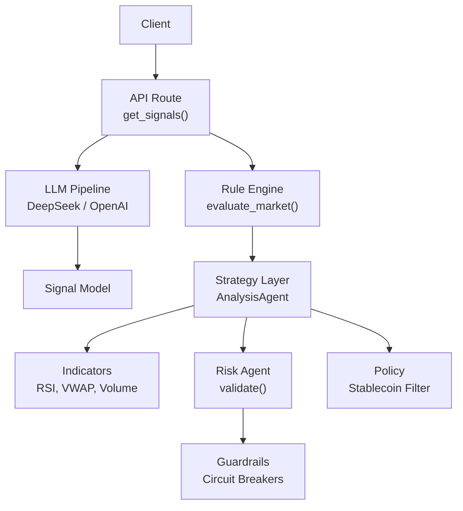
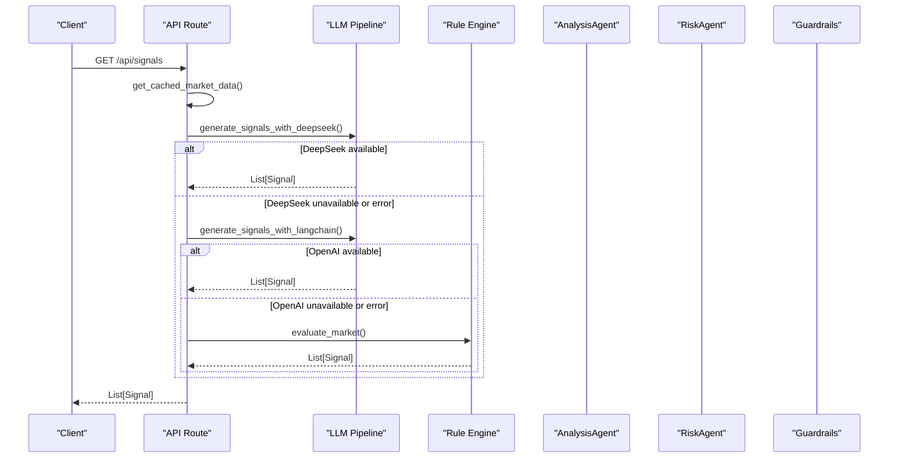
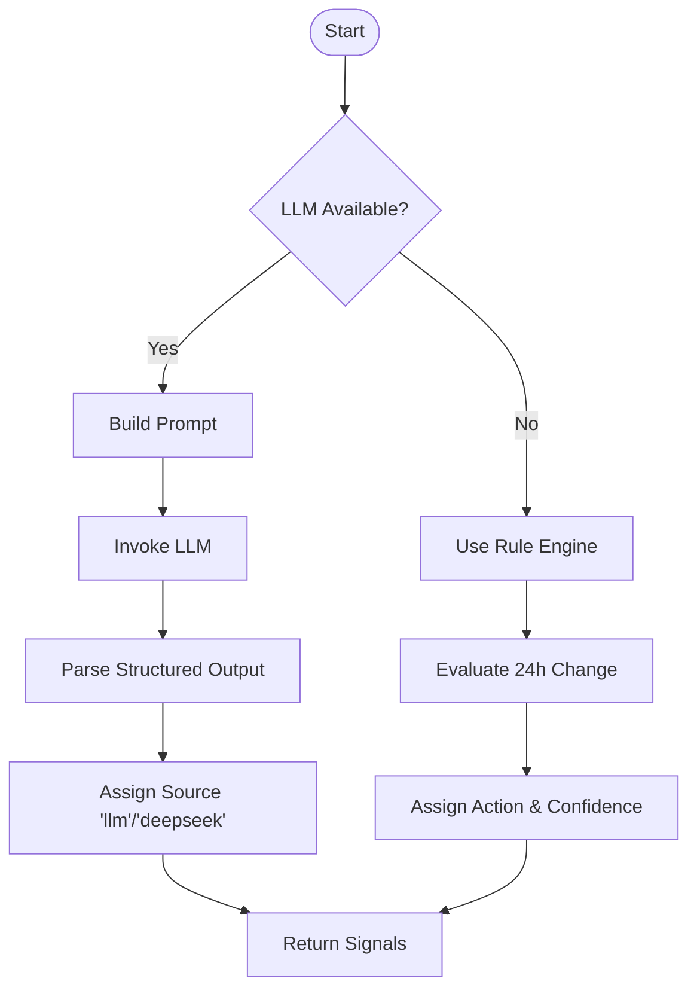
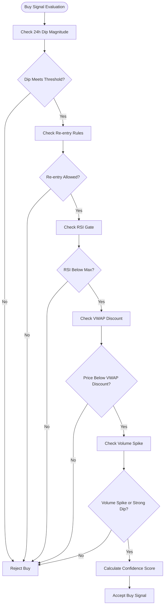
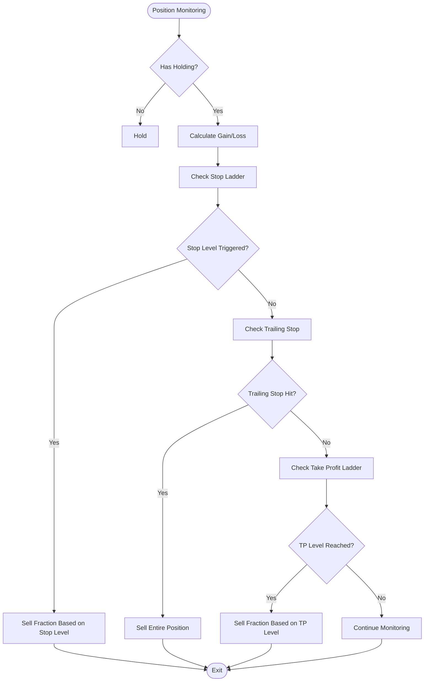
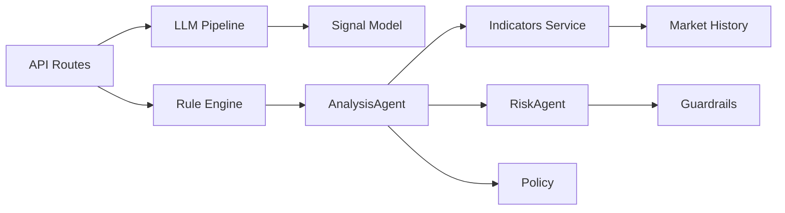

# Signal Generation Logic

<cite>
**Referenced Files in This Document**
- [routes_signals.py](file://backend/app/api/routes_signals.py)
- [langchain_signals.py](file://backend/app/agents/langchain_signals.py)
- [strategy.py](file://backend/app/services/strategy.py)
- [analysis_agent.py](file://backend/app/agents/analysis_agent.py)
- [risk_agent.py](file://backend/app/agents/risk_agent.py)
- [guardrails.py](file://backend/app/services/guardrails.py)
- [indicators.py](file://backend/app/services/indicators.py)
- [signals.py](file://backend/app/models/signals.py)
- [market.py](file://backend/app/models/market.py)
- [policy.py](file://backend/app/services/policy.py)
</cite>

## Table of Contents
1. [Introduction](#introduction)
2. [Project Structure](#project-structure)
3. [Core Components](#core-components)
4. [Architecture Overview](#architecture-overview)
5. [Detailed Component Analysis](#detailed-component-analysis)
6. [Dependency Analysis](#dependency-analysis)
7. [Performance Considerations](#performance-considerations)
8. [Troubleshooting Guide](#troubleshooting-guide)
9. [Conclusion](#conclusion)
10. [Appendices](#appendices)

## Introduction
This document explains how trading signals are generated, combined, scored, filtered, and validated before execution in the DexTrader system. It covers:
- How multiple indicators are combined into actionable buy/sell/hold signals
- The confidence scoring mechanism and threshold-based decision logic
- Position sizing algorithms, entry point determination, and exit strategies including stop ladders and trailing stops
- Examples of signal generation workflows
- Parameter tuning for different market conditions
- Validation and guardrail checks before execution

The system supports three signal sources:
- Rule-based strategy using technical indicators
- LLM-generated signals via OpenAI or DeepSeek
- A simple fallback rule engine based on 24-hour price change

## Project Structure
Signal generation spans API routes, agents, services, models, and configuration:
- API route exposes a signals endpoint that chooses between LLM and rules
- LLM pipeline builds prompts and parses structured outputs
- Rule-based strategy evaluates dips, exits, and position management
- Risk agent validates recommendations against portfolio constraints and gas costs
- Guardrails enforce daily limits, drawdowns, and kill switches
- Indicators provide RSI, VWAP, volume ratio, and spike detection
- Models define signals, market snapshots, and recommendation structures

**Diagram sources**
- [routes_signals.py:20-53](file://backend/app/api/routes_signals.py#L20-L53)
- [langchain_signals.py:19-58](file://backend/app/agents/langchain_signals.py#L19-L58)
- [strategy.py:8-38](file://backend/app/services/strategy.py#L8-L38)
- [analysis_agent.py:10-40](file://backend/app/agents/analysis_agent.py#L10-L40)
- [risk_agent.py:8-33](file://backend/app/agents/risk_agent.py#L8-L33)
- [guardrails.py:16-39](file://backend/app/services/guardrails.py#L16-L39)
- [indicators.py:17-96](file://backend/app/services/indicators.py#L17-L96)
- [policy.py:6-11](file://backend/app/services/policy.py#L6-L11)

**Section sources**
- [routes_signals.py:1-55](file://backend/app/api/routes_signals.py#L1-L55)
- [langchain_signals.py:1-123](file://backend/app/agents/langchain_signals.py#L1-L123)
- [strategy.py:1-39](file://backend/app/services/strategy.py#L1-L39)
- [analysis_agent.py:1-349](file://backend/app/agents/analysis_agent.py#L1-L349)
- [risk_agent.py:1-215](file://backend/app/agents/risk_agent.py#L1-L215)
- [guardrails.py:1-165](file://backend/app/services/guardrails.py#L1-L165)
- [indicators.py:1-97](file://backend/app/services/indicators.py#L1-L97)
- [signals.py:1-16](file://backend/app/models/signals.py#L1-L16)
- [market.py:1-42](file://backend/app/models/market.py#L1-L42)
- [policy.py:1-12](file://backend/app/services/policy.py#L1-L12)

## Core Components
- Signal model defines pair, action, confidence, explanation, source, and timestamp
- Market snapshot aggregates trading pairs with price and 24h change
- API route selects signal source and returns list of signals
- LLM pipeline constructs prompt, invokes model, and parses structured output
- Rule engine generates basic signals from 24h change thresholds
- AnalysisAgent implements dip buying, indicator gating, and exit ladders
- RiskAgent validates confidence, gas, position sizing, expected profit, and slippage
- Guardrails enforce daily trade caps, per-token caps, drawdown halt, and status reporting
- Indicators compute RSI, VWAP, volume ratio, and spike detection

**Section sources**
- [signals.py:1-16](file://backend/app/models/signals.py#L1-L16)
- [market.py:5-16](file://backend/app/models/market.py#L5-L16)
- [routes_signals.py:20-53](file://backend/app/api/routes_signals.py#L20-L53)
- [langchain_signals.py:19-58](file://backend/app/agents/langchain_signals.py#L19-L58)
- [strategy.py:8-38](file://backend/app/services/strategy.py#L8-L38)
- [analysis_agent.py:10-40](file://backend/app/agents/analysis_agent.py#L10-L40)
- [risk_agent.py:8-33](file://backend/app/agents/risk_agent.py#L8-L33)
- [guardrails.py:16-39](file://backend/app/services/guardrails.py#L16-L39)
- [indicators.py:17-96](file://backend/app/services/indicators.py#L17-L96)

## Architecture Overview
The signal generation architecture combines deterministic rules and probabilistic LLM outputs with robust risk validation:

**Diagram sources**
- [routes_signals.py:20-53](file://backend/app/api/routes_signals.py#L20-L53)
- [langchain_signals.py:40-58](file://backend/app/agents/langchain_signals.py#L40-L58)
- [langchain_signals.py:61-122](file://backend/app/agents/langchain_signals.py#L61-L122)
- [strategy.py:8-38](file://backend/app/services/strategy.py#L8-L38)

## Detailed Component Analysis

### Buy/Sell Signal Creation Process
Signals are created through two primary paths:
- LLM path: Prompt-based analysis producing structured signals with confidence and reasoning
- Rules path: Simple thresholding on 24h price change to produce buy/sell/hold signals

The LLM path uses LangChain to build a chain that parses structured output into Signal objects. The rules path iterates over market pairs and assigns actions based on change thresholds.

**Diagram sources**
- [langchain_signals.py:19-58](file://backend/app/agents/langchain_signals.py#L19-L58)
- [langchain_signals.py:61-122](file://backend/app/agents/langchain_signals.py#L61-L122)
- [strategy.py:8-38](file://backend/app/services/strategy.py#L8-L38)

**Section sources**
- [langchain_signals.py:19-58](file://backend/app/agents/langchain_signals.py#L19-L58)
- [langchain_signals.py:61-122](file://backend/app/agents/langchain_signals.py#L61-L122)
- [strategy.py:8-38](file://backend/app/services/strategy.py#L8-L38)

### Indicator Combination and Confidence Scoring
The AnalysisAgent combines multiple indicators to determine buy signals:
- RSI gate: Avoid catching falling knives by requiring RSI below threshold
- VWAP discount: Require price below VWAP for better entry
- Volume spike filter: Mandatory confirmation when indicators are ready
- Dip magnitude: Stronger dips receive higher confidence

Confidence scoring adjusts based on:
- Buy step progression (incremental confidence increase)
- RSI level (lower RSI increases confidence)
- Volume spike presence (adds confidence boost)
- VWAP discount depth (deeper discount increases confidence)
- Indicator readiness (penalty if indicators still warming up)
- Dip severity (major dips increase confidence)

**Diagram sources**
- [analysis_agent.py:258-300](file://backend/app/agents/analysis_agent.py#L258-L300)
- [analysis_agent.py:302-323](file://backend/app/agents/analysis_agent.py#L302-L323)
- [indicators.py:17-96](file://backend/app/services/indicators.py#L17-L96)

**Section sources**
- [analysis_agent.py:258-323](file://backend/app/agents/analysis_agent.py#L258-L323)
- [indicators.py:17-96](file://backend/app/services/indicators.py#L17-L96)

### Exit Strategy Calculations
Exit strategies include three main mechanisms:

1. **Stop Ladder**: Progressive sell fractions at increasing loss thresholds
   - -1.5% loss: Sell 25% of remaining position
   - -3% loss: Sell 75% of remaining position  
   - -5% loss: Sell 100% of remaining position

2. **Trailing Stop**: Activated after position reaches +3% gain, sells entire position if price drops 1.5% from peak

3. **Take Profit Ladder**: Progressive profit-taking at gains
   - +1.5% gain: Sell 20% of original position
   - +3% gain: Sell 50% cumulative
   - +6% gain: Sell 90% cumulative
   - +20% gain: Cap runner position

**Diagram sources**
- [analysis_agent.py:125-188](file://backend/app/agents/analysis_agent.py#L125-L188)
- [analysis_agent.py:30-39](file://backend/app/agents/analysis_agent.py#L30-L39)

**Section sources**
- [analysis_agent.py:125-188](file://backend/app/agents/analysis_agent.py#L125-L188)
- [analysis_agent.py:30-39](file://backend/app/agents/analysis_agent.py#L30-L39)

### Position Sizing Algorithms
Position sizing is determined by the RiskAgent considering:
- Portfolio value and existing holdings
- Maximum position percentage (configurable)
- Available cash constraints
- Per-step target allocation
- Headroom calculation to avoid overexposure

For buys:
- Calculate maximum position value as portfolio_value * max_position_pct
- Determine headroom as max(0, max_position_value - existing_value)
- Limit notional to minimum of: portfolio_value * 0.08, headroom, cash * 0.95
- Ensure minimum notional of $2.00

For sells:
- Calculate notional based on balance * price * sell_fraction
- Validate sufficient holdings exist

**Section sources**
- [risk_agent.py:84-130](file://backend/app/agents/risk_agent.py#L84-L130)

### Entry Point Determination
Entry points are determined through:
- Dip magnitude thresholds (-2%, -5%, -8%)
- RSI oversold conditions (below 35)
- VWAP discount requirements (price below VWAP * 0.995)
- Volume spike confirmation (volume_ratio >= 2.0)
- Re-entry cooldown after stop-loss (3600 seconds)
- Price must be lower than last exit price after stop-loss

**Section sources**
- [analysis_agent.py:258-300](file://backend/app/agents/analysis_agent.py#L258-L300)
- [analysis_agent.py:20-28](file://backend/app/agents/analysis_agent.py#L20-L28)

### Signal Filtering Logic
Multiple filtering mechanisms ensure signal quality:
- Stablecoin exclusion: USDC, USDT, DAI are excluded from trading
- Indicator readiness: Fallback to weaker signals when indicators warm up
- Volume spike requirement: Mandatory when indicators are ready
- Confidence thresholds: Minimum confidence of 0.50 for execution
- Gas cost filters: Expected profit must exceed gas costs by at least 10x
- Circuit breakers: Daily trade limits and per-token limits enforced

**Section sources**
- [policy.py:6-11](file://backend/app/services/policy.py#L6-L11)
- [analysis_agent.py:91-94](file://backend/app/agents/analysis_agent.py#L91-L94)
- [risk_agent.py:61-69](file://backend/app/agents/risk_agent.py#L61-L69)
- [risk_agent.py:132-174](file://backend/app/agents/risk_agent.py#L132-L174)

## Dependency Analysis
The signal generation system has clear dependency relationships:

**Diagram sources**
- [routes_signals.py:1-55](file://backend/app/api/routes_signals.py#L1-L55)
- [analysis_agent.py:1-40](file://backend/app/agents/analysis_agent.py#L1-L40)
- [risk_agent.py:1-33](file://backend/app/agents/risk_agent.py#L1-L33)

**Section sources**
- [routes_signals.py:1-55](file://backend/app/api/routes_signals.py#L1-L55)
- [analysis_agent.py:1-40](file://backend/app/agents/analysis_agent.py#L1-L40)
- [risk_agent.py:1-33](file://backend/app/agents/risk_agent.py#L1-L33)

## Performance Considerations
- LLM calls are rate-limited and have fallback mechanisms to prevent cascading failures
- Indicator calculations are pure functions with no global state, enabling efficient computation
- Market data caching reduces redundant API calls
- Signal processing limits pairs to manageable subsets (e.g., top 10 for LLM analysis)
- Risk validation includes early exits for failed checks to minimize computational overhead

## Troubleshooting Guide
Common issues and their resolutions:

1. **LLM API Errors**: System automatically falls back to rule-based signals
2. **Insufficient Data**: Indicators return None during warmup periods, triggering conservative signals
3. **Gas Price Spikes**: Risk agent rejects trades when gas costs exceed thresholds
4. **Drawdown Limits**: Guardrails halt trading when daily drawdown exceeds configured limits
5. **Position Caps**: Trades rejected when portfolio exposure limits are reached

**Section sources**
- [routes_signals.py:28-53](file://backend/app/api/routes_signals.py#L28-L53)
- [risk_agent.py:71-79](file://backend/app/agents/risk_agent.py#L71-L79)
- [guardrails.py:65-71](file://backend/app/services/guardrails.py#L65-L71)

## Conclusion
The DexTrader signal generation system provides a robust, multi-layered approach to trading signal creation and validation. It combines deterministic technical analysis with probabilistic LLM insights while maintaining strict risk controls. The system's modular design allows for easy parameter tuning and adaptation to different market conditions, while comprehensive guardrails protect against excessive risk exposure.

## Appendices

### Parameter Tuning Guidelines

#### Conservative Markets
- Increase RSI_BUY_MAX to 30 (more restrictive)
- Increase VOLUME_SPIKE_THRESHOLD to 2.5 (stronger volume confirmation)
- Decrease TRAILING_DISTANCE to 0.01 (tighter trailing stop)
- Increase min_profit_usd to $1.00 (higher profit expectations)

#### Volatile Markets
- Decrease RSI_BUY_MAX to 40 (allow more aggressive entries)
- Decrease VOLUME_SPIKE_THRESHOLD to 1.5 (less volume confirmation needed)
- Increase TRAILING_DISTANCE to 0.02 (wider trailing stop)
- Decrease min_profit_usd to $0.50 (lower profit expectations)

#### High-Frequency Trading
- Decrease MAX_BUY_STEPS to 2 (fewer entry attempts)
- Increase STOP_REENTRY_COOLDOWN to 7200 (longer re-entry wait)
- Decrease max_daily_trades to 10 (lower daily trade limit)

**Section sources**
- [analysis_agent.py:20-39](file://backend/app/agents/analysis_agent.py#L20-L39)
- [guardrails.py:16-24](file://backend/app/services/guardrails.py#L16-L24)