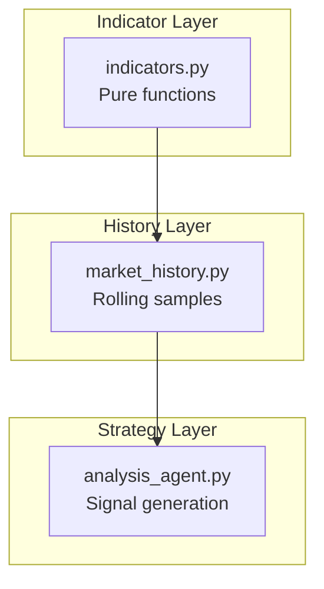
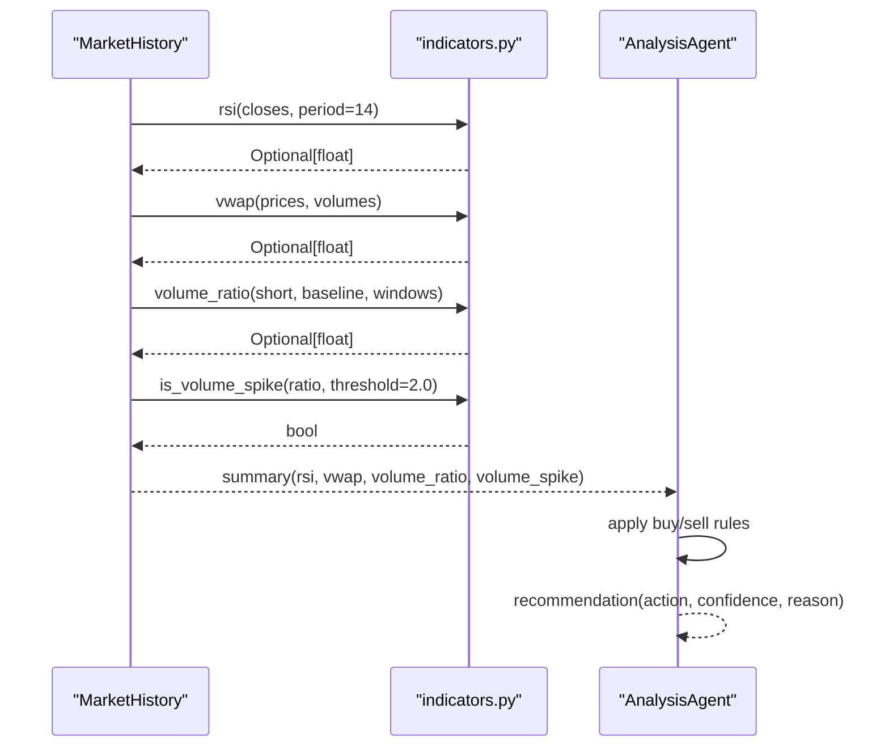
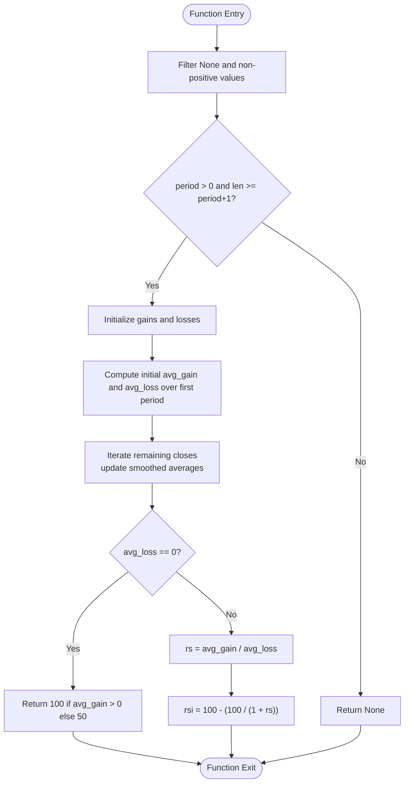
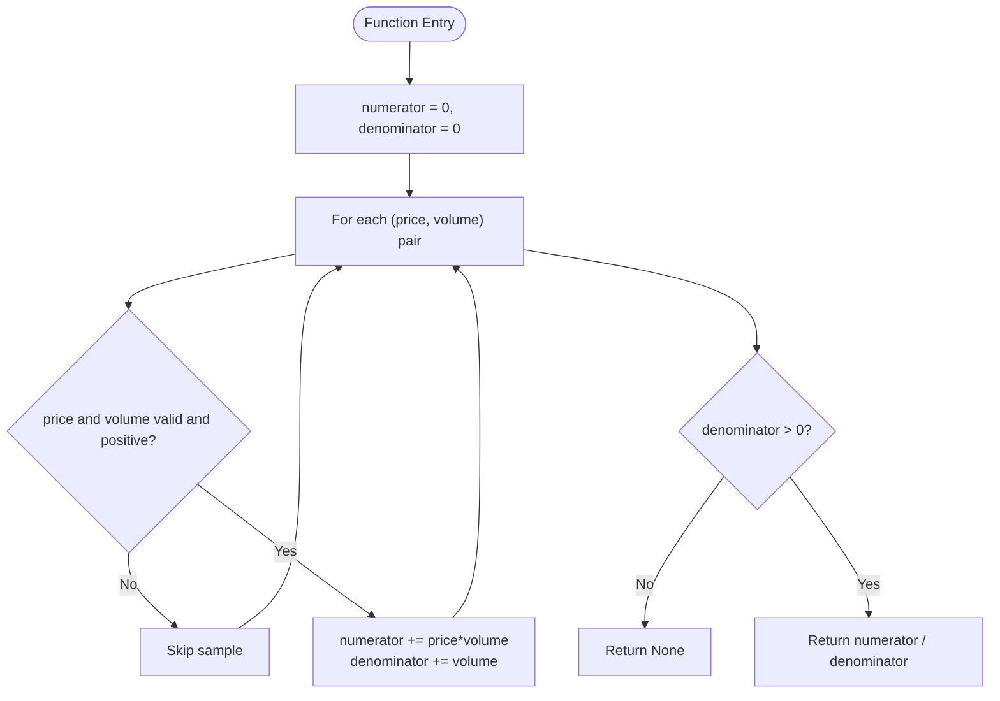
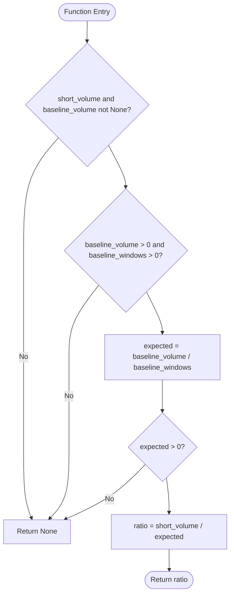
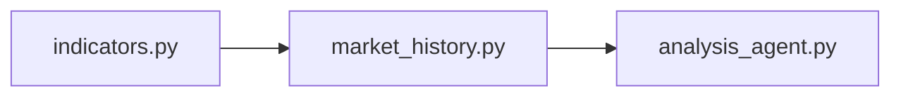

# Technical Indicators

<cite>
**Referenced Files in This Document**
- [indicators.py](file://backend/app/services/indicators.py)
- [market_history.py](file://backend/app/services/market_history.py)
- [analysis_agent.py](file://backend/app/agents/analysis_agent.py)
- [test_indicators.py](file://backend/test_indicators.py)
</cite>

## Table of Contents
1. [Introduction](#introduction)
2. [Project Structure](#project-structure)
3. [Core Components](#core-components)
4. [Architecture Overview](#architecture-overview)
5. [Detailed Component Analysis](#detailed-component-analysis)
6. [Dependency Analysis](#dependency-analysis)
7. [Performance Considerations](#performance-considerations)
8. [Troubleshooting Guide](#troubleshooting-guide)
9. [Conclusion](#conclusion)

## Introduction
This document explains the technical indicators implemented for the trading system, focusing on:
- Wilder’s Relative Strength Index (RSI) with a 14-period default
- Volume-weighted average price (VWAP)
- Volume ratio analysis and volume spike detection
- Percentage change calculations

It also documents input requirements, data validation, edge case handling, and how these indicators are combined by the analysis layer to generate buy/sell signals. The goal is to make the mathematical foundations and implementation behavior clear for both developers and non-technical readers.

## Project Structure
The indicator logic is split into two layers:
- Pure indicator math helpers that do not depend on network state or global variables
- A rolling market history service that aggregates samples and computes derived metrics such as VWAP and volume ratios

**Diagram sources**
- [indicators.py:1-97](file://backend/app/services/indicators.py#L1-L97)
- [market_history.py:1-189](file://backend/app/services/market_history.py#L1-L189)
- [analysis_agent.py:101-348](file://backend/app/agents/analysis_agent.py#L101-L348)

**Section sources**
- [indicators.py:1-97](file://backend/app/services/indicators.py#L1-L97)
- [market_history.py:1-189](file://backend/app/services/market_history.py#L1-L189)

## Core Components
The core indicator functions are:
- RSI: momentum oscillator using smoothed gains and losses
- VWAP: time-weighted price across valid price-volume pairs
- Volume ratio: short-window volume compared to baseline average
- Percentage change: relative change between new and old values

Key design principles:
- Missing or invalid inputs return None rather than neutral defaults
- Warm-up periods are respected; indicators may be unavailable until enough data exists
- All numeric operations validate positivity where required

**Section sources**
- [indicators.py:13-97](file://backend/app/services/indicators.py#L13-L97)

## Architecture Overview
The indicators are used by the analysis agent to decide whether to buy, sell, or hold. The flow is:
- Market history collects price and cumulative volume samples
- It computes RSI from recent closes, VWAP from price-volume deltas, and volume ratio comparing short vs baseline windows
- The analysis agent applies thresholds and filters to produce recommendations

**Diagram sources**
- [market_history.py:140-188](file://backend/app/services/market_history.py#L140-L188)
- [indicators.py:17-90](file://backend/app/services/indicators.py#L17-L90)
- [analysis_agent.py:101-348](file://backend/app/agents/analysis_agent.py#L101-L348)

## Detailed Component Analysis

### Wilder’s RSI(14)
Mathematical foundation:
- Compute per-period changes between consecutive closes
- Separate positive changes (gains) and negative changes (losses)
- Smooth average gain and average loss over the period using Wilder’s smoothing
- Compute RS = average gain / average loss
- RSI = 100 - (100 / (1 + RS))
- If average loss is zero, RSI saturates at 100 when there is any gain, otherwise 50

Input requirements:
- Sequence of closing prices
- Period must be positive
- Requires at least period + 1 valid closes

Data validation and edge cases:
- Invalid or non-positive values are filtered out before computation
- Returns None if insufficient data or invalid period
- Flat series yields neutral RSI near 50
- Monotonic rising/falling series saturate at 100/0 respectively

Complexity:
- Time: O(n) over the provided closes
- Space: O(1) beyond input storage

Usage example path:
- Calculate RSI with default 14-period setting from recent closes
- Handle None during warm-up by lowering confidence or skipping signals

**Section sources**
- [indicators.py:13-48](file://backend/app/services/indicators.py#L13-L48)
- [test_indicators.py:7-18](file://backend/test_indicators.py#L7-L18)

#### RSI Flowchart

**Diagram sources**
- [indicators.py:17-48](file://backend/app/services/indicators.py#L17-L48)

### VWAP Computation
Mathematical foundation:
- VWAP = sum(price * volume) / sum(volume)
- Only valid price-volume pairs contribute; missing or non-positive values are ignored

Input requirements:
- Two aligned sequences: prices and volumes
- At least one valid pair with positive price and volume

Data validation and edge cases:
- Ignores None entries and non-positive values
- Returns None if no valid denominator exists

Complexity:
- Time: O(n) over paired samples
- Space: O(1) beyond input storage

Usage example path:
- Compute VWAP from historical price-volume pairs
- Use VWAP as a dynamic support/resistance level in signal logic

**Section sources**
- [indicators.py:51-66](file://backend/app/services/indicators.py#L51-L66)
- [test_indicators.py:20-26](file://backend/test_indicators.py#L20-L26)

#### VWAP Flowchart

**Diagram sources**
- [indicators.py:51-66](file://backend/app/services/indicators.py#L51-L66)

### Volume Ratio Analysis and Spike Detection
Mathematical foundation:
- Expected baseline volume per short window = baseline_volume / baseline_windows
- Volume ratio = short_volume / expected
- Threshold-based spike detection: ratio >= threshold indicates a spike

Input requirements:
- Short window volume
- Baseline volume over multiple short windows
- Baseline windows multiplier must be positive

Data validation and edge cases:
- Returns None if either volume is None or baseline is non-positive
- Returns None if expected baseline is non-positive
- Spike detection returns boolean only when ratio is available

Complexity:
- Time: O(1) once volumes are aggregated
- Space: O(1)

Usage example path:
- Aggregate short and baseline volumes from rolling samples
- Detect spikes to confirm dips or breakouts

**Section sources**
- [indicators.py:69-90](file://backend/app/services/indicators.py#L69-L90)
- [test_indicators.py:28-33](file://backend/test_indicators.py#L28-L33)

#### Volume Ratio Flowchart

**Diagram sources**
- [indicators.py:69-86](file://backend/app/services/indicators.py#L69-L86)

### Percentage Change Calculation
Mathematical foundation:
- pct_change = (new - old) / old

Input requirements:
- New and old values must be present
- Old value must be non-zero

Data validation and edge cases:
- Returns None if new or old is None or old equals zero

Complexity:
- Time: O(1)
- Space: O(1)

Usage example path:
- Compute percentage change for 24h price movement to inform dip strength

**Section sources**
- [indicators.py:93-96](file://backend/app/services/indicators.py#L93-L96)

## Dependency Analysis
The indicators module is pure and has no external dependencies. The market history module depends on it to compute derived metrics. The analysis agent consumes the summary produced by market history to generate actionable signals.

**Diagram sources**
- [indicators.py:1-97](file://backend/app/services/indicators.py#L1-L97)
- [market_history.py:1-189](file://backend/app/services/market_history.py#L1-L189)
- [analysis_agent.py:101-348](file://backend/app/agents/analysis_agent.py#L101-L348)

**Section sources**
- [indicators.py:1-97](file://backend/app/services/indicators.py#L1-L97)
- [market_history.py:1-189](file://backend/app/services/market_history.py#L1-L189)
- [analysis_agent.py:101-348](file://backend/app/agents/analysis_agent.py#L101-L348)

## Performance Considerations
- RSI uses a single pass over closes with constant extra memory; suitable for real-time updates
- VWAP accumulates sums in a single pass; avoid recomputing over large datasets by limiting windows
- Volume ratio requires aggregation of short and baseline windows; ensure efficient delta computation
- Avoid unnecessary recomputation by caching results within the same cycle
- Be mindful of warm-up periods; indicators returning None should reduce confidence rather than force decisions

[No sources needed since this section provides general guidance]

## Troubleshooting Guide
Common issues and resolutions:
- RSI returns None:
  - Cause: Insufficient closes or invalid period
  - Resolution: Ensure at least period + 1 valid closes; verify period > 0
- VWAP returns None:
  - Cause: No valid price-volume pairs or all volumes non-positive
  - Resolution: Provide aligned positive price and volume samples
- Volume ratio returns None:
  - Cause: Missing volumes or non-positive baseline/window parameters
  - Resolution: Validate baseline windows and ensure positive baseline volume
- Percentage change returns None:
  - Cause: Missing values or old equals zero
  - Resolution: Guard against division by zero and ensure both values exist

Validation patterns:
- Always check for None before downstream logic
- Treat None as “not ready” and lower confidence or skip signals
- Use tests to assert expected behaviors for edge cases

**Section sources**
- [test_indicators.py:7-33](file://backend/test_indicators.py#L7-L33)

## Conclusion
The technical indicators in this system are designed to be robust, transparent, and safe under uncertainty:
- RSI(14) captures momentum while respecting warm-up and saturation conditions
- VWAP provides a volume-aware average price for dynamic reference levels
- Volume ratio and spike detection add confirmation through liquidity context
- Percentage change supports dip strength assessment

Together, they enable disciplined signal generation: RSI avoids catching falling knives, VWAP ensures buying below fair value, and volume spikes confirm participation. During warm-up, indicators gracefully return None, allowing the strategy to lower confidence rather than act prematurely.

[No sources needed since this section summarizes without analyzing specific files]