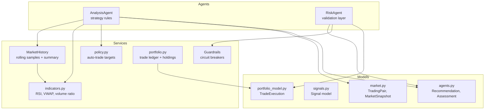
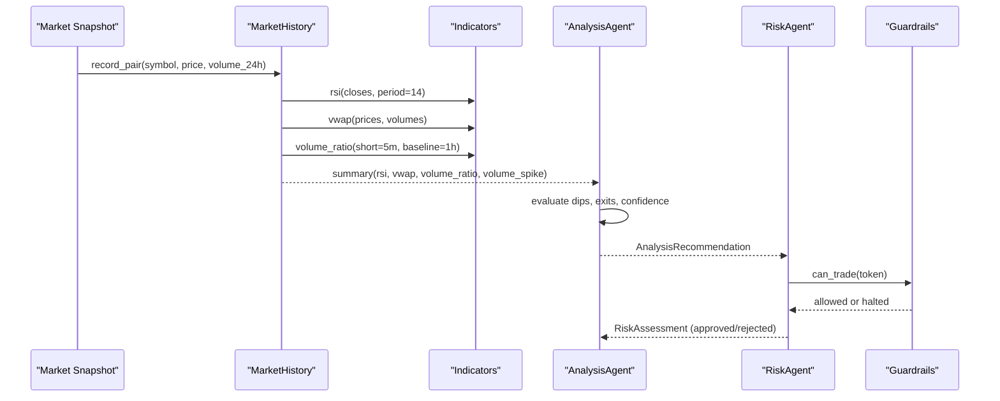
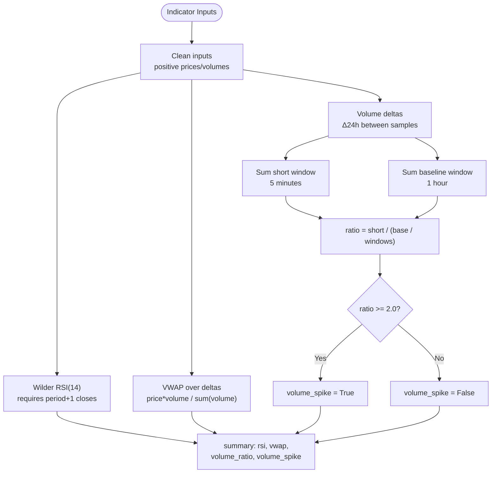
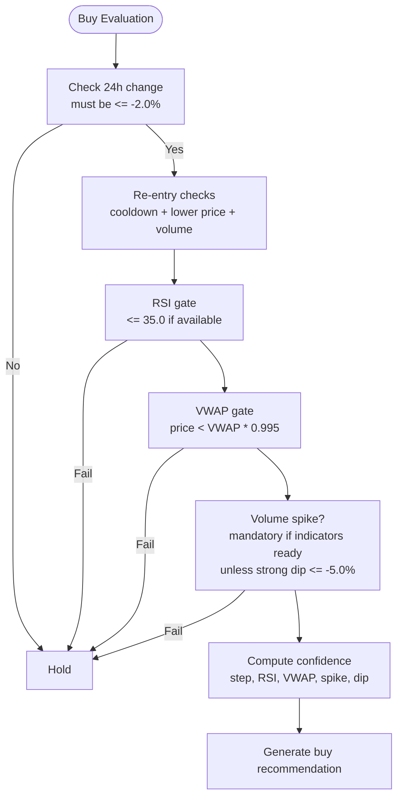
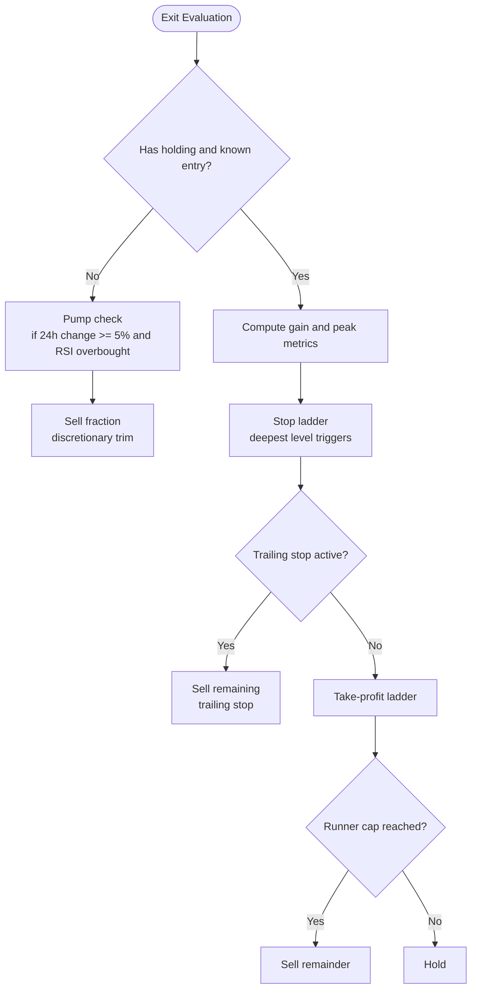
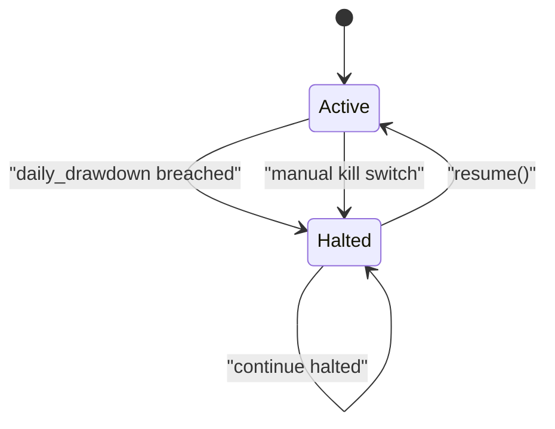
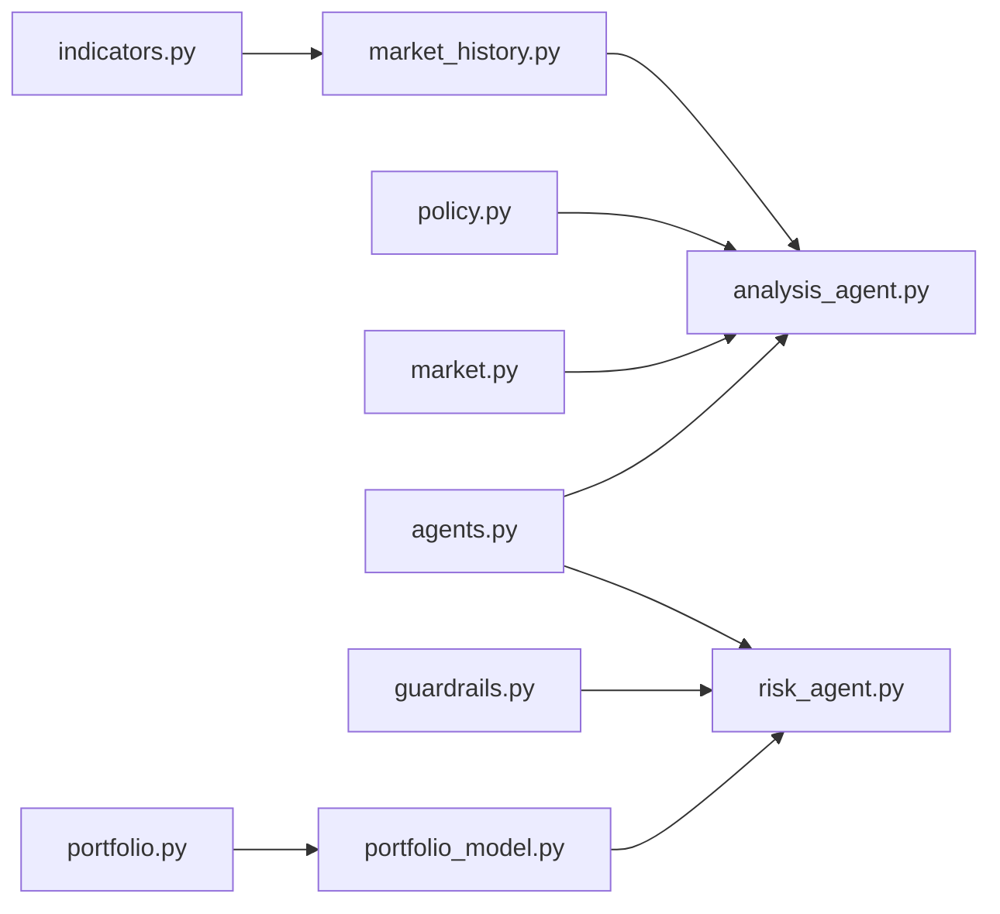

# Trading Strategy & Indicators

<cite>
**Referenced Files in This Document**
- [analysis_agent.py](file://backend/app/agents/analysis_agent.py)
- [indicators.py](file://backend/app/services/indicators.py)
- [market_history.py](file://backend/app/services/market_history.py)
- [risk_agent.py](file://backend/app/agents/risk_agent.py)
- [guardrails.py](file://backend/app/services/guardrails.py)
- [signals.py](file://backend/app/models/signals.py)
- [market.py](file://backend/app/models/market.py)
- [agents.py](file://backend/app/models/agents.py)
- [policy.py](file://backend/app/services/policy.py)
- [portfolio.py](file://backend/app/services/portfolio.py)
- [portfolio_model.py](file://backend/app/models/portfolio.py)
</cite>

## Table of Contents
1. [Introduction](#introduction)
2. [Project Structure](#project-structure)
3. [Core Components](#core-components)
4. [Architecture Overview](#architecture-overview)
5. [Detailed Component Analysis](#detailed-component-analysis)
6. [Dependency Analysis](#dependency-analysis)
7. [Performance Considerations](#performance-considerations)
8. [Troubleshooting Guide](#troubleshooting-guide)
9. [Conclusion](#conclusion)

## Introduction
This document explains the trading strategy implementation, focusing on how technical indicators are calculated and combined to generate actionable buy and sell signals, how position sizing and exits work, and how risk and guardrail systems protect the portfolio. The strategy is rule-based: it uses Wilder RSI(14), VWAP deviation, and a 5-minute volume spike detection against a 1-hour baseline to identify dip-buy opportunities, then applies mechanical scale-out, stop ladders, and trailing stops for exits. A separate risk layer enforces confidence thresholds, gas price limits, position caps, and portfolio-level circuit breakers.

## Project Structure
The trading logic is split across agents, services, and models:

- Agents implement strategy and risk decisions.
- Services provide pure indicator math, rolling market history, guardrails, and portfolio utilities.
- Models define data contracts for market snapshots, signals, recommendations, and trade records.

**Diagram sources**
- [analysis_agent.py:10-43](file://backend/app/agents/analysis_agent.py#L10-L43)
- [risk_agent.py:8-21](file://backend/app/agents/risk_agent.py#L8-L21)
- [indicators.py:17-96](file://backend/app/services/indicators.py#L17-L96)
- [market_history.py:37-43](file://backend/app/services/market_history.py#L37-L43)
- [guardrails.py:16-39](file://backend/app/services/guardrails.py#L16-L39)
- [policy.py:1-12](file://backend/app/services/policy.py#L1-L12)
- [market.py:5-16](file://backend/app/models/market.py#L5-L16)
- [signals.py:9-16](file://backend/app/models/signals.py#L9-L16)
- [agents.py:25-52](file://backend/app/models/agents.py#L25-L52)
- [portfolio_model.py:17-36](file://backend/app/models/portfolio.py#L17-L36)

**Section sources**
- [analysis_agent.py:10-43](file://backend/app/agents/analysis_agent.py#L10-L43)
- [risk_agent.py:8-21](file://backend/app/agents/risk_agent.py#L8-L21)
- [indicators.py:17-96](file://backend/app/services/indicators.py#L17-L96)
- [market_history.py:37-43](file://backend/app/services/market_history.py#L37-L43)
- [guardrails.py:16-39](file://backend/app/services/guardrails.py#L16-L39)
- [policy.py:1-12](file://backend/app/services/policy.py#L1-L12)
- [market.py:5-16](file://backend/app/models/market.py#L5-L16)
- [signals.py:9-16](file://backend/app/models/signals.py#L9-L16)
- [agents.py:25-52](file://backend/app/models/agents.py#L25-L52)
- [portfolio_model.py:17-36](file://backend/app/models/portfolio.py#L17-L36)

## Core Components
- Technical indicators:
  - Wilder RSI(14).
  - VWAP over rolling price/volume deltas.
  - Volume ratio comparing 5-minute traded volume to 1-hour baseline.
  - Volume spike flag based on ratio threshold.
- Strategy agent:
  - Buy signal generation using dip thresholds, RSI, VWAP discount, and volume spike confirmation.
  - Exit logic via take-profit ladder, hard stop ladder, and trailing stop.
  - Confidence scoring that adjusts for indicator quality and step progression.
- Risk agent:
  - Validates confidence, gas price, position caps, expected profit vs gas cost, and slippage.
- Guardrails:
  - Portfolio-level circuit breakers including daily drawdown, daily trade limit, per-token trade limit, kill switch, and gas limits.
- Data models:
  - Market snapshot, recommendation, assessment, and trade execution structures.

**Section sources**
- [indicators.py:17-96](file://backend/app/services/indicators.py#L17-L96)
- [market_history.py:140-188](file://backend/app/services/market_history.py#L140-L188)
- [analysis_agent.py:20-39](file://backend/app/agents/analysis_agent.py#L20-L39)
- [analysis_agent.py:76-255](file://backend/app/agents/analysis_agent.py#L76-L255)
- [risk_agent.py:24-190](file://backend/app/agents/risk_agent.py#L24-L190)
- [guardrails.py:16-133](file://backend/app/services/guardrails.py#L16-L133)
- [agents.py:25-52](file://backend/app/models/agents.py#L25-L52)

## Architecture Overview
The system evaluates market snapshots through the analysis agent, which computes indicators from rolling history and produces recommendations. The risk agent validates those recommendations against policy and guardrails before execution.

**Diagram sources**
- [market_history.py:89-114](file://backend/app/services/market_history.py#L89-L114)
- [market_history.py:168-188](file://backend/app/services/market_history.py#L168-L188)
- [indicators.py:17-96](file://backend/app/services/indicators.py#L17-L96)
- [analysis_agent.py:76-255](file://backend/app/agents/analysis_agent.py#L76-L255)
- [risk_agent.py:24-190](file://backend/app/agents/risk_agent.py#L24-L190)
- [guardrails.py:92-107](file://backend/app/services/guardrails.py#L92-L107)

## Detailed Component Analysis

### Technical Indicators
- Wilder RSI(14):
  - Requires at least 15 valid closes; returns None during warm-up.
  - Uses smoothed average gains and losses over the period.
- VWAP:
  - Computed over rolling price/volume deltas derived from consecutive samples.
  - Ignores samples without volume or with non-positive values.
- Volume Ratio and Spike:
  - Compares short window (default 5 minutes) traded volume to a longer baseline (default 1 hour).
  - Ratio = short_volume / (baseline_volume / baseline_windows).
  - Spike when ratio >= threshold (default 2.0).

**Diagram sources**
- [indicators.py:17-96](file://backend/app/services/indicators.py#L17-L96)
- [market_history.py:130-166](file://backend/app/services/market_history.py#L130-L166)
- [market_history.py:168-188](file://backend/app/services/market_history.py#L168-L188)

**Section sources**
- [indicators.py:17-96](file://backend/app/services/indicators.py#L17-L96)
- [market_history.py:130-166](file://backend/app/services/market_history.py#L130-L166)
- [market_history.py:168-188](file://backend/app/services/market_history.py#L168-L188)

### Buy Signal Generation Logic
The analysis agent generates buys only after satisfying multiple gates:

- Dip thresholds:
  - Minor dip: -2.0%.
  - Strong dip: -5.0%.
  - Major dip: -8.0% (boosts confidence).
- RSI gate:
  - If RSI is available, must be <= 35.0 to avoid catching falling knives.
- VWAP gate:
  - Price must be below VWAP * 0.995 (i.e., at least a 0.5% discount).
- Volume spike filter:
  - Once indicators are ready, a 5-minute volume spike (>= 2x 1-hour average) is mandatory unless the dip is strong (-5.0% or worse).
- Re-entry protection:
  - After a stop-loss exit, re-entry requires waiting for a cooldown period and a lower price plus fresh volume confirmation.

Confidence scoring starts at a base value and increases for:
- Deeper steps (up to MAX_BUY_STEPS).
- RSI < 30.
- Volume spike presence.
- Price significantly below VWAP (< 0.98 * VWAP).
- Major dip (-8.0% or worse).
It decreases if indicators are still warming up.

**Diagram sources**
- [analysis_agent.py:258-300](file://backend/app/agents/analysis_agent.py#L258-L300)
- [analysis_agent.py:302-323](file://backend/app/agents/analysis_agent.py#L302-L323)

**Section sources**
- [analysis_agent.py:20-39](file://backend/app/agents/analysis_agent.py#L20-L39)
- [analysis_agent.py:258-300](file://backend/app/agents/analysis_agent.py#L258-L300)
- [analysis_agent.py:302-323](file://backend/app/agents/analysis_agent.py#L302-L323)

### Exit Strategies: Stop Ladder, Trailing Stop, Scale-Out
Exits are prioritized in this order:

1. Hard stop ladder:
   - Levels trigger cumulative sell fractions at predefined loss thresholds.
   - Deepest triggered level wins.
2. Trailing stop:
   - Activates once peak gain reaches a threshold; sells fully if drawdown from peak exceeds distance.
3. Take-profit ladder:
   - Sells incremental fractions at predefined profit thresholds.
   - A runner holds the remainder until a cap target.
4. Discretionary pump exit:
   - When entry price is unknown and 24h change is high, trims a fraction if RSI indicates overbought conditions.

**Diagram sources**
- [analysis_agent.py:125-198](file://backend/app/agents/analysis_agent.py#L125-L198)

**Section sources**
- [analysis_agent.py:125-198](file://backend/app/agents/analysis_agent.py#L125-L198)

### Position Sizing Algorithms
Position sizing is enforced by the risk agent:

- For sells:
  - Fraction is taken from existing holdings based on recommendation.sell_fraction.
- For buys:
  - Max notional is capped by:
    - Portfolio percentage limit (configurable).
    - Headroom to reach target exposure.
    - Available cash multiplied by a safety factor.
  - Minimum notional floor ensures trades are economically viable.
- Expected profit vs gas cost:
  - Gas cost must be a small fraction of expected profit (e.g., <= 10%).
  - Exempt for capital protection exits (stop_loss/trailing_stop).

Slippage estimation is dynamic:
- Increases with volatility and volume spikes.
- Capped at an absolute maximum.

**Section sources**
- [risk_agent.py:84-130](file://backend/app/agents/risk_agent.py#L84-L130)
- [risk_agent.py:132-174](file://backend/app/agents/risk_agent.py#L132-L174)
- [risk_agent.py:203-214](file://backend/app/agents/risk_agent.py#L203-L214)

### Risk Management Rules
- Confidence scoring:
  - Minimum confidence threshold enforced by risk agent.
- Gas price limits:
  - Maximum gas gwei configurable; trades rejected if exceeded.
- Position caps:
  - Portfolio-level percentage cap prevents overexposure.
- Portfolio-level circuit breakers:
  - Daily drawdown limit halts trading.
  - Daily trade limit and per-token trade limit prevent excessive activity.
  - Kill switch can be engaged manually or automatically.

**Section sources**
- [risk_agent.py:54-79](file://backend/app/agents/risk_agent.py#L54-L79)
- [risk_agent.py:116-130](file://backend/app/agents/risk_agent.py#L116-L130)
- [guardrails.py:16-39](file://backend/app/services/guardrails.py#L16-L39)
- [guardrails.py:46-71](file://backend/app/services/guardrails.py#L46-L71)
- [guardrails.py:92-107](file://backend/app/services/guardrails.py#L92-L107)

### Guardrail System and Kill Switch
The guardrail system tracks daily state and enforces:

- Trade frequency caps:
  - Total daily trades.
  - Per-token trade limit.
- Drawdown protection:
  - Halts trading if daily drawdown breaches configured limit.
- Kill switch:
  - Can be engaged manually or due to drawdown breach.
- Reporting:
  - Status includes halted state, reason, kind, equity, drawdown, and limits.

**Diagram sources**
- [guardrails.py:46-71](file://backend/app/services/guardrails.py#L46-L71)
- [guardrails.py:81-89](file://backend/app/services/guardrails.py#L81-L89)

**Section sources**
- [guardrails.py:16-133](file://backend/app/services/guardrails.py#L16-L133)

### Examples of Indicator Calculation and Signal Generation
- RSI calculation:
  - Input: sequence of closing prices.
  - Output: 0-100 or None if insufficient data.
- VWAP deviation:
  - Input: rolling price/volume deltas.
  - Output: VWAP value used to enforce discount gating.
- Volume spike detection:
  - Input: 5-minute traded volume vs 1-hour baseline.
  - Output: ratio and boolean spike flag.
- Combined signal:
  - Buy allowed only if dip threshold met, RSI oversold, price below VWAP discount, and volume spike confirmed (or strong dip).
  - Confidence adjusted by indicator quality and step progression.

These examples illustrate how raw market data flows through indicators into actionable signals validated by risk and guardrails.

**Section sources**
- [indicators.py:17-96](file://backend/app/services/indicators.py#L17-L96)
- [market_history.py:140-188](file://backend/app/services/market_history.py#L140-L188)
- [analysis_agent.py:258-323](file://backend/app/agents/analysis_agent.py#L258-L323)

## Dependency Analysis
The following diagram shows key dependencies among components:

**Diagram sources**
- [indicators.py:17-96](file://backend/app/services/indicators.py#L17-L96)
- [market_history.py:37-43](file://backend/app/services/market_history.py#L37-L43)
- [analysis_agent.py:10-43](file://backend/app/agents/analysis_agent.py#L10-L43)
- [policy.py:1-12](file://backend/app/services/policy.py#L1-L12)
- [market.py:5-16](file://backend/app/models/market.py#L5-L16)
- [agents.py:25-52](file://backend/app/models/agents.py#L25-L52)
- [risk_agent.py:8-21](file://backend/app/agents/risk_agent.py#L8-L21)
- [guardrails.py:16-39](file://backend/app/services/guardrails.py#L16-L39)
- [portfolio_model.py:17-36](file://backend/app/models/portfolio.py#L17-L36)
- [portfolio.py:1-96](file://backend/app/services/portfolio.py#L1-L96)

**Section sources**
- [analysis_agent.py:10-43](file://backend/app/agents/analysis_agent.py#L10-L43)
- [risk_agent.py:8-21](file://backend/app/agents/risk_agent.py#L8-L21)
- [indicators.py:17-96](file://backend/app/services/indicators.py#L17-L96)
- [market_history.py:37-43](file://backend/app/services/market_history.py#L37-L43)
- [guardrails.py:16-39](file://backend/app/services/guardrails.py#L16-L39)
- [policy.py:1-12](file://backend/app/services/policy.py#L1-L12)
- [market.py:5-16](file://backend/app/models/market.py#L5-L16)
- [agents.py:25-52](file://backend/app/models/agents.py#L25-L52)
- [portfolio_model.py:17-36](file://backend/app/models/portfolio.py#L17-L36)
- [portfolio.py:1-96](file://backend/app/services/portfolio.py#L1-L96)

## Performance Considerations
- Rolling history management:
  - Samples are pruned by age and limited in count to control memory usage.
  - Persistence is throttled to reduce I/O overhead.
- Indicator computation:
  - RSI and VWAP operate on clean, positive-only inputs to avoid invalid calculations.
  - Volume ratio requires sufficient sample span to be meaningful.
- Strategy evaluation:
  - Early exits and filters reduce unnecessary computations.
  - Confidence adjustments avoid over-trading during warm-up periods.

[No sources needed since this section provides general guidance]

## Troubleshooting Guide
Common issues and diagnostics:

- Indicators returning None:
  - Indicates insufficient history; strategy lowers confidence or skips signals.
  - Check sample counts and history minutes in the indicator summary.
- Trades rejected by risk:
  - Insufficient confidence, gas price too high, position cap reached, or expected profit too low relative to gas cost.
  - Review the checks list in the risk assessment for specific failures.
- Guardrails halting trading:
  - Daily drawdown breach or manual kill switch engagement.
  - Check status output for halt reason and kind.
- Re-entry blocked after stop-loss:
  - Cooldown period not elapsed or price not sufficiently lower than last exit price.
  - Volume spike confirmation required after stop-loss.

**Section sources**
- [market_history.py:168-188](file://backend/app/services/market_history.py#L168-L188)
- [risk_agent.py:37-47](file://backend/app/agents/risk_agent.py#L37-L47)
- [risk_agent.py:61-79](file://backend/app/agents/risk_agent.py#L61-L79)
- [risk_agent.py:150-174](file://backend/app/agents/risk_agent.py#L150-L174)
- [guardrails.py:46-71](file://backend/app/services/guardrails.py#L46-L71)
- [analysis_agent.py:272-280](file://backend/app/agents/analysis_agent.py#L272-L280)

## Conclusion
The trading strategy combines robust technical indicators with disciplined risk controls. Wilder RSI(14), VWAP deviation, and 5-minute volume spike detection form the foundation for dip-buy signals, while mechanical exits ensure systematic profit-taking and loss containment. The risk agent and guardrails provide layered protection through confidence thresholds, gas price limits, position caps, and portfolio-level circuit breakers. Together, these components create a transparent, auditable, and resilient trading system suitable for automated execution.

[No sources needed since this section summarizes without analyzing specific files]